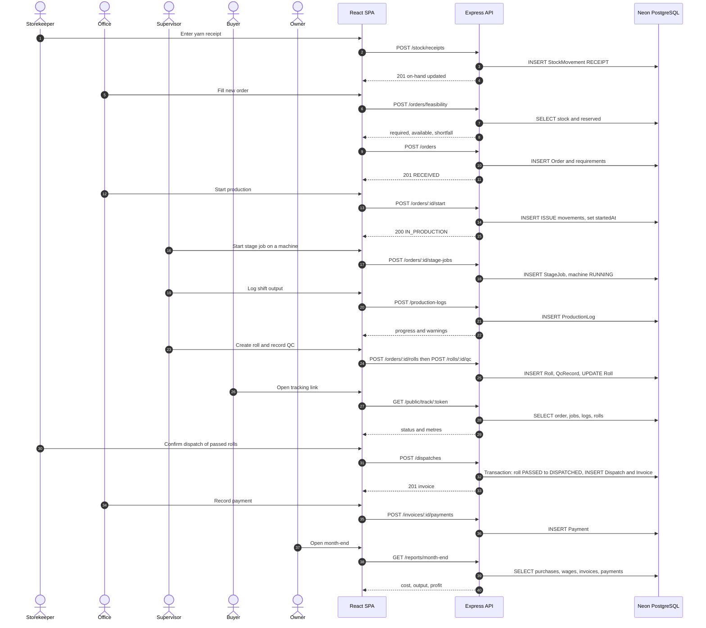
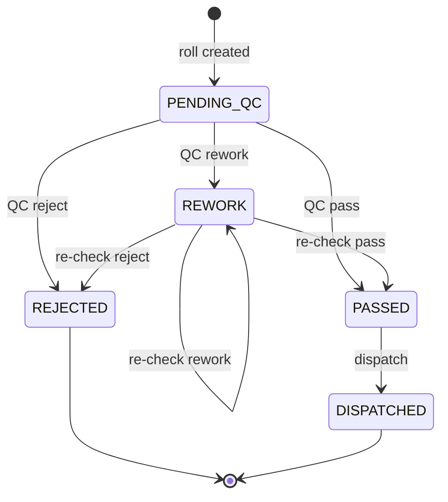
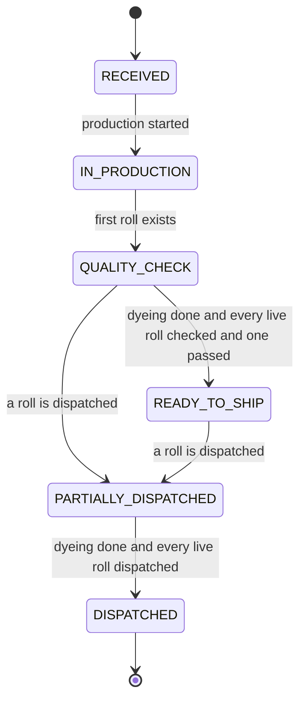
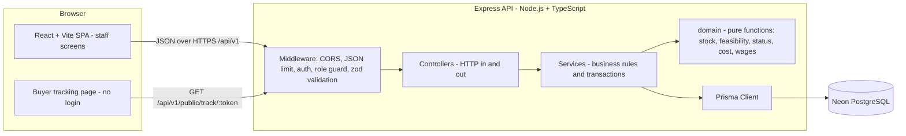
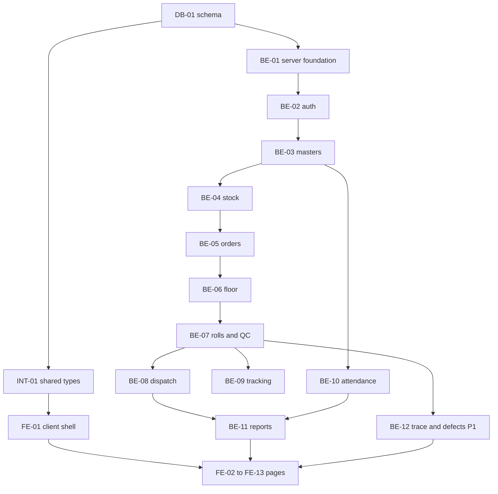
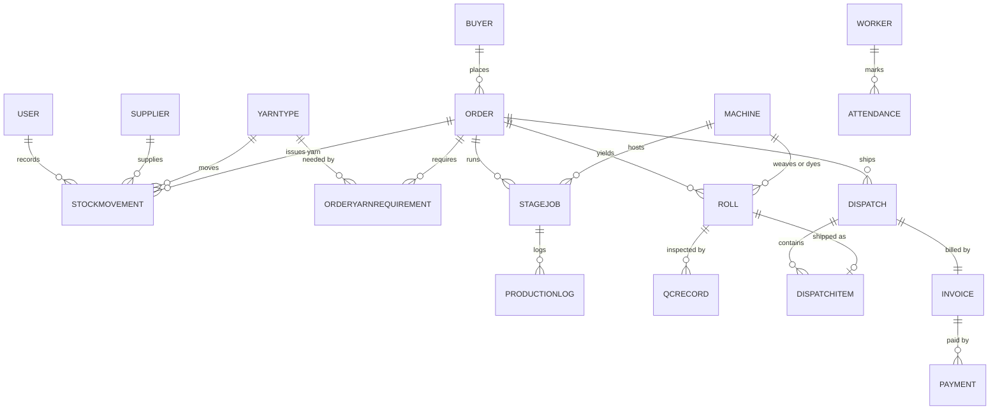

# MillTrace - MVP.md

**Textile Manufacturing System for Everest Textile Mills - 24-hour Odoo hackathon build plan**

> **Document status.** This is a planning document. Nothing in it has been built, run or tested yet. Every checkbox is unchecked, every test status is "Not run", and every version number, hosting option and library choice is provisional until the verification task named next to it has been executed. Where this document states a fact, it is one of: **Confirmed** (given in the problem statement or by the team), **Assumed** (a safe default, listed in Section 2.4), or **Unresolved** (a question for the organizers, listed in Section 2.8).

**Team:** 4 developers (Dev A, Dev B, Dev C, Dev D) - **Duration:** 24 hours - **Stack:** React + Vite + TypeScript, Node.js + Express + TypeScript, PostgreSQL on Neon, Prisma, Git + GitHub, Tailwind CSS.

## Contents

1. Project Overview
2. Scope and Boundaries
3. User Stories and Acceptance Criteria
4. Complete User Journey
5. System Architecture
6. Component and Module Inventory
7. Database Design
8. REST API Contracts
9. Repository and Folder Structure
10. Development Environment and Setup
11. Phase-Based Development Plan
12. Implementation Task Checklist
13. Four-Person Team Allocation
14. Frontend and Backend Implementation Details
15. Testing and Integration Strategy
16. Security and Configuration
17. Realistic 24-Hour Schedule
18. Risk Register and Decision Points
19. Definition of Done
20. Final Consistency Audit

**How to read IDs.** Components: `DB-`, `INT-`, `BE-`, `FE-`, `QA-`, `DOC-`. Tasks: `TASK-nn`. Stories: `US-nn`. Endpoints: `API-nn`. Tests: `T-nn`. Assumptions: `A-nn`. Decisions: `D-nn`. Risks: `R-nn`. Checkpoints: `CP-n`. Features: `P0-n`, `P1-n`, `P2-n` (carried over from the approved Part 1 scope).

---

## 1. Project Overview

### 1.1 Name and pitch

**Name:** MillTrace (working title; rename freely, nothing depends on it).

**One-line pitch:** One roll ID that follows fabric from the yarn gate to the buyer's truck, so the mill always knows its stock, order status, quality and true cost.

### 1.2 Original problem statement

The following is the selected problem statement as supplied (Textile Manufacturing System).

> **Build one system to replace notebooks and phone calls.**
>
> **The challenge.** Your task is to build one unified software platform that solves the real, day-to-day problems of a textile manufacturing unit. Think of it as the digital backbone of a busy fabric factory. Read the scenes that follow as things that actually happen on an ordinary day, and design the system that makes each of them easy.
>
> **Meet Everest Textile Mills.** Everest Textile Mills buys yarn, turns it into fabric on spinning, weaving and dyeing machines, checks the fabric for defects, and sells the finished rolls to buyers. Orders come in from many buyers at once, each with its own fabric type, colour, quantity and deadline. The factory runs in shifts, with workers on the floor, a store for raw material and finished goods, and an office that deals with buyers, suppliers and accounts.
>
> **How things run today.** Raw material stock: tracked in a notebook. Machine and order status: checked by walking the floor. Quality checks: recorded on paper slips. Order updates for buyers: given over phone calls. Worker attendance and wages: marked in a register. Orders get delayed, machines sit idle, and nobody knows the real cost of a single roll of fabric.
>
> **A day at the mill.**
> - *Yarn arrives at the gate:* note how much came in, what type and colour it is, and which order it is for before it goes into the store. Always know how much raw material there is, get a warning before it runs low, and see whether there is enough yarn to start a new order or whether more must be ordered first.
> - *The production floor, mid-shift:* yarn moves through spinning, weaving and dyeing. Say which order is on which machine, how far along it is, and which machines are idle. See what every machine is doing right now and how much fabric it has produced today.
> - *Checking the fabric before it leaves the line:* check for defects such as holes, colour mismatch or uneven weaving. Some rolls pass, some need rework, a few are rejected. Every roll is traceable to the order and machine it came from. Keep a clear record of what passed, what failed and what is waiting to be checked.
> - *A buyer calls asking about their order:* tell the buyer at any time exactly where the order stands (being woven, being checked, ready to ship) without anyone having to go and look.
> - *Loading the truck for dispatch:* make sure the right rolls, in the right quantity, go to the right buyer, with an invoice that matches. The store always shows how much finished fabric is on the shelf and what has gone out, so nothing is dispatched twice or forgotten.
> - *The owner, closing the books:* know what it cost to make each order, how much every machine produced, and how much was paid out in worker wages. Raw material bills, wages and buyer payments come together in one place so the owner can see whether the mill made money this month.

### 1.3 Problem summary

Everest Textile Mills has no shared, current record of what has happened to its yarn, orders, machines and fabric. Each fact lives in a notebook, a paper slip, a register or someone's memory, so every question (Is there enough yarn? Where is this order? Which machine made this defective roll? What did this order cost?) needs a walk across the floor or a phone call. The visible results are delayed orders, idle machines and no known cost per roll.

### 1.4 Target users

| Role | Who at Everest | What they do in MillTrace |
| --- | --- | --- |
| Owner | Mill owner | Reads the dashboard and the month-end report; sees defects by machine (P1) |
| Office | Order and accounts clerk | Creates orders, checks yarn feasibility, starts production, records payments |
| Supervisor | Shift supervisor, also QC inspector | Runs the machine board, logs output, creates and inspects rolls, marks attendance |
| Storekeeper | Store in-charge | Records yarn receipts, dispatches passed rolls, watches finished stock |
| Buyer (external) | Customer of the mill | Opens a tracking link to see order status; has no account |

### 1.5 Proposed solution

A web application with four role-based internal workspaces and one public buyer page, backed by a REST API and one PostgreSQL database. Every physical event (yarn received, output logged, roll inspected, roll dispatched, day worked, payment received) is recorded once, at the point where it happens, against an order and, where relevant, a roll. Every question above is answered by a screen that reads those records. Order status is derived from the events and is never typed in by hand.

### 1.6 Core value proposition

One record per event replaces five paper systems. Because every answer is computed from those records, it cannot go stale: the buyer's page, the machine board, the stock page and the month-end report all read the same data.

### 1.7 Key differentiator

A single traceable thread: **yarn issue -> order -> machine -> roll -> QC -> dispatch -> invoice**. Traceability, buyer status, guarded dispatch and cost per order fall out of the data model instead of being separate features. Typical solutions to this problem statement ship disconnected CRUD screens; this one is built around the roll as the unit that moves through every step.

### 1.8 Expected outcome after 24 hours

If the plan holds, the team can demonstrate this on a deployed (or locally run) build, using seeded demo data:

- One order runs from yarn receipt to month-end profit through the real UI, in under 5 minutes, with no manual database edits.
- The buyer opens a tracking link on a phone and sees the status change after a QC result.
- A roll cannot be dispatched twice or without passing QC.
- The owner sees cost per order, metres per machine, wages and profit for the month, and these equal a hand-calculated sheet.

This is a target, not a result. What is actually working is recorded only in Sections 15 and 19 after the tests are executed.

---

## 2. Scope and Boundaries

Scope below is the approved Part 1 scope, unchanged. Where Part 2 needed a clarification to make the design implementable, it is listed in Section 20.3, not hidden here.

### 2.1 Confirmed, assumed and unresolved

| Class | Items |
| --- | --- |
| Confirmed | Problem statement text (Section 1.2); 24-hour duration; 4 developers; stack (React + Vite + TypeScript, Node.js + Express + TypeScript, PostgreSQL on Neon, Prisma, Git + GitHub); Odoo module use is not restricted unless the organizers specify otherwise; the problem statement contains an Odoo logo but no Odoo requirement |
| Assumed | A-01 to A-22 (Section 2.4) |
| Unresolved | D-01 to D-06 (Section 2.8): Odoo mandatory or not, judging criteria and submission format, hosted URL required or not, hosting platform, rules on libraries and prior code, demo format and time limit |

### 2.2 Features: P0 (essential), P1 (differentiating), P2 (optional)

Planned effort for the whole build is **60.25 developer-hours** (54.25 h P0 and cross-cutting, 6 h P1). This is higher than the Part 1 feature-only estimate (35 h P0 and 8 h P1) because the plan now includes the foundation that Part 1 did not count: schema, server bootstrap, auth, client shell, seed data, deployment, test scripts and documentation. See Section 20.3.

| ID | Feature | Priority | Problem scene | Justification | Components |
| --- | --- | --- | --- | --- | --- |
| P0-1 | Login and four roles with role-based routes | P0 | All | Each role records only its own step; needed to demonstrate hand-offs | BE-02, FE-01, FE-02 |
| P0-2 | Masters: buyers, suppliers, yarn types, machines, workers | P0 | All | Every other record references them | BE-03, FE-03 |
| P0-3 | Yarn receipt, stock ledger, available stock, low-stock warning | P0 | Yarn arrives | Asked for directly: "always know how much", "warning before it runs low" | BE-04, FE-04 |
| P0-4 | Orders, feasibility check, start production issues yarn | P0 | Yarn arrives | Asked for directly: "enough yarn to start it" | BE-05, FE-05 |
| P0-5 | Stage jobs on machines, machine board, production log | P0 | Production floor | Asked for directly: which order on which machine, progress, idle machines, output today | BE-06, FE-06 |
| P0-6 | Rolls and QC (pass, rework, reject, defect type) | P0 | Checking fabric | Asked for directly: traceable rolls, record of passed, failed and waiting | BE-07, FE-07 |
| P0-7 | Buyer tracking link with derived status | P0 | Buyer calls | Asked for directly: status "without anyone having to go and look" | BE-09, FE-11 |
| P0-8 | Dispatch of passed rolls with guard and invoice; finished goods view | P0 | Loading the truck | Asked for directly: right rolls, right buyer, matching invoice, nothing dispatched twice | BE-08, FE-08 |
| P0-9 | Attendance and wages | P0 | Owner closes books | Replaces the register; wages feed month-end | BE-10, FE-09 |
| P0-10 | Payments and month-end: cost per order, metres per machine, wages, profit | P0 | Owner closes books | Asked for directly: cost per order, output per machine, wages paid, "whether the mill made money" | BE-11, BE-08, FE-10 |
| P1-1 | Roll QR label, scan or type roll code on dispatch, roll trace page | P1 | Checking fabric, loading the truck | Makes traceability visible in the demo; blocks wrong, unpassed or repeated rolls with a reason | FE-12, BE-12, INT-03 |
| P1-2 | Defects by machine and defect type, with flagged machines | P1 | Checking fabric, owner | Uses the traceability to answer "track a defect to its cause" | BE-12, FE-13 |
| P2-1 | Wages allocated to orders by metres produced | P2 | Owner | Better cost per order; needs worker-to-job mapping | - |
| P2-2 | Draft purchase order from a feasibility shortfall | P2 | Yarn arrives | Convenience on top of P0-4 | - |
| P2-3 | Estimated completion date from machine throughput | P2 | Buyer calls | Needs real throughput data to be meaningful | - |
| P2-4 | Breakdown log with downtime minutes | P2 | Production floor | Extends the machine board | - |
| P2-5 | Printable or PDF invoice | P2 | Loading the truck | On-screen invoice is enough to demonstrate | - |
| P2-6 | Push buyers and invoices to Odoo, or CSV export | P2 | Owner | Only if D-01 says Odoo is mandatory or scored | INT-04 |

Cross-cutting P0 work (not a feature, but required): DB-01, DB-02, INT-01, INT-02, BE-01, FE-14, QA-01, QA-02, DOC-01.

### 2.3 Excluded features

Machine sensors or IoT; GST and e-invoicing; full double-entry accounting; statutory payroll (PF, ESI) and payslips; multi-factory or multi-warehouse; scheduling optimizers or AI forecasting; buyer accounts, SMS, WhatsApp or email notifications; supplier portal; barcode hardware; offline mode; multiple languages; edit and delete screens for masters; password reset and user management screens; audit-log screens; file uploads; order amendments after production start; credit notes and returns.

### 2.4 Assumptions

| ID | Assumption | Verified by |
| --- | --- | --- |
| A-01 | Yarn is measured in kg, fabric in metres, money in INR; no tax is modelled | TASK-01 |
| A-02 | One order is one fabric type in one colour and passes spinning, then weaving, then dyeing | TASK-01 |
| A-03 | Rolls are created from dyeing output; QC is done per roll | TASK-01 |
| A-04 | Yarn need per order is entered as kg per metre for each yarn type (a one-level bill of materials) | TASK-01 |
| A-05 | Machine status is set by the supervisor; no sensors | TASK-01 |
| A-06 | Order cost = issued yarn kg x weighted-average receipt rate + logged metres x machine rate per metre; wages are counted at mill level, not per order (allocation is P2-1) | TASK-44 |
| A-07 | Monthly profit = invoiced - yarn purchases - wages; cash received is shown beside it, not used in profit | TASK-44 |
| A-08 | Buyers have no login; each order has an unguessable tracking token | TASK-23 |
| A-09 | Months are UTC calendar months; attendance and payment dates are plain dates; wage and machine rates are current values (no rate history) | TASK-44 |
| A-10 | One factory, one store, three shifts; demo data is seeded | TASK-01 |
| A-11 | Odoo is optional and no Odoo code is built unless D-01 changes | TASK-01 |
| A-12 | Neon is used with the pooled URL at runtime and the direct URL for migrations; a separate dev database (Neon branch or project) and demo database are available on the team's plan (unverified); interactive transactions work through the pooler (unverified) | TASK-02 |
| A-13 | Hosting for the API and static client is any Node-capable host plus a static host; no specific provider is confirmed and none is assumed to be available | TASK-17 |
| A-14 | Tool versions: Node 20.19+ or 22.12+, Prisma 6.x, Express 4, Vite 6, React 18 or 19, Tailwind CSS 4, React Router 6; all provisional | TASK-03 |
| A-15 | A stage's cumulative output may not exceed the previous stage's cumulative output (flag `ENFORCE_STAGE_CAP`, default on) | TASK-21 |
| A-16 | Partial unique indexes and CHECK constraints are added by a custom SQL migration; if that fails, the same rules are enforced in services only | TASK-04 |
| A-17 | OWNER may perform every action (demo superuser); other roles are limited as in Section 8.1 | TASK-06 |
| A-18 | Shifts are MORNING, EVENING and NIGHT; wages do not depend on the shift | TASK-01 |
| A-19 | The defect flag threshold is 10 percent (provisional) | TASK-37 |
| A-20 | One invoice per dispatch; roll numbers are `<orderNo>-R<nn>`; no taxes or discounts | TASK-25 |
| A-21 | Each machine has one flat cost rate per metre; no depreciation, power or maintenance cost | TASK-44 |
| A-22 | Demo passwords come from environment variables and are shared with the team out of band; none appear in the repository | TASK-08 |

### 2.5 External dependencies

| Dependency | Needed for | Access needed | Status | Fallback |
| --- | --- | --- | --- | --- |
| Neon PostgreSQL | Database | Account, project, pooled and direct connection strings | Unverified until TASK-02 | Local PostgreSQL with the same environment variable names |
| GitHub | Version control | Repo with four collaborators | Unverified until TASK-03 | Any Git remote |
| npm registry | Packages | Network on every developer machine | Unverified | Pre-install on one machine and share lockfiles |
| Hosting (API and static client) | Deployed demo | Account on a chosen provider (not chosen) | Unverified until TASK-17; need depends on D-03 | Local run on the demo laptop, plus a recorded video |
| QR libraries (`qrcode.react`, `html5-qrcode`) | P1-1 | npm install; camera needs HTTPS or localhost | Unverified until TASK-14 | Manual roll-code entry plus printed labels |
| Odoo | Only if D-01 = mandatory | URL, database, user, API key (none available) | Not required by the problem statement | See Section 5.6 |

### 2.6 Known limitations (planned, not defects)

- No password reset, no login rate limiting, no refresh tokens (token lasts 12 hours and lives in browser storage).
- Money is stored as Decimal in the database and converted to JavaScript numbers in services, rounded to 2 decimals; this is adequate for the demo but not for production accounting.
- A machine has one flat rate per metre; wages are not allocated to orders.
- Reservation of yarn is implied by unstarted orders and is not locked; two people starting two orders in the same second could both pass the feasibility check (accepted for the demo).
- Order status is derived on read; with thousands of orders the list endpoint would need a stored status.
- Month boundaries are UTC.
- Tracking tokens are bearer secrets; anyone with the link can read that order's status.
- No automatic tests for the UI; UI is checked manually.

### 2.7 Fallback scope

Fallback scopes apply when schedule rules in Section 17.4 trigger.

| Level | Trigger | Cut | What still works |
| --- | --- | --- | --- |
| F1 (Part 1 fallback) | CP-2 at hour 12 fails | Drop P1-2 (defects page). P1-1 becomes typed roll codes only. Attendance becomes one "days present" entry per worker per month. Order cost counts material only | All six scenes |
| F2 | 3 to 4 hours lost by hour 12 | F1, plus drop all P1, drop masters create screens (seed only), drop breakdown and restore, drop `/stock` ledger view | Stock, orders, floor, QC, tracking, dispatch, invoice, month-end |
| F3 | 6 or more hours lost | F2, plus attendance entered by seed only, machine board read-only (jobs started by API script during the demo), payments seeded | The thread from order to dispatched rolls, buyer tracking and month-end, demonstrated with seeded history |

### 2.8 Decisions requiring early confirmation

Ask all of these at kickoff (TASK-01). Until answered, the default applies.

| ID | Question | Default if unanswered | Impact if the answer differs |
| --- | --- | --- | --- |
| D-01 | Is Odoo integration mandatory or scored? | No; no Odoo code (A-11) | Add a verification task for Odoo access, then option B or C of Section 5.6; replan Phase 3 |
| D-02 | What are the judging criteria and the submission format (repo link, video, slides)? | Unknown; nothing assumed about weights | Re-weight the demo script and the submission package (TASK-55, TASK-56) |
| D-03 | Is a hosted public URL required, or is a local demo acceptable? | Hosted URL is attempted but optional | If required, hosting becomes a P0 gate at CP-5 |
| D-04 | Which hosting platform may or must be used, and are there credentials? | Any Node host plus static host (A-13) | Replace TASK-17 and TASK-52 steps accordingly |
| D-05 | Are there rules on libraries, templates, AI tools or pre-existing code? | Open-source libraries listed in this document only | Remove or replace the affected library |
| D-06 | What is the demo format and time limit? | 5 minutes live, with a backup video | Rework the demo script (TASK-55) |


---

## 3. User Stories and Acceptance Criteria

Stories US-01 to US-12 are the approved Part 1 stories, rewritten in the standard form. US-13 and US-14 cover P0-1 and P0-2, and US-15 covers the P1-1 trace page; Part 1 had features for these but no story. They are listed first or last for that reason and add no scope. Each story has measurable, testable criteria and a mapping to components, endpoints, tasks and tests.

### 3.1 Story map

| Story | Priority | Role | Components | Endpoints | Tasks | Tests |
| --- | --- | --- | --- | --- | --- | --- |
| US-13 | P0 | staff member (any internal role) | BE-02, FE-01, FE-02 | API-01, API-02 | TASK-06, TASK-11, TASK-12, TASK-51 | T-12 |
| US-14 | P0 | office staff member | BE-03, FE-03 | API-04, API-05, API-06, API-07, API-08, API-09, API-10, API-11, API-12, API-13 | TASK-09, TASK-18, TASK-27 | T-13 |
| US-01 | P0 | storekeeper | BE-04, FE-04, DB-01 | API-14, API-15, API-16, API-06, API-08 | TASK-04, TASK-10, TASK-15 | T-14, T-04 |
| US-02 | P0 | office staff member | BE-04, FE-04, FE-10 | API-15, API-43 | TASK-10, TASK-35, TASK-15, TASK-33 | T-15, T-04 |
| US-03 | P0 | office staff member | BE-05, FE-05 | API-18, API-19, API-21, API-22 | TASK-19, TASK-20, TASK-28 | T-04, T-05, T-16 |
| US-04 | P0 | shift supervisor | BE-06, FE-06 | API-23, API-24, API-25, API-26, API-27 | TASK-21, TASK-29, TASK-42, TASK-45 | T-17, T-35 |
| US-05 | P0 | shift supervisor | BE-06, FE-06 | API-28, API-29 | TASK-21, TASK-29 | T-18, T-09 |
| US-06 | P0 | QC inspector (supervisor role) | BE-07, FE-07 | API-30, API-31, API-32 | TASK-22, TASK-30, TASK-43 | T-09, T-19 |
| US-07 | P0 | buyer | BE-09, FE-11, BE-05 | API-46, API-21 | TASK-20, TASK-23, TASK-32 | T-03, T-20, T-30 |
| US-08 | P0 | storekeeper | BE-08, FE-08 | API-34, API-35, API-37, API-17 | TASK-25, TASK-31, TASK-36, TASK-46, TASK-47 | T-10, T-11 |
| US-09 | P0 | shift supervisor | BE-10, FE-09 | API-40, API-41, API-42 | TASK-24, TASK-40 | T-07, T-22 |
| US-10 | P0 | owner | BE-11, BE-08, FE-10, FE-08 | API-39, API-43, API-44, API-38 | TASK-25, TASK-26, TASK-44, TASK-33, TASK-48 | T-05, T-06, T-08, T-21 |
| US-11 | P1 | storekeeper | FE-12, BE-12, INT-03 | API-36, API-34 | TASK-14, TASK-37, TASK-39 | T-31 |
| US-12 | P1 | owner | BE-12, FE-13 | API-45 | TASK-37, TASK-41 | T-33 |
| US-15 | P1 | supervisor or owner | BE-12, FE-12 | API-33 | TASK-37, TASK-39 | T-32 |

### 3.2 Stories and acceptance criteria

#### US-13 (P0)

As a staff member (any internal role), I want to log in with my email and password, so that I only see and use the screens for my role.

Acceptance criteria:

- Valid credentials return 200 with a token and the role; wrong credentials return 401 with the same message for unknown email and wrong password.
- A request without a token to any protected endpoint returns 401; a role not permitted for an endpoint returns 403.
- The navigation lists only the pages allowed for the role (Section 8.1); an expired or invalid token redirects to `/login`.
- No response contains a password hash.

Mapping: components BE-02, FE-01, FE-02; endpoints API-01, API-02; tasks TASK-06, TASK-11, TASK-12, TASK-51; tests T-12.

#### US-14 (P0)

As a office staff member, I want to maintain buyers, suppliers, yarn types, machines and workers, so that every record I create references valid master data.

Acceptance criteria:

- Each of the five lists loads in under 2 s with the seeded rows.
- Creating a record with a missing required field returns 400 with field-level details; a duplicate code or name returns 409 `CONFLICT_DUPLICATE`.
- A new yarn type, buyer, supplier or machine appears in the related dropdowns without a page reload.
- Machine `ratePerMetre` and worker `dailyWage` must be 0 or more.

Mapping: components BE-03, FE-03; endpoints API-04, API-05, API-06, API-07, API-08, API-09, API-10, API-11, API-12, API-13; tasks TASK-09, TASK-18, TASK-27; tests T-13.

#### US-01 (P0)

As a storekeeper, I want to record a yarn receipt with supplier, yarn type, colour, quantity and rate, so that stock is always current and linked to the supplier and, if known, the order.

Acceptance criteria:

- A receipt needs supplier, yarn type, kg > 0 and rate > 0; `orderId` and `reference` are optional.
- On save, on-hand for that yarn rises by exactly the kg entered and a ledger row appears with type RECEIPT.
- kg x rate is added to that month's yarn purchases (visible in month-end).
- Invalid input returns 400 and creates no row.

Mapping: components BE-04, FE-04, DB-01; endpoints API-14, API-15, API-16, API-06, API-08; tasks TASK-04, TASK-10, TASK-15; tests T-14, T-04.

#### US-02 (P0)

As a office staff member, I want to be warned before a yarn runs low, so that I can order more yarn in time.

Acceptance criteria:

- When available (on-hand minus reserved) is below the reorder level, the yarn shows a Low badge on the stock page and counts in the dashboard tile.
- The badge clears once available is at or above the reorder level.
- Available is never shown as a negative number of metres or kg without the shortfall being visible (negative available is shown as 0 with a shortfall flag).

Mapping: components BE-04, FE-04, FE-10; endpoints API-15, API-43; tasks TASK-10, TASK-35, TASK-15, TASK-33; tests T-15, T-04.

#### US-03 (P0)

As a office staff member, I want to create an order and see whether there is enough yarn to start it, so that I either start production or order more yarn first.

Acceptance criteria:

- For each yarn line, required kg = order metres x kg per metre is shown beside available kg and the shortfall.
- Start production is disabled in the UI and returns 422 `INSUFFICIENT_YARN` from the API while any shortfall is above 0.
- Starting production creates one ISSUE movement per yarn line; on-hand for each yarn falls by exactly the required kg (the stock page "available" figure does not drop a second time because the kg was already reserved, see Section 20.3).
- Starting an order twice returns 409 `ALREADY_STARTED`.

Mapping: components BE-05, FE-05; endpoints API-18, API-19, API-21, API-22; tasks TASK-19, TASK-20, TASK-28; tests T-04, T-05, T-16.

#### US-04 (P0)

As a shift supervisor, I want to see what every machine is doing right now, so that I can place work on idle machines and react to breakdowns.

Acceptance criteria:

- Each machine shows Running (order and stage), Idle or Breakdown.
- Starting a job sets Running; completing it sets Idle; marking breakdown sets Breakdown; the board reflects each change within 5 s of the next poll.
- The idle count equals machines with no RUNNING job and not in breakdown.
- Starting a job on a busy, broken or wrong-stage machine returns 409 or 422 with a clear message.

Mapping: components BE-06, FE-06; endpoints API-23, API-24, API-25, API-26, API-27; tasks TASK-21, TASK-29, TASK-42, TASK-45; tests T-17, T-35.

#### US-05 (P0)

As a shift supervisor, I want to log fabric output per machine and shift, so that progress and today's production are always known.

Acceptance criteria:

- An entry needs a RUNNING job, a shift and metres > 0.
- Saving updates the stage progress % of the order and the machine's metres today.
- Cumulative metres above the order metres save with a warning; with the stage cap on, output above the previous stage returns 422 `EXCEEDS_PREVIOUS_STAGE`.

Mapping: components BE-06, FE-06; endpoints API-28, API-29; tasks TASK-21, TASK-29; tests T-18, T-09.

#### US-06 (P0)

As a QC inspector (supervisor role), I want to record each roll's result with the defect type, so that defects are traceable to the order and machines and only good rolls ship.

Acceptance criteria:

- The queue lists rolls in PENDING_QC and REWORK, each with roll number, order, weaving machine and dyeing machine.
- Result is Pass, Rework or Reject; defect type is required unless Pass; a roll in REWORK stays in the queue until re-checked.
- Creating rolls beyond the dyeing output returns 422 `EXCEEDS_STAGE_OUTPUT`; inspecting a DISPATCHED roll returns 409.

Mapping: components BE-07, FE-07; endpoints API-30, API-31, API-32; tasks TASK-22, TASK-30, TASK-43; tests T-09, T-19.

#### US-07 (P0)

As a buyer, I want to see exactly where my order stands without calling, so that I know when to expect delivery.

Acceptance criteria:

- The tracking link opens without login and shows order number, status, current stage, metres ordered/produced/passed/dispatched, deadline and last update.
- An unknown token returns 404; no other buyer's data and no rates or costs are reachable.
- A QC or stage change appears after the next refresh (page auto-refreshes every 15 s).
- The page is usable at 360 px width.

Mapping: components BE-09, FE-11, BE-05; endpoints API-46, API-21; tasks TASK-20, TASK-23, TASK-32; tests T-03, T-20, T-30.

#### US-08 (P0)

As a storekeeper, I want to dispatch the right rolls to the right buyer with a matching invoice, so that nothing is dispatched twice or forgotten.

Acceptance criteria:

- Only PASSED rolls of the selected order can be chosen.
- Confirm marks the rolls DISPATCHED and creates the invoice in one transaction; invoice amount = sum of roll metres x order rate per metre.
- Dispatching any of those rolls again returns 409 `ROLL_NOT_DISPATCHABLE`; two simultaneous requests for the same rolls produce exactly one dispatch.
- Finished stock on the shelf drops by the dispatched metres.

Mapping: components BE-08, FE-08; endpoints API-34, API-35, API-37, API-17; tasks TASK-25, TASK-31, TASK-36, TASK-46, TASK-47; tests T-10, T-11.

#### US-09 (P0)

As a shift supervisor, I want to mark daily attendance for workers, so that wages are calculated without the paper register.

Acceptance criteria:

- Present or absent can be saved per worker per date; saving the same date twice never creates duplicate rows.
- Monthly wage per worker = present days x daily wage; the month total is shown.

Mapping: components BE-10, FE-09; endpoints API-40, API-41, API-42; tasks TASK-24, TASK-40; tests T-07, T-22.

#### US-10 (P0)

As a owner, I want to see whether the mill made money this month and what each order cost, so that I can close the books quickly.

Acceptance criteria:

- For a chosen month the screen shows yarn purchases, wages, invoiced, payments received and profit (invoiced - purchases - wages).
- Cost per order = issued yarn kg x issue rate + logged metres x machine rate per metre; metres per machine are listed.
- Month-end figures for the seeded month equal the hand-calculated values in `docs/seed-expected.md` exactly (2 decimals).
- A payment above the outstanding balance returns 422 `PAYMENT_EXCEEDS_BALANCE`.

Mapping: components BE-11, BE-08, FE-10, FE-08; endpoints API-39, API-43, API-44, API-38; tasks TASK-25, TASK-26, TASK-44, TASK-33, TASK-48; tests T-05, T-06, T-08, T-21.

#### US-11 (P1)

As a storekeeper, I want to scan or type a roll code when loading the truck, so that wrong, unpassed or already dispatched rolls never reach the truck.

Acceptance criteria:

- A valid roll is added to the dispatch list; an invalid one shows one of: Not passed, Wrong order, Already dispatched, Unknown roll, and is not added.
- Manual roll-code entry behaves identically to scanning.

Mapping: components FE-12, BE-12, INT-03; endpoints API-36, API-34; tasks TASK-14, TASK-37, TASK-39; tests T-31.

#### US-12 (P1)

As a owner, I want to see which machine and defect type cause rejects and rework, so that I can fix the cause of quality problems.

Acceptance criteria:

- For a chosen month the table shows reject plus rework percentage per machine and per defect type.
- Machines above the threshold (provisional 10%) are flagged and each row links to its rolls.

Mapping: components BE-12, FE-13; endpoints API-45; tasks TASK-37, TASK-41; tests T-33.

#### US-15 (P1)

As a supervisor or owner, I want to open a roll's trace page, so that I can see its order, yarn, machines, shifts, QC history and dispatch in one place.

Acceptance criteria:

- The trace shows order and buyer, yarn issued to the order, stage jobs and machines, shifts that logged output on those machines for that order, QC history and dispatch/invoice if any.
- The page loads in under 2 s for a seeded roll.

Mapping: components BE-12, FE-12; endpoints API-33; tasks TASK-37, TASK-39; tests T-32.


### 3.3 Product-level success criteria

- One order runs end to end (yarn, order, stages, rolls, QC, dispatch, invoice, payment, month-end) in under 5 minutes through the UI, with no manual database edits (T-02).
- Each of the six scenes in the problem statement is answered on one screen, at most two clicks from that role's home (T-02).
- Dispatching an already-dispatched roll fails every time, including two simultaneous requests (T-10, T-11).
- A stage or QC change appears on the buyer link at the next refresh (T-20).
- Month-end figures equal the hand-calculated seed sheet exactly (T-08).

---

## 4. Complete User Journey

### 4.1 Primary journey: from user action to updated UI

The journey follows one hero order, in the order of the scenes in the problem statement. "Validation" is server-side (zod plus database checks); the browser also validates, but only the server is trusted.

| # | Actor and screen | Frontend behavior | API request | Validation | Backend business logic | Database operations | Response | UI update |
| --- | --- | --- | --- | --- | --- | --- | --- | --- |
| 1 | Storekeeper, `/stock/receipt` | Form with supplier, yarn, kg, rate, optional order and reference; submit disabled while sending | API-14 `POST /stock/receipts` | Yarn and supplier exist; kg > 0; rate > 0; order exists if given | Create a RECEIPT movement dated now | INSERT `StockMovement` | 201 with the movement and new on-hand kg | Toast; stock table refreshes; Low badge clears if available reaches the reorder level |
| 2 | Office, `/orders/new` | Form with yarn lines; feasibility table updates 400 ms after each change | API-18 `POST /orders/feasibility`, then API-19 `POST /orders` | Buyer exists; metres > 0; rate > 0; deadline today or later; at least 1 line; no duplicate yarn; kg per metre > 0 | Create order number and tracking token; compute required, available and shortfall per yarn (orders with a shortfall are still created) | INSERT `Order`, `OrderYarnRequirement`, update `Counter` in one transaction | 201 with order detail, status RECEIVED, feasibility | Redirect to the order detail; shortfall shown in red |
| 3 | Office, `/orders/:id` | Start production button, enabled only when every shortfall is 0 | API-22 `POST /orders/:id/start` | Order exists and not started; feasibility re-checked on the server | Issue each yarn at the weighted-average receipt rate; set `startedAt` | INSERT `StockMovement` (ISSUE) per line; UPDATE `Order` in one transaction | 200 with order detail, status IN_PRODUCTION; or 422 `INSUFFICIENT_YARN`; or 409 `ALREADY_STARTED` | Status badge changes; yarn on-hand drops on the stock page |
| 4 | Supervisor, `/floor` | Start-job dialog: order, stage, machine | API-24 `POST /orders/:id/stage-jobs` | Order started; machine matches the stage and is IDLE; no RUNNING job for that order and stage; previous stage has logged output | Create the job and set the machine RUNNING | INSERT `StageJob`; UPDATE `Machine` in one transaction | 201 with the job; or 409 `MACHINE_BUSY` / `MACHINE_BROKEN`; or 422 `STAGE_NOT_READY` | Machine card shows the order and stage within the next 5 s poll |
| 5 | Supervisor, `/floor/log` | Job, shift, metres | API-28 `POST /production-logs` | Job is RUNNING; metres > 0; stage cap when enabled | Add the output; compute progress percent; flag exceeding the order metres as a warning | INSERT `ProductionLog` | 201 with the log, `progressPct`, `warnings[]`; or 422 `EXCEEDS_PREVIOUS_STAGE` | Progress and metres today update |
| 6 | Supervisor, `/floor` | Complete button on a job | API-25 `POST /stage-jobs/:id/complete` | Job is RUNNING | Mark the job COMPLETED and the machine IDLE | UPDATE `StageJob`, `Machine` | 200 with the job | Machine shows Idle; next stage can start |
| 7 | Supervisor, `/qc` | Create rolls form: metres and the two machines (defaults from the latest jobs) | API-30 `POST /orders/:id/rolls` | Metres > 0; machines worked on this order; metres not above dyeing output minus rolled | Create the roll in PENDING_QC with roll number `<orderNo>-R<nn>` | INSERT `Roll`; UPDATE `Counter` | 201 with the roll; or 422 `EXCEEDS_STAGE_OUTPUT` | Roll appears in the QC queue; order status becomes QUALITY_CHECK |
| 8 | Supervisor, `/qc` | Result dialog; defect type required unless Pass | API-32 `POST /rolls/:id/qc` | Roll is PENDING_QC or REWORK; defect type present unless PASS | Record the result and move the roll to PASSED, REWORK or REJECTED | INSERT `QcRecord`; UPDATE `Roll` in one transaction | 200 with the roll and QC record | Queue row leaves (Pass, Reject) or stays (Rework) |
| 9 | Buyer, `/track/:token` | Mobile page refreshes every 15 s | API-46 `GET /public/track/:token` | Token exists | Derive status, stage and metres from events | SELECT order, jobs, logs, rolls | 200 with the safe payload; or 404 | Stepper and metres bars update |
| 10 | Storekeeper, `/dispatch` | Pick an order, tick PASSED rolls, confirm | API-34 `POST /dispatches` | At least 1 roll, no duplicates, all of this order and PASSED | Conditional update PASSED to DISPATCHED; compare count; build invoice from the rolls | In one transaction: UPDATE `Roll`, INSERT `Dispatch`, `DispatchItem`, `Invoice`, `Counter` | 201 with dispatch and invoice; or 409 `ROLL_NOT_DISPATCHABLE` | Invoice summary; finished stock drops |
| 11 | Office, `/invoices/:id` | Payment form | API-39 `POST /invoices/:id/payments` | Amount > 0 and not above the outstanding balance | Record the payment; compute the balance | INSERT `Payment` | 201 with the invoice balance; or 422 `PAYMENT_EXCEEDS_BALANCE` | Balance and status update |
| 12 | Supervisor, `/attendance` (any time) | Toggle present per worker, save | API-41 `PUT /attendance` | Date valid; workers exist | Upsert on worker and date | UPSERT `Attendance` | 200 with saved rows | Saved state and month wage |
| 13 | Owner, `/reports/month-end` | Month picker | API-44 `GET /reports/month-end?month=` | Month format `YYYY-MM` | Sum purchases, wages, invoiced, received; cost per order; metres per machine | SELECT across movements, attendance, invoices, payments, logs | 200 with the report | Totals, cost per order, machine output |

### 4.2 Sequence diagram



### 4.3 State machines

Roll status (stored). A roll in REWORK stays in the QC queue and is re-checked; see Section 20.3.



Order status (derived on every read, never stored). The exact rules are in Section 14.3.



### 4.4 The workflow that must work for the MVP to count as functional

All of the following, in this order, on a seeded database, through the deployed or locally run application. The same steps are scripted in `server/scripts/smoke.ts` (T-01) and walked by hand in the demo (T-02).

1. Log in as STOREKEEPER; record a yarn receipt; on-hand rises by exactly the kg entered.
2. Log in as OFFICE; preview an order with enough yarn; create it (status RECEIVED); start production; on-hand falls by the required kg; status is IN_PRODUCTION.
3. Preview an order that needs more yarn than available; the shortfall is shown and Start production is refused (422).
4. Log in as SUPERVISOR; start spinning, weaving and dyeing jobs on idle machines of the right stage, in order; the board shows each machine Running with the order.
5. Log output per shift on each stage; stage progress and metres today update.
6. Create at least two rolls from dyeing output; pass one, rework then pass the other (or reject it); the QC queue and order status follow.
7. Open the buyer tracking link without logging in; it shows the derived status and the passed metres.
8. As STOREKEEPER, dispatch the passed rolls; an invoice is created whose amount is sum of roll metres x order rate; dispatching the same rolls again fails.
9. As OFFICE, record a payment up to the invoice balance; paying more fails.
10. As OWNER, month-end shows purchases, wages, invoiced, received, profit, cost for the order and metres per machine, and the values equal the expected values for the dataset.

If any of steps 1 to 10 fails, the MVP is not functional, and the fallback rules of Section 17.4 apply.

### 4.5 Demo order (about 5 minutes, follows the problem-statement scenes)

| Time | Scene (problem statement) | Role and screen | What the audience sees |
| --- | --- | --- | --- |
| 0:00 to 0:20 | Introduction | Slide or README | The five notebooks and calls, one roll ID thread |
| 0:20 to 0:50 | Yarn arrives at the gate | Storekeeper, `/stock/receipt` | Receipt entered; Low badge on polyester clears or stays |
| 0:50 to 1:30 | New order | Office, `/orders/new` | Live feasibility; one order with shortfall refused; one started |
| 1:30 to 2:15 | Production floor | Supervisor, `/floor` | Machines Running and Idle; output logged; progress moves |
| 2:15 to 2:50 | Checking the fabric | Supervisor, `/qc` | Roll pass and rework; defect type; roll shows both machines |
| 2:50 to 3:20 | Buyer calls | Phone, `/track/:token` | Status updates after the QC change without anyone walking the floor |
| 3:20 to 4:00 | Loading the truck | Storekeeper, `/dispatch` | Dispatch; invoice; second dispatch blocked (and QR scan reasons if P1 shipped) |
| 4:00 to 4:45 | Owner closes the books | Owner, `/reports/month-end` | Cost of the hero order, metres per machine, wages, profit |
| 4:45 to 5:00 | Close | Slide | What is built and what is not (Section 2.3) |


---

## 5. System Architecture

### 5.1 Overview

Request flow, as required: **React + Vite -> Express REST API -> validation and business logic -> Prisma -> Neon PostgreSQL.** There is no message queue, cache, microservice or separate worker. Everything the MVP needs runs in one Node process against one database.



### 5.2 Frontend

- Single-page app built with Vite, React and TypeScript; React Router v6 for routes; Tailwind CSS for styling.
- One API client (`client/src/lib/api.ts`) wraps `fetch`: adds the bearer token, unwraps `{ data }`, throws `ApiError` (code, message, details) on error envelopes, and redirects to `/login` on 401.
- State is local to pages (React state and small hooks such as `useApi` and `usePolling`). No global state library.
- Auth state lives in a React context; the token is kept in `localStorage` inside try/catch (the app must still load if storage is blocked).
- The machine board and buyer page poll (5 s and 15 s). Polling stops on unmount.
- The client never computes a business rule that matters (status, stock, cost, wages). It displays what the API returns. Live feasibility calls the API.

### 5.3 Backend layering

| Layer | Folder | Responsibility | Must not |
| --- | --- | --- | --- |
| Routes | `modules/<x>/<x>.routes.ts` | Map method and path to middleware and a controller | Contain logic |
| Controllers | `modules/<x>/<x>.controller.ts` | Read validated input, call one service function, send the envelope | Call Prisma |
| Validation | `modules/<x>/<x>.schemas.ts` | zod schemas for body, query and params | Query the database |
| Services | `modules/<x>/<x>.service.ts` | Business rules, Prisma queries, transactions | Know about HTTP |
| Domain | `domain/*.ts` | Pure functions: availability, feasibility, order status, costing, wages, stage rules; each with a unit test | Import Prisma or Express |
| Middleware | `middleware/*.ts` | Auth, role guard, validation, error handler | Hold business rules |

Business rules live in services and domain functions on the server only.

### 5.4 Error handling

- All errors leave the API as `{ "error": { "code", "message", "details?" } }` (Section 8.1).
- Services throw `AppError(httpStatus, code, message, details?)`; the central `errorHandler` converts it.
- zod failures become 400 `VALIDATION_ERROR` with `details: [{ path, message }]`.
- Prisma errors are mapped: unique violation (P2002) to 409 `CONFLICT_DUPLICATE`; record not found (P2025) to 404 `NOT_FOUND`; everything else to 500 `INTERNAL_ERROR` with a generic message.
- Stack traces and SQL are logged on the server, never returned. Tokens, passwords and connection strings are never logged.
- The client maps `error.code` to readable messages and shows `details` next to form fields.

### 5.5 Configuration and secret management

| Variable | Where | Secret | Purpose |
| --- | --- | --- | --- |
| `DATABASE_URL` | server | Yes | Pooled Neon connection string used by Prisma Client at runtime |
| `DIRECT_URL` | server | Yes | Direct Neon connection string used by Prisma Migrate |
| `JWT_SECRET` | server | Yes | Signs tokens; at least 32 random characters |
| `JWT_EXPIRES_IN` | server | No | Token lifetime, default `12h` |
| `CLIENT_ORIGIN` | server | No | Allowed CORS origin or comma-separated list of exact origins (no wildcard) |
| `PORT` | server | No | Default 4000 |
| `NODE_ENV` | server | No | `development` or `production` |
| `SEED_USER_PASSWORD` | server | Yes | Password given to the seeded demo users |
| `ALLOW_DEMO_RESET` | server | No | Must be `true` for `demo:reset` |
| `DEMO_DB_NAME` | server | No | Database name the reset script is allowed to wipe |
| `ENFORCE_STAGE_CAP` | server | No | `true` by default (A-15) |
| `DEFECT_FLAG_PCT` | server | No | Defect flag threshold, default 10 (A-19) |
| `VITE_API_BASE_URL` | client | No | Public API base URL; anything with a `VITE_` prefix is visible in the browser, so no secret may use it |
| `API_BASE_URL`, `SMOKE_PASSWORD` | scripts | Password only | Used by the smoke scripts |

Only `.env.example` files with placeholder values are committed. Real `.env` files are git-ignored.

### 5.6 Integration boundaries and Odoo

- **Neon:** only the server talks to the database, through Prisma. The browser never sees a connection string.
- **Hosting:** the client is a static build; the API is a long-running Node process started with `npm start`.
- **QR libraries:** client side only; they never contact a server.
- **Odoo:** the problem statement does not require it. Odoo already offers inventory, manufacturing and accounting apps, so a thin integration would add little to the six scenes while costing build time. No Odoo code is built unless D-01 says otherwise. Nothing about the Odoo instance, version, credentials or API availability is assumed.

| Option | When | Cost | Needed before starting | Fallback |
| --- | --- | --- | --- | --- |
| A. No Odoo (default) | D-01 = not mandatory | 0 h | Nothing | - |
| B. Push buyers and invoices to Odoo (P2-6, INT-04) | D-01 = encouraged or scored | About 4 to 6 h for one developer (estimate, unverified) | Instance URL, database name, user, API key; confirm which external API the organizers' version offers; add a proof-of-concept task that creates one partner before any other work | CSV export of buyers and invoices that Odoo can import |
| C. Build on Odoo modules | D-01 = must be built inside Odoo | Changes the stack; this document would need replanning | Odoo version, dev instance, module rules | None within this plan |

### 5.7 Database access rules

- Only service functions call Prisma; controllers and domain functions do not.
- Use a single Prisma Client instance (`db/prisma.ts`).
- Transactions (`prisma.$transaction`) are required for: create order with requirements, start production, start and complete stage jobs (job plus machine), QC (record plus roll), create roll (roll plus counter), dispatch (rolls, dispatch, items, invoice, counter). Nothing else needs one.
- Decimal columns are converted to numbers at the service boundary with `lib/numbers.ts` (`toNum`, `round2`) so the API returns plain JSON numbers.
- Runtime uses the pooled URL; migrations use the direct URL. If interactive transactions fail through the pooler (checked in TASK-02), runtime switches to the direct URL (A-12).

---

## 6. Component and Module Inventory

Components are independently testable units of work, each with an owner and a unique ID reused throughout this document. Estimated hours are the sum of the tasks in Section 12 that reference the component (tasks that list several components split their effort equally). They include the owner's own testing.

#### Database components

| ID | Component and responsibility | Inputs / outputs | Depends on | API / database | Acceptance criteria and test method | Prio | Est. h | Owner | Tasks |
| --- | --- | --- | --- | --- | --- | --- | --- | --- | --- |
| DB-01 | **Prisma schema and migrations.** Defines all 19 tables (18 entities plus a counter table), enums, relations, indexes, partial unique indexes and CHECK constraints. | In: Section 7 design. Out: migrated Neon schema, generated Prisma Client. | - | All tables via Prisma Client. | Migration applies on an empty database; constraint probes in 7.5 fail as expected. Test: SQL probes, `prisma validate`. | P0 | 1.5 | Dev B | TASK-02, TASK-04 |
| DB-02 | **Seed and demo reset.** Creates demo users, masters, opening stock, a history order, attendance and payments; resets the demo database. | In: env passwords. Out: deterministic demo data matching `docs/seed-expected.md`. | DB-01, BE-05, BE-06, BE-07, BE-08, BE-10 | Writes through services and Prisma. | Idempotent seed; reset twice gives identical totals. Test: T-24, T-08. | P0 | 2.75 | Dev B | TASK-08, TASK-38, TASK-53 |

#### Integration components

| ID | Component and responsibility | Inputs / outputs | Depends on | API / database | Acceptance criteria and test method | Prio | Est. h | Owner | Tasks |
| --- | --- | --- | --- | --- | --- | --- | --- | --- | --- |
| INT-01 | **Shared contract types.** Single source of DTO and enum types used by client and server; enum parity script. | In: Section 8 contracts. Out: `shared/api.ts`, `shared/enums.ts`. | DB-01 | All endpoints (types only). | Both packages typecheck; parity script passes. Test: T-26. | P0 | 1 | Dev B | TASK-07 |
| INT-02 | **Repository, environments and deployment.** Git repo and branches, environment files, hosting for API and static client, Neon wiring. | In: repo, env values. Out: public URLs, deployed commit. | BE-01, FE-01 | `GET /api/v1/health`. | Deployed client logs in against the deployed API; CORS limited to the client origin. Test: T-28. | P0 | 2 | Dev D | TASK-03, TASK-17, TASK-52 |
| INT-03 | **QR generate and scan libraries.** Spike that decides camera scanning versus manual roll-code entry. | In: roll number text. Out: QR image, scanned text. | - | None. | Decision recorded in `docs/spike-qr.md`. Test: Manual on phone. | P1 | 0.5 | Dev D | TASK-14 |
| INT-04 | **Odoo integration (not built).** Conditional. Built only if D-01 is answered "mandatory"; otherwise no code. Details in Section 5.6. | In: Odoo URL, database, user, API key (not available). Out: pushed buyers/invoices or CSV export. | BE-08 | Odoo external API (unverified). | Not applicable unless mandated; a verification task would be added first. Test: T-34 (not applicable). | P2 | 0 (conditional) | Dev A | - |

#### Backend components

| ID | Component and responsibility | Inputs / outputs | Depends on | API / database | Acceptance criteria and test method | Prio | Est. h | Owner | Tasks |
| --- | --- | --- | --- | --- | --- | --- | --- | --- | --- |
| BE-01 | **Server foundation.** Express app, env validation, CORS, JSON limit, security headers, error envelope, route mounting, health check. | In: HTTP requests, env. Out: envelope responses. | DB-01 | API-03. | Health returns db ok; errors use the envelope; startup fails on missing env. Test: curl; T-25. | P0 | 1.75 | Dev A | TASK-05, TASK-51 |
| BE-02 | **Authentication and RBAC.** Login, JWT issue and verification, role guard (OWNER always allowed). | In: email, password, bearer token. Out: token, user, 401/403. | BE-01, DB-01 | API-01, API-02; `User`. | US-13 criteria. Test: T-12. | P0 | 0.75 | Dev A | TASK-06 |
| BE-03 | **Masters.** List and create buyers, suppliers, yarn types, machines, workers. | In: master bodies. Out: master rows. | BE-02, DB-01 | API-04 to API-13; `Buyer`, `Supplier`, `YarnType`, `Machine`, `Worker`. | US-14 criteria. Test: T-13, smoke. | P0 | 1.5 | Dev B | TASK-09, TASK-18 |
| BE-04 | **Stock.** Yarn receipts, stock ledger, on-hand/reserved/available/low, finished-goods view data. | In: receipt body. Out: summary rows, ledger rows. | BE-02, BE-03, DB-01 | API-14 to API-16; `StockMovement`. | US-01 and US-02 criteria. Test: T-04, T-14, T-15. | P0 | 2 | Dev A | TASK-10, TASK-35 |
| BE-05 | **Orders and feasibility.** Orders, yarn requirements, feasibility, start production with yarn issue, derived status, tracking token. | In: order body, start request. Out: order detail with status and feasibility. | BE-04, BE-03 | API-18 to API-22; `Order`, `OrderYarnRequirement`, `StockMovement`. | US-03 criteria; status table tests. Test: T-03, T-04, T-05, T-16. | P0 | 3 | Dev A | TASK-19, TASK-20 |
| BE-06 | **Floor and production.** Machine board, stage jobs, breakdown/restore, production logs, stage rules. | In: job and log bodies. Out: board, jobs, logs, warnings. | BE-05, BE-03 | API-23 to API-29; `StageJob`, `ProductionLog`, `Machine`. | US-04 and US-05 criteria. Test: T-17, T-18. | P0 | 3 | Dev B | TASK-21, TASK-42 |
| BE-07 | **Rolls and QC.** Roll creation with cap, QC results, queue data. | In: roll and QC bodies. Out: rolls with order and machine links. | BE-06 | API-30 to API-32; `Roll`, `QcRecord`. | US-06 criteria. Test: T-09, T-19. | P0 | 2 | Dev B | TASK-22, TASK-43 |
| BE-08 | **Dispatch, invoices and payments.** Transactional dispatch with guard, invoice creation, payments, finished stock view. | In: order, roll IDs, payment body. Out: dispatch, invoice, balance. | BE-07, BE-05 | API-17, API-34, API-35, API-37 to API-39; `Dispatch`, `DispatchItem`, `Invoice`, `Payment`. | US-08 criteria; double dispatch impossible. Test: T-10, T-11, T-21. | P0 | 3 | Dev A | TASK-25, TASK-36 |
| BE-09 | **Public order tracking.** Unauthenticated read-only order status by token. | In: token. Out: safe status payload or 404. | BE-05, BE-07 | API-46. | US-07 API criteria; forbidden fields absent. Test: T-20. | P0 | 0.75 | Dev B | TASK-23 |
| BE-10 | **Attendance and wages.** Daily attendance upsert and monthly wages. | In: date and entries, month. Out: attendance rows, wage rows. | BE-03 | API-40 to API-42; `Attendance`. | US-09 criteria. Test: T-07, T-22. | P0 | 0.75 | Dev B | TASK-24 |
| BE-11 | **Reports.** Dashboard counts, month-end totals, cost per order, metres per machine. | In: month. Out: report payloads. | BE-04, BE-06, BE-08, BE-10 | API-43, API-44; reads most tables. | US-10 criteria; equals hand-calculated seed totals. Test: T-06, T-08. | P0 | 3 | Dev A | TASK-26, TASK-44 |
| BE-12 | **Roll trace, scan check and defects.** Roll trace data, dispatch scan validation, defects by machine. | In: roll id or code, month. Out: trace, reason code, defect rates. | BE-07, BE-06, BE-08 | API-33, API-36, API-45. | US-11, US-12, US-15 API criteria. Test: T-31, T-32, T-33. | P1 | 1.5 | Dev B | TASK-37 |

#### Frontend components

| ID | Component and responsibility | Inputs / outputs | Depends on | API / database | Acceptance criteria and test method | Prio | Est. h | Owner | Tasks |
| --- | --- | --- | --- | --- | --- | --- | --- | --- | --- |
| FE-01 | **Client shell.** Router, auth context, API client, layout, role nav, shared UI primitives. | In: token, API envelopes. Out: protected routes, toasts. | INT-01 | API-01, API-02. | All routes reachable by the right role; build passes. Test: Manual; `npm run build`. | P0 | 2.5 | Dev C | TASK-11 |
| FE-02 | **Login page.** Email and password form with error handling and role redirect. | In: credentials. Out: session, redirect. | FE-01, BE-02 | API-01. | US-13 UI criteria. Test: Manual. | P0 | 0.5 | Dev C | TASK-12 |
| FE-03 | **Masters pages.** Generic list-and-create page for five masters. | In: master rows. Out: new rows. | FE-01, BE-03 | API-04 to API-13. | US-14 UI criteria. Test: Manual. | P0 | 1 | Dev D | TASK-27 |
| FE-04 | **Stock pages.** Stock overview with Low badge, receipt form, ledger. | In: summary, ledger. Out: receipts. | FE-01, BE-04, BE-03 | API-08, API-06, API-14 to API-16. | US-01 and US-02 UI criteria. Test: Manual; smoke. | P0 | 1.5 | Dev D | TASK-15 |
| FE-05 | **Orders pages.** Order list, new order with live feasibility, detail with start production and tracking link. | In: orders, feasibility. Out: new order, start action. | FE-01, BE-05 | API-04, API-08, API-18 to API-22. | US-03 UI criteria. Test: Manual. | P0 | 2.5 | Dev C | TASK-28 |
| FE-06 | **Machine board and production log.** Live machine board, stage job actions, production log form. | In: board data. Out: job and log actions. | FE-01, BE-06 | API-23 to API-29. | US-04 and US-05 UI criteria. Test: Manual; T-35. | P0 | 2.5 | Dev C | TASK-29, TASK-45 |
| FE-07 | **QC queue and roll creation.** QC queue, result dialog, roll creation form. | In: rolls. Out: rolls, QC records. | FE-01, BE-07 | API-30 to API-32. | US-06 UI criteria. Test: Manual. | P0 | 1.75 | Dev D | TASK-30 |
| FE-08 | **Dispatch, invoices and payments.** Dispatch picker, finished goods view, invoices, payment form. | In: passed rolls, invoices. Out: dispatches, payments. | FE-01, BE-08 | API-17, API-34 to API-39. | US-08 UI criteria; conflicts shown in plain words. Test: Manual; T-10. | P0 | 2.25 | Dev D | TASK-31, TASK-46 |
| FE-09 | **Attendance and wages pages.** Daily attendance form and monthly wages view. | In: workers, attendance. Out: saved attendance. | FE-01, BE-10 | API-40 to API-42. | US-09 UI criteria. Test: Manual. | P0 | 0.75 | Dev C | TASK-40 |
| FE-10 | **Owner dashboard and month-end.** Role home tiles and month-end report page. | In: dashboard, month-end payloads. Out: display. | FE-01, BE-11 | API-43, API-44. | US-10 UI criteria. Test: Manual; T-08. | P0 | 2 | Dev C | TASK-33, TASK-48 |
| FE-11 | **Public tracking page.** Mobile-first buyer status page with auto refresh. | In: token in URL. Out: status display. | FE-01, BE-09 | API-46. | US-07 UI criteria at 360 px. Test: Manual on phone; T-30. | P0 | 0.75 | Dev C | TASK-32 |
| FE-12 | **QR labels, scan dispatch and roll trace page.** Printable roll label, scan or type roll code on dispatch, trace page. | In: roll codes, trace. Out: validated roll additions. | FE-08, BE-12, INT-03 | API-33, API-36. | US-11 and US-15 UI criteria. Test: Manual; T-31, T-32. | P1 | 3 | Dev D | TASK-39 |
| FE-13 | **Defects by machine page.** Month table of reject and rework rates by machine and defect type. | In: month. Out: display. | FE-01, BE-12 | API-45. | US-12 UI criteria. Test: Manual; T-33. | P1 | 1 | Dev C | TASK-41 |
| FE-14 | **UI polish and responsive pass.** Spacing, labels, responsive checks, print stylesheet for labels. | In: finished pages. Out: consistent UI. | All FE components | None. | Buyer page works at 360 px; floor page at 768 px. Test: T-30. | P0 | 2 | Dev C and D | TASK-49, TASK-50 |

#### QA components

| ID | Component and responsibility | Inputs / outputs | Depends on | API / database | Acceptance criteria and test method | Prio | Est. h | Owner | Tasks |
| --- | --- | --- | --- | --- | --- | --- | --- | --- | --- |
| QA-01 | **Smoke and scenario scripts.** Primary workflow script, concurrency script, validation matrix, final test run. | In: API URL, credentials. Out: pass/fail per step. | BE-01 to BE-11 | Calls the API only. | Primary workflow script exits 0 on a seeded database. Test: T-01, T-11, T-13. | P0 | 2.75 | Dev D | TASK-16, TASK-34, TASK-47, TASK-54 |
| QA-02 | **Unit test harness for domain logic.** Vitest harness; tests for pure functions in `domain/`. | In: pure function inputs. Out: pass/fail. | BE-01 | None. | `npm test` passes in under 10 s. Test: T-03 to T-07. | P0 | 0.5 | Dev D | TASK-13 |

#### Docs components

| ID | Component and responsibility | Inputs / outputs | Depends on | API / database | Acceptance criteria and test method | Prio | Est. h | Owner | Tasks |
| --- | --- | --- | --- | --- | --- | --- | --- | --- | --- |
| DOC-01 | **Demo and submission package.** README, demo script, rehearsals, backup video, definition-of-done walk. | In: finished product. Out: README, script, video, tag. | INT-02, QA-01 | None. | Fresh clone follows README; two timed rehearsals under 5 minutes. Test: T-27. | P0 | 2.25 | Dev C | TASK-55, TASK-56, TASK-57 |


### 6.1 Planned effort per component

| Component | Planned h | Tasks |
| --- | --- | --- |
| DB-01 | 1.5 | TASK-02, TASK-04 |
| DB-02 | 2.75 | TASK-08, TASK-38, TASK-53 |
| INT-01 | 1 | TASK-07 |
| INT-02 | 2 | TASK-03, TASK-17, TASK-52 |
| INT-03 | 0.5 | TASK-14 |
| BE-01 | 1.75 | TASK-05, TASK-51 |
| BE-02 | 0.75 | TASK-06 |
| BE-03 | 1.5 | TASK-09, TASK-18 |
| BE-04 | 2 | TASK-10, TASK-35 |
| BE-05 | 3 | TASK-19, TASK-20 |
| BE-06 | 3 | TASK-21, TASK-42 |
| BE-07 | 2 | TASK-22, TASK-43 |
| BE-08 | 3 | TASK-25, TASK-36 |
| BE-09 | 0.75 | TASK-23 |
| BE-10 | 0.75 | TASK-24 |
| BE-11 | 3 | TASK-26, TASK-44 |
| BE-12 | 1.5 | TASK-37 |
| FE-01 | 2.5 | TASK-11 |
| FE-02 | 0.5 | TASK-12 |
| FE-03 | 1 | TASK-27 |
| FE-04 | 1.5 | TASK-15 |
| FE-05 | 2.5 | TASK-28 |
| FE-06 | 2.5 | TASK-29, TASK-45 |
| FE-07 | 1.75 | TASK-30 |
| FE-08 | 2.25 | TASK-31, TASK-46 |
| FE-09 | 0.75 | TASK-40 |
| FE-10 | 2 | TASK-33, TASK-48 |
| FE-11 | 0.75 | TASK-32 |
| FE-12 | 3 | TASK-39 |
| FE-13 | 1 | TASK-41 |
| FE-14 | 2 | TASK-49, TASK-50 |
| QA-01 | 2.75 | TASK-16, TASK-34, TASK-47, TASK-54 |
| QA-02 | 0.5 | TASK-13 |
| DOC-01 | 2.25 | TASK-55, TASK-56, TASK-57 |

Total planned build effort: **60.25 h**, of which P1 is 6 h.

### 6.2 Dependency order of the components




---

## 7. Database Design

Only the entities the approved MVP needs: 18 business entities plus one technical `Counter` table for document numbers (Section 20.3).

### 7.1 Entities

| Entity | Purpose | Key fields | Notable rules |
| --- | --- | --- | --- |
| `User` | Staff login and role | email (unique), passwordHash, role | Four roles; hash never returned by the API |
| `Buyer` | Customer of the mill | name (unique), contact, phone | Referenced by orders |
| `Supplier` | Yarn supplier | name (unique), phone | Referenced by receipts |
| `YarnType` | Raw material | code (unique), name, colour, count label, reorderLevelKg | `reorderLevelKg >= 0` |
| `StockMovement` | Yarn ledger: RECEIPT in, ISSUE out | yarnTypeId, type, kg, ratePerKg, supplierId?, orderId?, reference?, occurredAt | `kg > 0`; on-hand is the sum of RECEIPT minus ISSUE |
| `Order` | Buyer order | orderNo (unique), buyerId, fabricType, colour, metres, ratePerMetre, deadline, trackingToken (unique), startedAt? | Status is derived, not stored |
| `OrderYarnRequirement` | Yarn per metre for an order | orderId, yarnTypeId, kgPerMetre | Unique per order and yarn |
| `Machine` | Spinning, weaving or dyeing machine | code (unique), stage, status, ratePerMetre | One stage per machine |
| `StageJob` | An order's work on a machine | orderId, stage, machineId, status, startedAt, endedAt? | One RUNNING job per machine and per order-stage (partial unique indexes) |
| `ProductionLog` | Output per shift | stageJobId, orderId, machineId, stage, shift, metres, loggedAt | `metres > 0`; order, machine and stage copied from the job on write |
| `Roll` | Physical roll of finished fabric | rollNo (unique), orderId, metres, weavingMachineId, dyeingMachineId, status | The unit of traceability |
| `QcRecord` | One inspection | rollId, result, defectType?, notes?, inspectorId, checkedAt | History is kept; the roll status holds the latest result |
| `Dispatch` | A truck loading | dispatchNo (unique), orderId, vehicleNo?, dispatchedAt | One order per dispatch |
| `DispatchItem` | Roll on a dispatch | dispatchId, rollId (unique), metres | A roll can be on only one dispatch |
| `Invoice` | Bill for a dispatch | invoiceNo (unique), dispatchId (unique), orderId, amount, issuedAt | Amount = sum of roll metres x order rate |
| `Payment` | Money received | invoiceId, amount, paidOn, method? | `amount > 0`; total not above the invoice amount (service rule) |
| `Worker` | Mill worker | code (unique), name, dailyWage, active | `dailyWage >= 0` |
| `Attendance` | Presence per day | workerId, date, present | Unique per worker and date |
| `Counter` | Document number sequences | key, value | Atomic increment inside a transaction |

### 7.2 ER diagram



### 7.3 Integrity rules and conventions

- Primary keys are UUIDs (`@db.Uuid`, `uuid()` default) on every table except `Counter` (string key).
- Money and quantities use `Decimal`: kg `(12,3)`, metres `(12,2)`, rates and money `(12,2)` or `(14,2)`. The API returns numbers rounded to 2 decimals (kg to 3).
- Timestamps: `createdAt` everywhere it helps; business dates (`deadline`, `paidOn`, attendance `date`) are `@db.Date`.
- Enums are Prisma enums and mirrored in `shared/enums.ts`; `check-enum-parity.ts` fails if they drift (TASK-07).
- Foreign keys use the default `RESTRICT` behavior; the MVP never deletes business rows.
- Derived values are never stored: order status, on-hand, reserved and available stock, stage progress, invoice balance.
- Stock rules: on-hand = sum of RECEIPT kg minus sum of ISSUE kg per yarn type; reserved = required kg of orders with `startedAt` null; available = on-hand - reserved.
- Issue rate: ISSUE rows store the weighted-average RECEIPT rate at issue time, rounded to 2 decimals (`sum(kg x rate) / sum(kg)` over all receipts of that yarn to date). Cost lines use that stored rate.
- Required kg per yarn line = order metres x kgPerMetre.
- Useful indexes are declared in the schema (ledger by yarn and date, orders by buyer and deadline, rolls by order and status, logs by order/stage and machine/date, QC by roll and date, invoices and payments by date).

### 7.4 `schema.prisma` (initial)

Copy into `server/prisma/schema.prisma` (TASK-04). Prisma 6 syntax; the Prisma 7 generator and datasource configuration differ, so keep Prisma pinned to 6.x (A-14).

```prisma
generator client {
  provider = "prisma-client-js"
}

datasource db {
  provider  = "postgresql"
  url       = env("DATABASE_URL")
  directUrl = env("DIRECT_URL")
}

enum Role {
  OWNER
  OFFICE
  SUPERVISOR
  STOREKEEPER
}

enum Stage {
  SPINNING
  WEAVING
  DYEING
}

enum MachineStatus {
  IDLE
  RUNNING
  BREAKDOWN
}

enum StageJobStatus {
  RUNNING
  COMPLETED
  INTERRUPTED
}

enum Shift {
  MORNING
  EVENING
  NIGHT
}

enum MovementType {
  RECEIPT
  ISSUE
}

enum RollStatus {
  PENDING_QC
  PASSED
  REWORK
  REJECTED
  DISPATCHED
}

enum QcResult {
  PASS
  REWORK
  REJECT
}

enum DefectType {
  HOLE
  COLOUR_MISMATCH
  UNEVEN_WEAVE
  OTHER
}

model User {
  id           String   @id @default(uuid()) @db.Uuid
  email        String   @unique
  name         String
  passwordHash String
  role         Role
  createdAt    DateTime @default(now())

  stockMovements StockMovement[]
  orders         Order[]
  productionLogs ProductionLog[]
  rolls          Roll[]
  qcRecords      QcRecord[]
  dispatches     Dispatch[]
  payments       Payment[]
}

model Buyer {
  id          String   @id @default(uuid()) @db.Uuid
  name        String   @unique
  contactName String?
  phone       String?
  createdAt   DateTime @default(now())

  orders Order[]
}

model Supplier {
  id        String   @id @default(uuid()) @db.Uuid
  name      String   @unique
  phone     String?
  createdAt DateTime @default(now())

  movements StockMovement[]
}

model YarnType {
  id             String   @id @default(uuid()) @db.Uuid
  code           String   @unique
  name           String
  colour         String
  countLabel     String?
  reorderLevelKg Decimal  @default(0) @db.Decimal(12, 3)
  createdAt      DateTime @default(now())

  movements    StockMovement[]
  requirements OrderYarnRequirement[]
}

model StockMovement {
  id          String       @id @default(uuid()) @db.Uuid
  yarnTypeId  String       @db.Uuid
  type        MovementType
  kg          Decimal      @db.Decimal(12, 3)
  ratePerKg   Decimal      @db.Decimal(12, 2)
  supplierId  String?      @db.Uuid
  orderId     String?      @db.Uuid
  reference   String?
  occurredAt  DateTime     @default(now())
  createdById String       @db.Uuid
  createdAt   DateTime     @default(now())

  yarnType  YarnType  @relation(fields: [yarnTypeId], references: [id])
  supplier  Supplier? @relation(fields: [supplierId], references: [id])
  order     Order?    @relation(fields: [orderId], references: [id])
  createdBy User      @relation(fields: [createdById], references: [id])

  @@index([yarnTypeId, occurredAt])
  @@index([orderId])
  @@index([type, occurredAt])
}

model Order {
  id            String    @id @default(uuid()) @db.Uuid
  orderNo       String    @unique
  buyerId       String    @db.Uuid
  fabricType    String
  colour        String
  metres        Decimal   @db.Decimal(12, 2)
  ratePerMetre  Decimal   @db.Decimal(12, 2)
  deadline      DateTime  @db.Date
  trackingToken String    @unique
  startedAt     DateTime?
  createdById   String    @db.Uuid
  createdAt     DateTime  @default(now())

  buyer          Buyer                  @relation(fields: [buyerId], references: [id])
  createdBy      User                   @relation(fields: [createdById], references: [id])
  requirements   OrderYarnRequirement[]
  movements      StockMovement[]
  stageJobs      StageJob[]
  productionLogs ProductionLog[]
  rolls          Roll[]
  dispatches     Dispatch[]
  invoices       Invoice[]

  @@index([buyerId])
  @@index([startedAt])
  @@index([deadline])
}

model OrderYarnRequirement {
  id         String  @id @default(uuid()) @db.Uuid
  orderId    String  @db.Uuid
  yarnTypeId String  @db.Uuid
  kgPerMetre Decimal @db.Decimal(8, 4)

  order    Order    @relation(fields: [orderId], references: [id])
  yarnType YarnType @relation(fields: [yarnTypeId], references: [id])

  @@unique([orderId, yarnTypeId])
}

model Machine {
  id           String        @id @default(uuid()) @db.Uuid
  code         String        @unique
  name         String
  stage        Stage
  status       MachineStatus @default(IDLE)
  ratePerMetre Decimal       @default(0) @db.Decimal(8, 2)
  createdAt    DateTime      @default(now())

  stageJobs      StageJob[]
  productionLogs ProductionLog[]
  weavingRolls   Roll[]          @relation("RollWeavingMachine")
  dyeingRolls    Roll[]          @relation("RollDyeingMachine")

  @@index([stage, status])
}

model StageJob {
  id        String         @id @default(uuid()) @db.Uuid
  orderId   String         @db.Uuid
  stage     Stage
  machineId String         @db.Uuid
  status    StageJobStatus @default(RUNNING)
  startedAt DateTime       @default(now())
  endedAt   DateTime?

  order   Order           @relation(fields: [orderId], references: [id])
  machine Machine         @relation(fields: [machineId], references: [id])
  logs    ProductionLog[]

  @@index([orderId, stage])
  @@index([machineId, status])
}

model ProductionLog {
  id          String   @id @default(uuid()) @db.Uuid
  stageJobId  String   @db.Uuid
  orderId     String   @db.Uuid
  machineId   String   @db.Uuid
  stage       Stage
  shift       Shift
  metres      Decimal  @db.Decimal(12, 2)
  loggedAt    DateTime @default(now())
  createdById String   @db.Uuid

  stageJob  StageJob @relation(fields: [stageJobId], references: [id])
  order     Order    @relation(fields: [orderId], references: [id])
  machine   Machine  @relation(fields: [machineId], references: [id])
  createdBy User     @relation(fields: [createdById], references: [id])

  @@index([orderId, stage])
  @@index([machineId, loggedAt])
  @@index([loggedAt])
}

model Roll {
  id               String     @id @default(uuid()) @db.Uuid
  rollNo           String     @unique
  orderId          String     @db.Uuid
  metres           Decimal    @db.Decimal(10, 2)
  weavingMachineId String     @db.Uuid
  dyeingMachineId  String     @db.Uuid
  status           RollStatus @default(PENDING_QC)
  createdById      String     @db.Uuid
  createdAt        DateTime   @default(now())

  order          Order         @relation(fields: [orderId], references: [id])
  weavingMachine Machine       @relation("RollWeavingMachine", fields: [weavingMachineId], references: [id])
  dyeingMachine  Machine       @relation("RollDyeingMachine", fields: [dyeingMachineId], references: [id])
  createdBy      User          @relation(fields: [createdById], references: [id])
  qcRecords      QcRecord[]
  dispatchItem   DispatchItem?

  @@index([orderId, status])
  @@index([status])
}

model QcRecord {
  id          String      @id @default(uuid()) @db.Uuid
  rollId      String      @db.Uuid
  result      QcResult
  defectType  DefectType?
  notes       String?
  inspectorId String      @db.Uuid
  checkedAt   DateTime    @default(now())

  roll      Roll @relation(fields: [rollId], references: [id])
  inspector User @relation(fields: [inspectorId], references: [id])

  @@index([rollId])
  @@index([checkedAt])
}

model Dispatch {
  id           String   @id @default(uuid()) @db.Uuid
  dispatchNo   String   @unique
  orderId      String   @db.Uuid
  vehicleNo    String?
  dispatchedAt DateTime @default(now())
  createdById  String   @db.Uuid

  order     Order          @relation(fields: [orderId], references: [id])
  createdBy User           @relation(fields: [createdById], references: [id])
  items     DispatchItem[]
  invoice   Invoice?

  @@index([orderId])
}

model DispatchItem {
  id         String  @id @default(uuid()) @db.Uuid
  dispatchId String  @db.Uuid
  rollId     String  @unique @db.Uuid
  metres     Decimal @db.Decimal(10, 2)

  dispatch Dispatch @relation(fields: [dispatchId], references: [id])
  roll     Roll     @relation(fields: [rollId], references: [id])

  @@index([dispatchId])
}

model Invoice {
  id         String   @id @default(uuid()) @db.Uuid
  invoiceNo  String   @unique
  dispatchId String   @unique @db.Uuid
  orderId    String   @db.Uuid
  amount     Decimal  @db.Decimal(14, 2)
  issuedAt   DateTime @default(now())

  dispatch Dispatch  @relation(fields: [dispatchId], references: [id])
  order    Order     @relation(fields: [orderId], references: [id])
  payments Payment[]

  @@index([orderId])
  @@index([issuedAt])
}

model Payment {
  id          String   @id @default(uuid()) @db.Uuid
  invoiceId   String   @db.Uuid
  amount      Decimal  @db.Decimal(14, 2)
  paidOn      DateTime @db.Date
  method      String?
  createdById String   @db.Uuid
  createdAt   DateTime @default(now())

  invoice   Invoice @relation(fields: [invoiceId], references: [id])
  createdBy User    @relation(fields: [createdById], references: [id])

  @@index([invoiceId])
  @@index([paidOn])
}

model Worker {
  id        String   @id @default(uuid()) @db.Uuid
  code      String   @unique
  name      String
  dailyWage Decimal  @db.Decimal(8, 2)
  active    Boolean  @default(true)
  createdAt DateTime @default(now())

  attendance Attendance[]
}

model Attendance {
  id       String   @id @default(uuid()) @db.Uuid
  workerId String   @db.Uuid
  date     DateTime @db.Date
  present  Boolean

  worker Worker @relation(fields: [workerId], references: [id])

  @@unique([workerId, date])
  @@index([date])
}

model Counter {
  key   String @id
  value Int    @default(0)
}
```

### 7.5 Custom SQL migration (constraints Prisma cannot express)

Create with `npx prisma migrate dev --create-only --name extra_constraints`, paste the SQL below into the generated `migration.sql`, then apply with `npx prisma migrate dev`. Table names are the default PascalCase model names; check them in the first migration before pasting (A-16).

```sql
-- One RUNNING job per machine, and one RUNNING job per order and stage
CREATE UNIQUE INDEX "StageJob_one_running_per_machine"
  ON "StageJob" ("machineId") WHERE "status" = 'RUNNING';
CREATE UNIQUE INDEX "StageJob_one_running_per_order_stage"
  ON "StageJob" ("orderId", "stage") WHERE "status" = 'RUNNING';

-- Positive quantities and non-negative rates
ALTER TABLE "StockMovement" ADD CONSTRAINT "StockMovement_kg_positive" CHECK ("kg" > 0);
ALTER TABLE "StockMovement" ADD CONSTRAINT "StockMovement_rate_nonneg" CHECK ("ratePerKg" >= 0);
ALTER TABLE "Order" ADD CONSTRAINT "Order_metres_positive" CHECK ("metres" > 0);
ALTER TABLE "Order" ADD CONSTRAINT "Order_rate_positive" CHECK ("ratePerMetre" > 0);
ALTER TABLE "OrderYarnRequirement" ADD CONSTRAINT "Req_kgPerMetre_positive" CHECK ("kgPerMetre" > 0);
ALTER TABLE "ProductionLog" ADD CONSTRAINT "ProductionLog_metres_positive" CHECK ("metres" > 0);
ALTER TABLE "Roll" ADD CONSTRAINT "Roll_metres_positive" CHECK ("metres" > 0);
ALTER TABLE "Payment" ADD CONSTRAINT "Payment_amount_positive" CHECK ("amount" > 0);
ALTER TABLE "Machine" ADD CONSTRAINT "Machine_rate_nonneg" CHECK ("ratePerMetre" >= 0);
ALTER TABLE "Worker" ADD CONSTRAINT "Worker_wage_nonneg" CHECK ("dailyWage" >= 0);
ALTER TABLE "YarnType" ADD CONSTRAINT "YarnType_reorder_nonneg" CHECK ("reorderLevelKg" >= 0);
```

Constraint probes for T-23 (run on the dev database inside a transaction that is rolled back; each statement must fail):

1. Insert two `StageJob` rows with `status = 'RUNNING'` for the same `machineId`.
2. Insert a second `DispatchItem` with the same `rollId`.
3. Insert a `StockMovement` with `kg = 0` or negative.
4. Insert a second `Attendance` row for the same `workerId` and `date`.

### 7.6 Migrations workflow

- Dev B owns `schema.prisma` and `migrations/`. After the schema freeze (CP-1, hour 3) only additive changes are allowed, through a PR that Dev A and Dev C are tagged on.
- `npx prisma migrate dev --name <change>` runs only against the shared dev database. Commit the whole `migrations/<timestamp>_<name>/` folder.
- Other developers pull, then run `npx prisma migrate deploy && npx prisma generate`.
- Never edit an applied migration. If two migrations conflict, Dev B resets the dev database (`npx prisma migrate reset`, dev only) and regenerates one clean migration.
- The demo database receives `npx prisma migrate deploy` only. `migrate dev` and `migrate reset` are never run against it, except by the guarded `demo:reset` script.

### 7.7 Neon configuration

1. Create one Neon project. Create a `dev` branch (shared team database) and keep `main` (or a second project) as the demo database. Whether the team's plan allows both is unverified (A-12, TASK-02); fallback is one database, reset with `demo:reset` before the demo, or a local PostgreSQL.
2. From the Neon console copy both connection strings for each database: the pooled string (host contains `-pooler`) and the direct string.
3. Put them in `server/.env` (never committed). Placeholders only, shape to be confirmed against the console:

```env
DATABASE_URL="postgresql://<user>:<password>@<endpoint>-pooler.<region>.aws.neon.tech/<database>?sslmode=require&pgbouncer=true&connect_timeout=15"
DIRECT_URL="postgresql://<user>:<password>@<endpoint>.<region>.aws.neon.tech/<database>?sslmode=require"
```

4. Prisma 6 uses `url` for Prisma Client (pooled) and `directUrl` for Migrate (direct). Whether `pgbouncer=true` is needed, and whether interactive transactions work through the pooler, is checked in TASK-02 and recorded in `docs/spike-neon.md`.
5. Neon may suspend an idle database; the first request after idle can be slow. Warm the demo database a few minutes before the demo (a call to `GET /api/v1/health`).

### 7.8 Seed data and expected totals

Seed v1 (TASK-08) creates masters and opening stock; seed v2 (TASK-38) adds the history order. All passwords come from `SEED_USER_PASSWORD` (A-22).

| Data | Values |
| --- | --- |
| Users | `owner@everest.test` (OWNER), `office@everest.test` (OFFICE), `supervisor@everest.test` (SUPERVISOR), `store@everest.test` (STOREKEEPER) |
| Buyers | Lotus Garments, Sunrise Apparels |
| Suppliers | Shree Yarn Traders, Ganga Spinners |
| Yarn types (code, name, reorder kg) | `YC30W` Cotton 30s White 200; `YC40W` Cotton 40s White 150; `YP150G` Polyester 150D Grey 150 |
| Opening receipts (dated last month) | `YC30W` 800 kg at 250; `YC40W` 500 kg at 280; `YP150G` 120 kg at 180 |
| Machines (rate per metre) | `SPN-01`, `SPN-02` spinning 2; `WVN-01`, `WVN-02` weaving 5; `DYE-01`, `DYE-02` dyeing 3 |
| Workers | `W-01` to `W-08`, daily wage 500 each |
| History order `ORD-0001` | Lotus Garments, Cotton Twill, Olive, 500 m at 100 per metre, `YC40W` 0.2 kg per metre (100 kg issued at 280); jobs on `SPN-01`, `WVN-01`, `DYE-01`, each logged 500 m; rolls `ORD-0001-R01` and `-R02` of 250 m each, both passed and dispatched in `DSP-0001`; invoice `INV-0001` of 50,000; payment of 30,000 |
| Attendance | Days 1 to 7 of the current month: all 8 workers present except `W-08` absent on day 3 |

**Expected values after seed v2, for the current month (hand-calculated; recheck by hand in TASK-38 before trusting them):**

| Quantity | Calculation | Value |
| --- | --- | --- |
| Yarn purchases this month | Opening receipts are dated last month | 0 |
| Wages | (8 x 7 - 1) present days = 55; 55 x 500 | 27,500 |
| Invoiced | 500 m x 100 | 50,000 |
| Payments received | One partial payment | 30,000 |
| Profit | 50,000 - 0 - 27,500 | 22,500 |
| Cost of `ORD-0001` | Yarn 100 kg x 280 = 28,000; machines 500 x (2 + 5 + 3) = 5,000 | 33,000 |
| Metres per machine | `SPN-01`, `WVN-01`, `DYE-01` | 500 each; the other three 0 |
| On-hand yarn | `YC30W` 800; `YC40W` 500 - 100 = 400; `YP150G` 120 | `YP150G` is Low (120 < 150) |

**Hero-run expectations (used by T-01 and the demo; provisional until hand-checked):** receive 100 kg `YC30W` at 260; create a 1,000 m order for Lotus Garments at 120 per metre needing `YC30W` at 0.15 kg per metre (150 kg; available is 900, so no shortfall); a second order for Sunrise Apparels needing `YP150G` at 0.2 kg per metre for 1,000 m needs 200 kg against 120 available, so shortfall is 80 kg and start is refused. Issue rate for the first order = (800 x 250 + 100 x 260) / 900 = 251.11 (rounded), so yarn cost = 150 x 251.11 = 37,666.50; with 1,000 m on each of three machines at a combined 10 per metre the machine cost is 10,000, so cost of the hero order = 47,666.50. If both of its rolls are dispatched, invoiced for the month becomes 50,000 + 120,000 = 170,000; purchases this month = 100 x 260 = 26,000; profit = 170,000 - 26,000 - 27,500 = 116,500.

`docs/seed-expected.md` holds the same calculations; if the app and the sheet disagree, recompute by hand before changing either (TASK-44).


---

## 8. REST API Contracts

These contracts are final at CP-1 (hour 3). After that, any change follows the protocol in Section 13.5: change this section and `shared/api.ts` in the same pull request and tell every consumer listed in the endpoint's last column. All routes live under `/api/v1`.

### 8.1 Conventions

**Transport and format.** JSON request and response bodies (`Content-Type: application/json`). Dates are `YYYY-MM-DD`, timestamps are ISO 8601 UTC strings, months are `YYYY-MM`. Numbers are JSON numbers (kg to 3 decimals, metres and money to 2 decimals). IDs are UUID strings.

**Authentication.** `Authorization: Bearer <token>` on every endpoint except API-01, API-03 and API-46.

**Success envelope.**

```json
{ "data": { }, "meta": { "total": 12, "limit": 50, "offset": 0 } }
```

`meta` appears only on paginated lists.

**Error envelope.**

```json
{ "error": { "code": "INSUFFICIENT_YARN", "message": "Not enough yarn to start this order.", "details": [ { "yarnCode": "YC30W", "requiredKg": 150, "availableKg": 120, "shortfallKg": 30 } ] } }
```

`details` is optional. For `VALIDATION_ERROR`, `details` is `[ { "path": "lines.0.kgPerMetre", "message": "Must be greater than 0" } ]`.

**HTTP status and error codes.**

| Status | Codes | Meaning |
| --- | --- | --- |
| 400 | `VALIDATION_ERROR` | Body, query or params invalid |
| 401 | `UNAUTHENTICATED` | Missing, invalid or expired token; also wrong login |
| 403 | `FORBIDDEN` | Role not allowed for this endpoint |
| 404 | `NOT_FOUND` | Record or token does not exist |
| 409 | `CONFLICT_DUPLICATE`, `ALREADY_STARTED`, `MACHINE_BUSY`, `MACHINE_BROKEN`, `STAGE_ALREADY_RUNNING`, `STAGE_JOB_NOT_RUNNING`, `ROLL_NOT_INSPECTABLE`, `ROLL_NOT_DISPATCHABLE`, `MACHINE_NOT_BROKEN` | State conflict |
| 422 | `INSUFFICIENT_YARN`, `ORDER_NOT_STARTED`, `WRONG_STAGE_MACHINE`, `STAGE_NOT_READY`, `EXCEEDS_PREVIOUS_STAGE`, `EXCEEDS_STAGE_OUTPUT`, `PAYMENT_EXCEEDS_BALANCE` | Business rule refused the request |
| 500 | `INTERNAL_ERROR` | Unexpected; generic message only |
| 503 | `DB_UNAVAILABLE` | Health check cannot reach the database |

**Pagination and filtering** only where listed: `limit` (default 50, maximum 200) and `offset` (default 0) on orders, rolls, ledger, production logs, dispatches, invoices; masters return up to 200 rows with optional `limit` and `offset`. Filters are named per endpoint. Comma-separated values are allowed for `status` filters.

**Access control.** OWNER may call every endpoint (A-17), so tables below list the other roles that may call it. "any" means every authenticated role. Abbreviations: F = OFFICE, S = SUPERVISOR, K = STOREKEEPER.

**Field rules.** All write endpoints reject unknown fields. Strings are trimmed; maximum length 120 unless stated.

**Role matrix (summary of the Roles column; OWNER is allowed everywhere).**

| Capability | OFFICE | SUPERVISOR | STOREKEEPER | Endpoints |
| --- | --- | --- | --- | --- |
| Read masters, stock, orders, board, rolls, dispatches, dashboard | yes | yes | yes | API-04, 06, 08, 10, 12, 15 to 17, 20, 21, 23, 29, 31, 33, 35, 43 |
| Create masters | yes (suppliers also STOREKEEPER) | no | suppliers only | API-05, 07, 09, 11, 13 |
| Record yarn receipt | no | no | yes | API-14 |
| Create and start orders; feasibility preview | yes | no | no | API-18, 19, 22 |
| Stage jobs, breakdown, production log | no | yes | no | API-24 to 28 |
| Create rolls, record QC | no | yes | no | API-30, 32 |
| Dispatch, validate scanned roll | no | no | yes | API-34, 36 |
| Read invoices | yes | no | yes | API-37, 38 |
| Record payments | yes | no | no | API-39 |
| Attendance read and wages | yes | yes | no | API-40, 42 |
| Save attendance | no | yes | no | API-41 |
| Month-end report | yes | no | no | API-44 |
| Defects report (P1) | no | no | no | API-45 |
| Public tracking | anyone with the link | | | API-46 |

### 8.2 Health and auth

| ID | Method and route | Purpose | Request | Success | Validation and errors | Roles | Consumers |
| --- | --- | --- | --- | --- | --- | --- | --- |
| API-01 | `POST /auth/login` | Log in | Body: `email`, `password` | 200 `{ token, user: { id, name, email, role } }` | 400 invalid body; 401 `UNAUTHENTICATED` (same message for unknown email and wrong password) | public | FE-02, FE-01 / BE-02 |
| API-02 | `GET /auth/me` | Current user | - | 200 `{ user }` | 401 | any | FE-01 / BE-02 |
| API-03 | `GET /health` | Liveness and database check | - | 200 `{ status: "ok", db: "ok", time }` | 503 `DB_UNAVAILABLE` | public | INT-02, QA-01 / BE-01 |

### 8.3 Masters

| ID | Method and route | Purpose | Request | Success | Validation and errors | Roles | Consumers |
| --- | --- | --- | --- | --- | --- | --- | --- |
| API-04 | `GET /buyers` | List buyers | Query: `limit`, `offset` | 200 `[ { id, name, contactName, phone } ]` | 401 | any | FE-03, FE-05 / BE-03 |
| API-05 | `POST /buyers` | Create buyer | Body: `name`, `contactName?`, `phone?` | 201 buyer | 400; 409 `CONFLICT_DUPLICATE` on name | F | FE-03 / BE-03 |
| API-06 | `GET /suppliers` | List suppliers | Query: `limit`, `offset` | 200 `[ { id, name, phone } ]` | 401 | any | FE-03, FE-04 / BE-03 |
| API-07 | `POST /suppliers` | Create supplier | Body: `name`, `phone?` | 201 supplier | 400; 409 | F, K | FE-03 / BE-03 |
| API-08 | `GET /yarn-types` | List yarn types | Query: `limit`, `offset` | 200 `[ { id, code, name, colour, countLabel, reorderLevelKg } ]` | 401 | any | FE-03, FE-04, FE-05 / BE-03 |
| API-09 | `POST /yarn-types` | Create yarn type | Body: `code` (A-Z, 0-9, hyphen, up to 20), `name`, `colour`, `countLabel?`, `reorderLevelKg` (0 or more) | 201 yarn type | 400; 409 on code | F | FE-03 / BE-03 |
| API-10 | `GET /machines` | List machines | Query: `stage?`, `limit`, `offset` | 200 `[ { id, code, name, stage, status, ratePerMetre } ]` | 401 | any | FE-03, FE-06, FE-07 / BE-03 |
| API-11 | `POST /machines` | Create machine | Body: `code`, `name`, `stage`, `ratePerMetre` (0 or more) | 201 machine (status IDLE) | 400; 409 on code | F | FE-03 / BE-03 |
| API-12 | `GET /workers` | List workers | Query: `limit`, `offset` | 200 `[ { id, code, name, dailyWage, active } ]` | 401 | any | FE-03, FE-09 / BE-03 |
| API-13 | `POST /workers` | Create worker | Body: `code`, `name`, `dailyWage` (0 or more) | 201 worker | 400; 409 on code | F | FE-03 / BE-03 |

### 8.4 Stock

| ID | Method and route | Purpose | Request | Success | Validation and errors | Roles | Consumers |
| --- | --- | --- | --- | --- | --- | --- | --- |
| API-14 | `POST /stock/receipts` | Record a yarn receipt | Body: `yarnTypeId`, `supplierId`, `kg` (above 0, up to 3 decimals), `ratePerKg` (above 0, up to 2 decimals), `orderId?`, `reference?` (up to 60) | 201 `{ movement: { id, yarnTypeId, kg, ratePerKg, occurredAt, reference }, onHandKg }` | 400; 404 yarn, supplier or order not found | K | FE-04 / BE-04 |
| API-15 | `GET /stock/summary` | Stock per yarn | - | 200 `[ { yarnTypeId, code, name, colour, onHandKg, reservedKg, availableKg, shortfallKg, reorderLevelKg, isLow } ]` where `availableKg = max(onHand - reserved, 0)`, `shortfallKg = max(reserved - onHand, 0)`, `isLow = (onHand - reserved) < reorderLevelKg` | 401 | any | FE-04, FE-10 / BE-04 |
| API-16 | `GET /stock/ledger` | Yarn ledger | Query: `yarnTypeId?`, `limit`, `offset` | 200 `[ { id, occurredAt, type, yarnCode, kg, ratePerKg, supplierName?, orderNo?, reference? } ]` newest first, with `meta` | 401 | any | FE-04 / BE-04 |
| API-17 | `GET /stock/finished` | Finished fabric on the shelf and gone | Query: `orderId?` | 200 `[ { orderId, orderNo, buyerName, pendingQcMetres, passedOnShelfMetres, dispatchedMetres } ]` | 401 | any | FE-08 / BE-08 |

### 8.5 Orders

| ID | Method and route | Purpose | Request | Success | Validation and errors | Roles | Consumers |
| --- | --- | --- | --- | --- | --- | --- | --- |
| API-18 | `POST /orders/feasibility` | Preview yarn feasibility without saving | Body: `metres` (above 0), `lines: [ { yarnTypeId, kgPerMetre } ]` (1 to 10, unique yarn) | 200 `{ canStart, lines: [ { yarnTypeId, code, requiredKg, onHandKg, reservedByOthersKg, availableKg, shortfallKg } ] }` | 400; 404 yarn | F | FE-05 / BE-05 |
| API-19 | `POST /orders` | Create an order | Body: `buyerId`, `fabricType`, `colour`, `metres` (above 0), `ratePerMetre` (above 0), `deadline` (today or later), `lines` as above | 201 order detail (Section 8.12) with status RECEIVED | 400; 404 buyer or yarn | F | FE-05 / BE-05 |
| API-20 | `GET /orders` | List orders | Query: `status?`, `buyerId?`, `limit`, `offset` | 200 `[ { id, orderNo, buyerName, fabricType, colour, metres, deadline, status, currentStage, progressPct } ]` with `meta` | 401 | any | FE-05, FE-10 / BE-05 |
| API-21 | `GET /orders/:id` | Order detail | - | 200 order detail (Section 8.12) | 404 | any | FE-05, FE-06, FE-07, FE-12 / BE-05 |
| API-22 | `POST /orders/:id/start` | Start production and issue yarn | - | 200 order detail with status IN_PRODUCTION | 404; 409 `ALREADY_STARTED`; 422 `INSUFFICIENT_YARN` with `details` per yarn | F | FE-05 / BE-05 |

### 8.6 Floor

| ID | Method and route | Purpose | Request | Success | Validation and errors | Roles | Consumers |
| --- | --- | --- | --- | --- | --- | --- | --- |
| API-23 | `GET /floor/board` | Machine board | - | 200 `{ machines: [ { id, code, stage, status, currentJob: { id, orderNo, stage, progressPct } or null, metresToday } ], counts: { running, idle, breakdown } }` | 401 | any | FE-06, FE-10 / BE-06 |
| API-24 | `POST /orders/:id/stage-jobs` | Start a stage job on a machine | Body: `stage`, `machineId` | 201 `{ id, orderId, stage, machineId, status: "RUNNING", startedAt }` | 404; 409 `MACHINE_BUSY`, `MACHINE_BROKEN`, `STAGE_ALREADY_RUNNING`; 422 `ORDER_NOT_STARTED`, `WRONG_STAGE_MACHINE`, `STAGE_NOT_READY` (previous stage has no logged output) | S | FE-06 / BE-06 |
| API-25 | `POST /stage-jobs/:id/complete` | Complete a job; machine becomes IDLE | - | 200 job with status COMPLETED | 404; 409 `STAGE_JOB_NOT_RUNNING` | S | FE-06 / BE-06 |
| API-26 | `POST /machines/:id/breakdown` | Mark breakdown; a RUNNING job becomes INTERRUPTED | - | 200 machine (and `interruptedJobId?`) | 404; 409 if already in BREAKDOWN | S | FE-06 / BE-06 |
| API-27 | `POST /machines/:id/restore` | Return a machine in BREAKDOWN to IDLE | - | 200 machine | 404; 409 `MACHINE_NOT_BROKEN` | S | FE-06 / BE-06 |
| API-28 | `POST /production-logs` | Log output for a shift | Body: `stageJobId`, `shift`, `metres` (above 0, up to 2 decimals) | 201 `{ log: { id, stageJobId, shift, metres, loggedAt }, stageLoggedMetres, progressPct, warnings: [ "EXCEEDS_ORDER_METRES" ] }` | 404; 409 `STAGE_JOB_NOT_RUNNING`; 422 `EXCEEDS_PREVIOUS_STAGE` (when the stage cap is on) | S | FE-06 / BE-06 |
| API-29 | `GET /production-logs` | List logs | Query: `date?`, `machineId?`, `orderId?`, `limit`, `offset` | 200 `[ { id, orderNo, machineCode, stage, shift, metres, loggedAt } ]` with `meta` | 401 | any | FE-06 / BE-06 |

### 8.7 Rolls and QC

| ID | Method and route | Purpose | Request | Success | Validation and errors | Roles | Consumers |
| --- | --- | --- | --- | --- | --- | --- | --- |
| API-30 | `POST /orders/:id/rolls` | Create a roll from dyeing output | Body: `metres` (above 0), `weavingMachineId`, `dyeingMachineId` | 201 `{ id, rollNo, orderNo, metres, status: "PENDING_QC", weavingMachineCode, dyeingMachineCode }` | 404; 422 `ORDER_NOT_STARTED`, `WRONG_STAGE_MACHINE` (machine is not of that stage or never ran a job for this order), `EXCEEDS_STAGE_OUTPUT` (metres above dyeing output minus metres already in rolls) | S | FE-07 / BE-07 |
| API-31 | `GET /rolls` | List rolls | Query: `status?` (comma list), `orderId?`, `limit`, `offset` | 200 `[ { id, rollNo, orderNo, buyerName, metres, status, weavingMachineCode, dyeingMachineCode, lastQc: { result, defectType, checkedAt } or null, createdAt } ]` with `meta` | 401 | any | FE-07, FE-08 / BE-07 |
| API-32 | `POST /rolls/:id/qc` | Record an inspection | Body: `result` (PASS, REWORK, REJECT), `defectType?` (required unless PASS), `notes?` (up to 300) | 200 `{ roll, qcRecord }`; roll status PASSED, REWORK or REJECTED | 400 (defect type missing); 404; 409 `ROLL_NOT_INSPECTABLE` (roll is PASSED, REJECTED or DISPATCHED) | S | FE-07 / BE-07 |
| API-33 | `GET /rolls/:id/trace` (P1) | Roll trace | - | 200 `{ roll, order: { orderNo, buyerName, fabricType, colour }, yarnIssued: [ { yarnCode, yarnName, kg, ratePerKg, issuedAt } ], stageJobs: [ { stage, machineCode, status, startedAt, endedAt } ], shifts: [ { machineCode, stage, shift, metres } ], qcHistory: [ { result, defectType, notes, checkedAt, inspector } ], dispatch: { dispatchNo, dispatchedAt, vehicleNo, invoiceNo } or null }` | 404 | any | FE-12 / BE-12 |

### 8.8 Dispatch, invoices and payments

| ID | Method and route | Purpose | Request | Success | Validation and errors | Roles | Consumers |
| --- | --- | --- | --- | --- | --- | --- | --- |
| API-34 | `POST /dispatches` | Dispatch passed rolls and create the invoice, in one transaction | Body: `orderId`, `rollIds` (1 to 100, no duplicates), `vehicleNo?` | 201 `{ dispatch: { id, dispatchNo, orderNo, vehicleNo, dispatchedAt, totalMetres, rollNos }, invoice: { id, invoiceNo, amount } }` | 400 (empty list, duplicates); 404 order; 409 `ROLL_NOT_DISPATCHABLE` with `details: [ { rollId, reason } ]`, reason one of `NOT_PASSED`, `WRONG_ORDER`, `ALREADY_DISPATCHED`, `UNKNOWN_ROLL`; nothing is changed on any error | K | FE-08, FE-12 / BE-08 |
| API-35 | `GET /dispatches` | List dispatches | Query: `orderId?`, `limit`, `offset` | 200 `[ { id, dispatchNo, orderNo, rollCount, totalMetres, vehicleNo, dispatchedAt, invoiceNo } ]` with `meta` | 401 | any | FE-08 / BE-08 |
| API-36 | `POST /dispatches/validate-roll` (P1) | Check one scanned or typed roll code before adding it | Body: `orderId`, `rollNo` | 200 `{ ok: true, roll: { id, rollNo, metres } }` or `{ ok: false, reason }` with the same reason codes as API-34 | 400; 404 order | K | FE-12 / BE-12 |
| API-37 | `GET /invoices` | List invoices | Query: `orderId?`, `limit`, `offset` | 200 `[ { id, invoiceNo, orderNo, buyerName, amount, paidAmount, balance, issuedAt } ]` with `meta` | 401 | F, K | FE-08 / BE-08 |
| API-38 | `GET /invoices/:id` | Invoice detail | - | 200 `{ id, invoiceNo, orderNo, buyerName, amount, paidAmount, balance, issuedAt, lines: [ { rollNo, metres, ratePerMetre, lineAmount } ], payments: [ { id, amount, paidOn, method } ] }` | 404 | F, K | FE-08 / BE-08 |
| API-39 | `POST /invoices/:id/payments` | Record a payment | Body: `amount` (above 0), `paidOn` (date, not in the future), `method?` (up to 30) | 201 `{ payment, balance }` | 400; 404; 422 `PAYMENT_EXCEEDS_BALANCE` | F | FE-08 / BE-08 |

### 8.9 Attendance and wages

| ID | Method and route | Purpose | Request | Success | Validation and errors | Roles | Consumers |
| --- | --- | --- | --- | --- | --- | --- | --- |
| API-40 | `GET /attendance` | Attendance for a date | Query: `date` (default today) | 200 `{ date, entries: [ { workerId, code, name, present } ] }`, `present` is `null` when not marked | 400 | F, S | FE-09 / BE-10 |
| API-41 | `PUT /attendance` | Save attendance for a date (upsert) | Body: `date`, `entries: [ { workerId, present } ]` | 200 same shape as API-40 | 400; 404 unknown worker | S | FE-09 / BE-10 |
| API-42 | `GET /wages` | Monthly wages | Query: `month` | 200 `{ month, rows: [ { workerId, code, name, daysPresent, dailyWage, wage } ], total }` | 400 | F, S | FE-09, FE-10 / BE-10 |

### 8.10 Reports

| ID | Method and route | Purpose | Request | Success | Validation and errors | Roles | Consumers |
| --- | --- | --- | --- | --- | --- | --- | --- |
| API-43 | `GET /reports/dashboard` | Role-home counts | - | 200 `{ ordersByStatus, machines: { running, idle, breakdown }, lowStockCount, lowStock: [ { code, availableKg, reorderLevelKg } ], rollsAwaitingQc, metresToday }` | 401 | any | FE-10 / BE-11 |
| API-44 | `GET /reports/month-end` | Month-end report | Query: `month` (default current month) | 200 `{ month, yarnPurchases, wages, invoiced, received, profit, orderCosts: [ { orderNo, buyerName, yarnCost, machineCost, totalCost, invoiced } ], machineOutput: [ { machineCode, stage, metres } ] }`. `orderCosts` lists orders with a yarn issue or production log in the month and shows cost to date; `machineOutput` is metres logged in the month | 400 | F | FE-10 / BE-11 |
| API-45 | `GET /reports/defects` (P1) | Defects by machine and type | Query: `month` | 200 `{ month, thresholdPct, machines: [ { machineCode, stage, qcCount, reworkCount, rejectCount, defectPct, flagged } ], byDefectType: [ { defectType, count } ] }` | 400 | none beyond OWNER | FE-13 / BE-12 |

### 8.11 Public

| ID | Method and route | Purpose | Request | Success | Validation and errors | Roles | Consumers |
| --- | --- | --- | --- | --- | --- | --- | --- |
| API-46 | `GET /public/track/:token` | Buyer order tracking | Path: `token` | 200 `{ orderNo, buyerName, fabricType, colour, deadline, status, currentStage, orderedMetres, producedMetres, passedMetres, dispatchedMetres, lastUpdatedAt }`. Never returned: rates, costs, yarn, invoices, internal IDs, other orders, user data | 404 `NOT_FOUND` for any unknown token | public | FE-11 / BE-09 |

### 8.12 Key payload definitions

**Order detail** (API-19, API-21, API-22):

```json
{
  "id": "uuid", "orderNo": "ORD-0002", "buyer": { "id": "uuid", "name": "Lotus Garments" },
  "fabricType": "Cotton Poplin", "colour": "Navy", "metres": 1000, "ratePerMetre": 120,
  "deadline": "2026-10-24", "status": "RECEIVED", "currentStage": null, "startedAt": null,
  "trackingToken": "<24 url-safe characters>", "trackingPath": "/track/<token>",
  "requirements": [ { "yarnTypeId": "uuid", "code": "YC30W", "name": "Cotton 30s White", "kgPerMetre": 0.15, "requiredKg": 150 } ],
  "feasibility": { "canStart": true, "lines": [ { "code": "YC30W", "requiredKg": 150, "onHandKg": 900, "reservedByOthersKg": 0, "availableKg": 900, "shortfallKg": 0 } ] },
  "stages": [ { "stage": "SPINNING", "status": "NOT_STARTED", "loggedMetres": 0, "progressPct": 0, "jobs": [] } ],
  "rolls": { "total": 0, "pendingQc": 0, "rework": 0, "passed": 0, "rejected": 0, "dispatched": 0, "passedMetres": 0, "dispatchedMetres": 0 },
  "createdAt": "2026-10-10T08:00:00.000Z"
}
```

`feasibility` is `null` once the order has started. `stages[].status` is NOT_STARTED, RUNNING or DONE (DONE when the latest job of the stage is COMPLETED). `progressPct` = min(100, logged metres / order metres x 100), one decimal.

**Derived fields.** `status` follows Section 14.3. `currentStage` is the latest stage with any job, or `null`. `producedMetres` (tracking) is the logged dyeing output. `passedMetres` counts PASSED and DISPATCHED rolls. `dispatchedMetres` counts DISPATCHED rolls. `lastUpdatedAt` is the newest event time among logs, QC records and dispatches.


---

## 9. Repository and Folder Structure

One Git repository, three folders, no workspace tooling and no cross-package build. `shared/` holds type-only files that both packages import; the server never imports it at runtime (`import type`), and the client resolves it with a Vite alias.

```text
milltrace/
  MVP.md
  README.md
  package.json                    root scripts only (concurrently)
  .gitignore
  docs/
    spike-neon.md  spike-qr.md  seed-expected.md  demo-script.md  smoke-curl.md
  shared/
    api.ts                        envelope and DTO types (type-only)
    enums.ts                      const arrays and union types mirrored from Prisma enums
  client/
    index.html  vite.config.ts  tsconfig.json  tsconfig.app.json  package.json  .env.example
    src/
      main.tsx  App.tsx  routes.tsx  index.css
      lib/                        api.ts  auth.tsx  format.ts  useApi.ts  usePolling.ts
      components/
        ui/                       Button  Input  Select  Table  Badge  Card  Spinner  EmptyState  ErrorState  Toast  Dialog
        layout/                   AppLayout  Nav  RequireRole
      features/
        auth/        LoginPage.tsx
        stock/       StockPage.tsx  ReceiptPage.tsx  LedgerPanel.tsx  stock.api.ts
        masters/     MasterListPage.tsx  masters.api.ts
        orders/      OrdersPage.tsx  NewOrderPage.tsx  OrderDetailPage.tsx  orders.api.ts
        floor/       BoardPage.tsx  LogPage.tsx  floor.api.ts
        qc/          QcPage.tsx  CreateRollForm.tsx  qc.api.ts
        dispatch/    DispatchPage.tsx  InvoicesPage.tsx  InvoicePage.tsx  ScanPanel.tsx  dispatch.api.ts
        attendance/  AttendancePage.tsx  attendance.api.ts
        reports/     HomePage.tsx  MonthEndPage.tsx  DefectsPage.tsx  reports.api.ts
        rolls/       RollTracePage.tsx  RollLabelPage.tsx
        track/       TrackPage.tsx
  server/
    package.json  tsconfig.json  vitest.config.ts  .env.example
    prisma/
      schema.prisma  seed.ts  migrations/
    scripts/
      smoke.ts  concurrency.ts  validation.ts  demo-reset.ts  check-enum-parity.ts  db-ping.ts
    src/
      index.ts  app.ts  routes.ts
      config/        env.ts
      db/            prisma.ts
      middleware/    auth.ts  validate.ts  errorHandler.ts  notFound.ts
      lib/           httpErrors.ts  respond.ts  numbers.ts  counters.ts  dates.ts
      domain/        stock.ts  feasibility.ts  orderStatus.ts  costing.ts  wages.ts  stageRules.ts  (each with *.test.ts)
      modules/
        auth/  masters/  stock/  orders/  floor/  rolls/  dispatch/  invoices/  attendance/  reports/  public/
          each: <name>.routes.ts  <name>.controller.ts  <name>.service.ts  <name>.schemas.ts
```

| What | Where | Owner |
| --- | --- | --- |
| Pages (route-level components) | `client/src/features/<area>/*Page.tsx` | Area owner (Section 13) |
| Layouts and route guard | `client/src/components/layout/` | Dev C |
| Reusable UI components | `client/src/components/ui/` | Dev C (others request additions by PR) |
| Feature modules and their API calls | `client/src/features/<area>/` with `<area>.api.ts` | Area owner |
| API client, auth context, helpers | `client/src/lib/` | Dev C |
| Route table | `client/src/routes.tsx` (all routes stubbed in TASK-11) | Dev C |
| Shared types | `shared/` | Dev B |
| Express app, route mounting | `server/src/app.ts`, `server/src/routes.ts` (all modules stubbed in TASK-05) | Dev A |
| Controllers, services, validation schemas | `server/src/modules/<name>/` | Module owner |
| Pure business logic | `server/src/domain/` | Module owner, with a test |
| Middleware and error handling | `server/src/middleware/`, `server/src/lib/httpErrors.ts` | Dev A |
| Configuration | `server/src/config/env.ts`, `.env.example` files | Dev A (server), Dev C (client) |
| Prisma schema, migrations | `server/prisma/` | Dev B |
| Seed and demo reset | `server/prisma/seed.ts`, `server/scripts/demo-reset.ts` | Dev B |
| Test and scenario scripts | `server/scripts/`, `server/src/**/*.test.ts` | Dev D (scripts), module owners (unit tests) |
| Environment files | `.env` (git-ignored), `.env.example` (committed, placeholders only) | Each package owner |

Rules: one type per concept (DTOs live in `shared/api.ts`, never redefined in `client/` or `server/`); no barrel files; no dependency injection container; no repository layer on top of Prisma; a new folder needs a reason in the PR description.

---

## 10. Development Environment and Setup

All versions are provisional (A-14). TASK-03 and TASK-02 confirm them; record the versions that actually installed in `README.md`.

### 10.1 Version checks

```bash
node -v    # expect v20.19+ or v22.12+
npm -v
git --version
```

### 10.2 Repository and package initialization

```bash
mkdir milltrace && cd milltrace
git init -b main
mkdir shared docs
npm init -y
npm i -D concurrently

# Client (Vite + React + TypeScript)
npm create vite@6 client -- --template react-ts
cd client
npm install
npm i react-router-dom@6
npm i -D tailwindcss @tailwindcss/vite @types/node
cd ..

# Server (Express + TypeScript + Prisma 6)
mkdir server && cd server
npm init -y
npm i express@4 cors helmet zod jsonwebtoken bcryptjs dotenv @prisma/client@6
npm i -D typescript tsx vitest prisma@6 @types/node @types/express@4 @types/cors @types/jsonwebtoken @types/bcryptjs
npx prisma init --datasource-provider postgresql
cd ..
```

Install the QR libraries only after the spike (TASK-14) says which to use: `npm i qrcode.react html5-qrcode` inside `client/`.

### 10.3 Root `package.json` scripts

```json
{
  "name": "milltrace",
  "private": true,
  "scripts": {
    "install:all": "npm install && npm --prefix server install && npm --prefix client install",
    "dev": "concurrently -n api,web -c blue,green \"npm --prefix server run dev\" \"npm --prefix client run dev\"",
    "typecheck": "npm --prefix server run typecheck && npm --prefix client run typecheck",
    "test": "npm --prefix server test",
    "build": "npm --prefix client run build"
  }
}
```

### 10.4 Server configuration

`server/package.json` (scripts and seed hook; keep the dependencies npm wrote):

```json
{
  "name": "milltrace-server",
  "private": true,
  "scripts": {
    "dev": "tsx watch src/index.ts",
    "start": "tsx src/index.ts",
    "typecheck": "tsc --noEmit",
    "test": "vitest run",
    "db:migrate": "prisma migrate dev",
    "db:deploy": "prisma migrate deploy",
    "db:generate": "prisma generate",
    "db:seed": "prisma db seed",
    "demo:reset": "tsx scripts/demo-reset.ts",
    "smoke": "tsx scripts/smoke.ts",
    "test:concurrency": "tsx scripts/concurrency.ts",
    "test:validation": "tsx scripts/validation.ts",
    "check:enums": "tsx scripts/check-enum-parity.ts"
  },
  "prisma": { "seed": "tsx prisma/seed.ts" }
}
```

Add `"postinstall": "prisma generate"` to `scripts` after TASK-04 has created the schema, so a fresh install on a host generates the client. `tsx` is a runtime dependency here (the API runs with `tsx`, no build step); move it from devDependencies to dependencies before deployment.

`server/tsconfig.json`:

```json
{
  "compilerOptions": {
    "target": "ES2022",
    "module": "CommonJS",
    "moduleResolution": "Node",
    "strict": true,
    "esModuleInterop": true,
    "skipLibCheck": true,
    "resolveJsonModule": true,
    "noEmit": true,
    "baseUrl": ".",
    "paths": { "@shared/*": ["../shared/*"] }
  },
  "include": ["src", "scripts", "prisma/seed.ts", "../shared"]
}
```

`server/.env.example` (copy to `.env`; never commit `.env`):

```env
NODE_ENV=development
PORT=4000
DATABASE_URL="postgresql://<user>:<password>@<endpoint>-pooler.<region>.aws.neon.tech/<database>?sslmode=require&pgbouncer=true&connect_timeout=15"
DIRECT_URL="postgresql://<user>:<password>@<endpoint>.<region>.aws.neon.tech/<database>?sslmode=require"
JWT_SECRET="replace-with-at-least-32-random-characters"
JWT_EXPIRES_IN=12h
CLIENT_ORIGIN=http://localhost:5173
ENFORCE_STAGE_CAP=true
DEFECT_FLAG_PCT=10
SEED_USER_PASSWORD="replace-me"
ALLOW_DEMO_RESET=false
DEMO_DB_NAME=
```

Generate a secret: `node -e "console.log(require('crypto').randomBytes(48).toString('base64url'))"`.

### 10.5 Express startup, CORS and health check

`server/src/config/env.ts`:

```ts
import 'dotenv/config';
import { z } from 'zod';

const schema = z.object({
  NODE_ENV: z.enum(['development', 'production', 'test']).default('development'),
  PORT: z.coerce.number().default(4000),
  DATABASE_URL: z.string().min(1),
  DIRECT_URL: z.string().min(1),
  JWT_SECRET: z.string().min(32),
  JWT_EXPIRES_IN: z.string().default('12h'),
  CLIENT_ORIGIN: z.string().min(1).transform((v) => v.split(',').map((s) => s.trim())),
  ENFORCE_STAGE_CAP: z.enum(['true', 'false']).default('true').transform((v) => v === 'true'),
  DEFECT_FLAG_PCT: z.coerce.number().default(10),
});

const parsed = schema.safeParse(process.env);
if (!parsed.success) {
  console.error('Invalid environment:', parsed.error.flatten().fieldErrors);
  process.exit(1);
}
export const env = parsed.data;
```

`server/src/app.ts`:

```ts
import express from 'express';
import cors from 'cors';
import helmet from 'helmet';
import { env } from './config/env';
import { router } from './routes';
import { notFound } from './middleware/notFound';
import { errorHandler } from './middleware/errorHandler';

export function createApp() {
  const app = express();
  app.disable('x-powered-by');
  app.use(helmet());
  app.use(cors({ origin: env.CLIENT_ORIGIN, allowedHeaders: ['Content-Type', 'Authorization'] }));
  app.use(express.json({ limit: '100kb' }));
  app.use('/api/v1', router);
  app.use(notFound);
  app.use(errorHandler);
  return app;
}
```

`server/src/index.ts`:

```ts
import { createApp } from './app';
import { env } from './config/env';

createApp().listen(env.PORT, () => console.log(`API listening on port ${env.PORT}`));
```

`server/src/db/prisma.ts` and `server/src/routes.ts` (health plus one mount line per module, added by the module owner):

```ts
// db/prisma.ts
import { PrismaClient } from '@prisma/client';
export const prisma = new PrismaClient();

// routes.ts
import { Router } from 'express';
import { prisma } from './db/prisma';

export const router = Router();

router.get('/health', async (_req, res) => {
  try {
    await prisma.$queryRaw`SELECT 1`;
    res.json({ data: { status: 'ok', db: 'ok', time: new Date().toISOString() } });
  } catch {
    res.status(503).json({ error: { code: 'DB_UNAVAILABLE', message: 'Database not reachable' } });
  }
});
// router.use('/auth', authRoutes);   one stub line per module, created in TASK-05
```

`server/src/lib/httpErrors.ts` and `server/src/middleware/errorHandler.ts`:

```ts
// lib/httpErrors.ts
export class AppError extends Error {
  constructor(public status: number, public code: string, message: string, public details?: unknown) {
    super(message);
  }
}

// middleware/errorHandler.ts
import type { ErrorRequestHandler } from 'express';
import { ZodError } from 'zod';
import { Prisma } from '@prisma/client';
import { AppError } from '../lib/httpErrors';

export const errorHandler: ErrorRequestHandler = (err, _req, res, _next) => {
  if (err instanceof AppError) {
    return res.status(err.status).json({ error: { code: err.code, message: err.message, details: err.details } });
  }
  if (err instanceof ZodError) {
    return res.status(400).json({ error: { code: 'VALIDATION_ERROR', message: 'Invalid input',
      details: err.issues.map((i) => ({ path: i.path.join('.'), message: i.message })) } });
  }
  if (err instanceof Prisma.PrismaClientKnownRequestError) {
    if (err.code === 'P2002') return res.status(409).json({ error: { code: 'CONFLICT_DUPLICATE', message: 'Already exists' } });
    if (err.code === 'P2025') return res.status(404).json({ error: { code: 'NOT_FOUND', message: 'Not found' } });
  }
  if (err?.type === 'entity.parse.failed') {
    return res.status(400).json({ error: { code: 'VALIDATION_ERROR', message: 'Malformed JSON' } });
  }
  console.error(err);
  return res.status(500).json({ error: { code: 'INTERNAL_ERROR', message: 'Something went wrong' } });
};
```

`notFound` returns 404 `NOT_FOUND` in the same envelope.

### 10.6 Client configuration

`client/vite.config.ts`:

```ts
import { defineConfig } from 'vite';
import react from '@vitejs/plugin-react';
import tailwindcss from '@tailwindcss/vite';
import path from 'node:path';

export default defineConfig({
  plugins: [react(), tailwindcss()],
  resolve: {
    alias: {
      '@': path.resolve(__dirname, 'src'),
      '@shared': path.resolve(__dirname, '../shared'),
    },
  },
  server: {
    port: 5173,
    proxy: { '/api': 'http://localhost:4000' },
    fs: { allow: ['..'] },
  },
});
```

In `client/tsconfig.app.json` add `"baseUrl": "."`, `"paths": { "@/*": ["src/*"], "@shared/*": ["../shared/*"] }` under `compilerOptions`, and `"../shared"` to `include`. In `client/package.json` add `"typecheck": "tsc --noEmit -p tsconfig.app.json"`. In `client/src/index.css` use `@import "tailwindcss";`. If the Tailwind 4 plugin does not work with the installed Vite, use Tailwind 3 with PostCSS (fallback in TASK-03).

`client/.env.example`:

```env
# Dev uses the Vite proxy, so the relative path works. For a deployed build set the public API URL.
VITE_API_BASE_URL=/api/v1
```

Never put a secret in any `VITE_` variable: the value is embedded in the browser bundle.

`client/src/lib/api.ts` (core of the shared API client):

```ts
const BASE = import.meta.env.VITE_API_BASE_URL ?? '/api/v1';

export class ApiError extends Error {
  constructor(public status: number, public code: string, message: string, public details?: unknown) {
    super(message);
  }
}

let getToken: () => string | null = () => null;
let onUnauthorized: () => void = () => {};
export function configureApi(opts: { getToken: () => string | null; onUnauthorized: () => void }) {
  getToken = opts.getToken;
  onUnauthorized = opts.onUnauthorized;
}

export async function api<T>(path: string, init: { method?: string; json?: unknown } = {}) {
  const token = getToken();
  const res = await fetch(`${BASE}${path}`, {
    method: init.method ?? 'GET',
    headers: { 'Content-Type': 'application/json', ...(token ? { Authorization: `Bearer ${token}` } : {}) },
    body: init.json === undefined ? undefined : JSON.stringify(init.json),
  });
  const body = await res.json().catch(() => null);
  if (!res.ok) {
    if (res.status === 401) onUnauthorized();
    throw new ApiError(res.status, body?.error?.code ?? 'UNKNOWN', body?.error?.message ?? 'Request failed', body?.error?.details);
  }
  return body as { data: T; meta?: { total: number; limit: number; offset: number } };
}
```

### 10.7 Neon, Prisma initialization, migrations and seed

```bash
# 1. In the Neon console: create the project and the dev database; copy the pooled and direct strings.
cd server
cp .env.example .env            # fill DATABASE_URL, DIRECT_URL, JWT_SECRET, SEED_USER_PASSWORD
npx prisma validate             # after pasting schema.prisma from Section 7.4
npx prisma migrate dev --name init
npx prisma migrate dev --create-only --name extra_constraints   # paste the SQL from Section 7.5
npx prisma migrate dev          # applies the custom migration
npx prisma generate
npm run db:seed                 # idempotent seed v1 (TASK-08)
```

On a deployed database use only `npx prisma migrate deploy`. Dependency-install and migrate steps on the host depend on the hosting choice (A-13, D-04).

### 10.8 Local run and checks

```bash
npm run install:all     # from the repo root
npm run dev             # API on :4000, client on :5173
curl http://localhost:4000/api/v1/health      # expect {"data":{"status":"ok","db":"ok",...}}
npm run typecheck       # both packages
npm test                # server unit tests
npm --prefix server run smoke                 # with API_BASE_URL set; see Section 15.3
```

### 10.9 Git setup

`.gitignore` (root):

```text
node_modules/
dist/
.env
.env.*
!.env.example
*.log
.DS_Store
coverage/
```

Verify before the first push: `git ls-files | grep -i "\.env"` prints only `.env.example` files. Branch and commit rules are in Section 13.4. `main` is always runnable; nobody pushes a broken build to it.


---

## 11. Phase-Based Development Plan

Development is incremental and component-based. Each vertical slice goes through every layer (UI, API, validation, business logic, database, response, UI) and is verified and merged before the next one starts. Integration is continuous: the smoke script grows with each slice, and nothing waits until the end.

**Slice verification checklist (applies to every slice).**

1. API behavior: the happy path and one invalid input return the documented status and error code (curl or smoke script).
2. UI integration: the screen performs the action against the real API, not mocks, with loading, empty, error and success states visible.
3. Persistence: reload the page, then check the row in the database (Prisma Studio or SQL); the data is still there and correct.
4. Error handling: a business-rule failure (for example insufficient yarn) shows a readable message.
5. Commit: the slice is merged to `main` through a pull request with the task ID in the title; `npm run typecheck` and `npm test` pass.

| Phase | Hours (elapsed) | Duration | Planned effort (h) |
| --- | --- | --- | --- |
| Phase 0 | 0 to 1 | 1 h | 1 |
| Phase 1 | 1 to 4 | 3 h | 11.5 |
| Phase 2 | 4 to 12 | 8 h | 27 |
| Phase 3 | 12 to 15 | 3 h | 9.5 |
| Phase 4 | 15 to 18 | 3 h | 3.25 |
| Phase 5 | 18 to 21 | 3 h | 4.75 |
| Phase 6 | 21 to 24 | 3 h | 3.25 |

### Phase 0: Problem validation, scope lock, dependency checks (hours 0 to 1)

- **Objectives:** confirm D-01 to D-06 with the organizers; verify Neon, Node and Git; create the repository; accept this document as the single source of truth.
- **Tasks:** TASK-01, TASK-02, TASK-03.
- **Dependencies:** none.
- **Deliverables:** shared GitHub repo with scaffold; Neon dev database reachable through both URLs; decision log updated; pooler and transaction findings in `docs/spike-neon.md`.
- **Tests:** T-25 (database connectivity, via the ping script).
- **Exit criteria (CP-0, hour 1):** each developer can run `npm run dev` from a fresh clone; D-01 and D-03 answered or defaulted; owners confirmed.
- **Fallback:** Neon unreachable: local PostgreSQL with the same variable names. Organizers unreachable: keep defaults and ask again at CP-1.

### Phase 1: Foundation and first end-to-end vertical slice (hours 1 to 4)

- **Slice 1:** log in, record a yarn receipt, see the stock page change (UI to API to validation to business logic to database to response to UI).
- **Objectives:** schema migrated; server bootstrap, auth, shared contract types; client shell and login; stock API and stock UI; seed v1; QR spike.
- **Tasks:** TASK-04, TASK-05, TASK-06, TASK-07, TASK-08, TASK-09, TASK-10, TASK-11, TASK-12, TASK-13, TASK-14, TASK-15.
- **Dependencies:** Phase 0. Inside the phase: schema first; bootstrap in parallel; auth after both; stock API after auth and seed; stock UI against the frozen contract, wired when the API lands.
- **Deliverables:** migrated Neon dev database; `/api/v1/health`, login, masters read, receipt, summary, ledger; client with role-based shell, login, stock overview and receipt form; `shared/` types; seed v1; Vitest harness; QR decision.
- **Tests:** T-12 (login and roles, manual), T-14 (receipt), T-15 (low stock, manual), T-25, T-26.
- **Exit criteria:** CP-1 at hour 3 (schema, contract types and client skeleton merged and frozen); slice 1 demonstrated by hour 4, automated by TASK-16 shortly after. A slice-1 spill of up to 1 hour is absorbed by Phase 2 slack (each developer is planned at 6.5 to 7 of 8 hours in Phase 2).
- **Fallback:** custom SQL migration fails: keep tables, enforce rules in services (A-16). Auth blocked: fixed bearer tokens per role. Shared alias fails: copy `shared/` into the client with a script.

### Phase 2: Core P0 feature slices (hours 4 to 12)

Slices run in this order, each with backend and frontend developers working in parallel against the frozen contract:

| Slice | Content | Backend | Frontend | Done when |
| --- | --- | --- | --- | --- |
| S2 | Orders: feasibility preview, create, start production | TASK-19, TASK-20, TASK-18 | TASK-28, TASK-27 | An order is created, shows shortfall or starts and issues yarn |
| S3 | Floor: board, stage jobs, production log | TASK-21 | TASK-29 | A machine runs a job and the board and progress update |
| S4 | Rolls, QC and buyer tracking | TASK-22, TASK-23 | TASK-30, TASK-32 | A roll is inspected and the buyer page shows the new status |
| S5 | Dispatch, invoice and payments | TASK-25 | TASK-31 | Passed rolls ship once; invoice and payment recorded |
| S6 | Attendance API, reports, dashboard, month-end | TASK-24, TASK-26 | TASK-33 | Month-end shows totals and cost per order |

- **Other tasks:** TASK-16, TASK-17 (early deployment), TASK-34.
- **Full task list:** TASK-16, TASK-17, TASK-18, TASK-19, TASK-20, TASK-21, TASK-22, TASK-23, TASK-24, TASK-25, TASK-26, TASK-27, TASK-28, TASK-29, TASK-30, TASK-31, TASK-32, TASK-33, TASK-34.
- **Dependencies:** Phase 1 complete. S3 needs S2 (started orders); S4 needs S3 (dyeing output); S5 needs S4 (passed rolls); S6 needs S5 and attendance.
- **Deliverables:** every P0 backend endpoint except P1; every P0 page except attendance (moved to Phase 3); early deployment with health and login working.
- **Tests:** T-03 to T-10 and T-14 to T-22 as each slice lands; T-01 (smoke) extended per slice; T-28 partial after TASK-17.
- **Exit criteria (CP-2, hour 12):** T-01 passes against the dev database and one person has walked the workflow of Section 4.4 through the UI without a manual database edit. Hour-8 checkpoint (CP-S2): S2 and S3 merged; if more than 1 hour behind, apply the cut rules of Section 17.4.
- **Fallback:** F1 (Section 2.7). `ENFORCE_STAGE_CAP=false` if the stage cap blocks the flow. Seed historical data instead of building a screen (payments, breakdown/restore).

### Phase 3: P1 differentiators and P0 stabilization (hours 12 to 15)

- **Starts only after CP-2 passes** (Part 1 rule R2). If CP-2 failed, Phase 3 is spent on fixing P0 and no P1 starts.
- **Objectives:** P1-1 (roll QR labels, scan or type roll code on dispatch, roll trace page) and P1-2 (defects by machine); finish attendance UI; hardening of stock and dispatch; seed v2 with the hand-calculated expectations.
- **Tasks:** TASK-35, TASK-36, TASK-37, TASK-38, TASK-39, TASK-40, TASK-41.
- **Dependencies:** CP-2; TASK-14 decision; TASK-37 before TASK-39 trace page and TASK-41.
- **Deliverables:** printable roll label; dispatch scan or typed code with refusal reasons; `/rolls/:id` trace; defects page; attendance page; seed v2 and `docs/seed-expected.md`.
- **Tests:** T-31, T-32, T-33 (P1); T-04, T-15, T-10 (hardening); T-22; T-08 first run.
- **Exit criteria (CP-3, hour 15):** each P1 item is either working end to end or cut. Cut decisions are made here and not revisited.
- **Fallback:** manual roll-code entry only; ship trace without defects; drop P1-2 (F1).

### Phase 4: Integration, reliability and edge cases (hours 15 to 18)

- **Objectives:** reconcile month-end with the hand-calculated seed; edge cases in floor and QC; frontend states sweep; double-dispatch and validation scripts; run the full smoke on a freshly reset database.
- **Tasks:** TASK-42, TASK-43, TASK-44, TASK-45, TASK-46, TASK-47.
- **Dependencies:** CP-3; seed v2.
- **Deliverables:** `concurrency.ts` and `validation.ts` scripts; reconciled reports; readable errors everywhere in the demo path.
- **Tests:** T-08, T-09, T-10, T-11, T-13 (key endpoints), T-17, T-18, T-19, T-35; T-01 rerun on a fresh seed.
- **Exit criteria (CP-4, hour 18, feature freeze):** all mandatory P0 tests that exist so far pass on the dev database; no open P0 bug; tag `rc-1`. After CP-4 no new feature, endpoint or screen is added; only fixes and polish.
- **Fallback:** a number that cannot be reconciled is removed from the demo and listed under known limitations.
- **Reserved capacity:** the tasks in this phase are small (about 3.25 h of planned effort for 12 available developer-hours). The rest is reserved for integration bugs found at CP-2 and CP-3, and is not to be filled with new features.

### Phase 5: UI polish, deployment and demo preparation (hours 18 to 21)

- **Objectives:** responsive and visual polish; security and configuration pass; final deployment; demo reset script and dress-rehearsal data.
- **Tasks:** TASK-48, TASK-49, TASK-50, TASK-51, TASK-52, TASK-53.
- **Dependencies:** CP-4.
- **Deliverables:** deployed release candidate (or local demo build) with the demo database loaded; `demo:reset` working and repeatable.
- **Tests:** T-24, T-26, T-28, T-29, T-30.
- **Exit criteria (CP-5, hour 21):** the deployed build passes T-28 and one full run of the hero order; demo reset gives identical totals twice.
- **Fallback:** hosting fails: demo from the laptop with the tagged commit and the local database; recorded video as backup.

### Phase 6: Feature freeze, final validation and submission (hours 21 to 24)

- **Objectives:** execute every mandatory test on the deployed environment; rehearse; record a backup video; README and fresh-clone test; walk Section 19; submit.
- **Tasks:** TASK-54, TASK-55, TASK-56, TASK-57.
- **Dependencies:** CP-5.
- **Deliverables:** test results recorded in Section 15 (only for tests actually executed); `docs/demo-script.md`; backup video; README; release tag `v1.0-demo`; submission.
- **Tests:** every mandatory test (Section 15.2), T-27 and T-02 in particular.
- **Exit criteria (CP-6, hour 24):** submission sent; Section 19 reflects reality.
- **Fallback:** run the shortlist T-01, T-02, T-10, T-11, T-20, T-28 and submit the last green commit.


---

## 12. Implementation Task Checklist

57 tasks, 60.25 h of planned active effort (including the owner's own testing). All boxes are unchecked and stay so until the task's acceptance criteria were actually met and the commit is on `main`.

**Reading the entries.**

- *Depends on* means the dependency must be finished before this task can be marked done and verified. Work may start earlier against the frozen contract (Section 8) when the entry says so.
- *Effort* is active effort in hours for one developer, not elapsed time.
- *Expected files* are given in the objective line.
- Commit messages follow Section 13.4. Fallbacks follow Section 2.7 and the cut rules of Section 17.4.

### Phase 0 - Problem validation, scope lock, dependency checks (1 h block, 1 h planned effort)

- [ ] **TASK-01 - Kickoff: confirm organizer rules, lock scope, assign owners**
  - Phase and priority: Phase 0, P0
  - Owner: Dev D - Depends on: none - Effort: 0 h build (team time inside Phase 0)
  - Components: All
  - Objective and expected files: Read this document as a team (team meeting inside the 1 h Phase 0 block, not counted in build hours). Ask organizers the questions in Section 2.8 (Odoo mandatory? judging criteria? deliverables and submission format? hosting expectations?). Record answers in the decision log. Files: `MVP.md` (Section 2.8).
  - Implementation notes: Unanswered questions keep their stated assumption. Dev D facilitates and keeps the clock.
  - Acceptance criteria: Every decision D-01 to D-06 marked Confirmed or Assumed; owners and branch rules accepted; team channel and repo URL shared.
  - Test method: Review only.
  - Commit checkpoint: `docs: record kickoff decisions [TASK-01]`
  - Fallback if blocked: Unanswered rules default to their assumptions; revisit at CP-1 (hour 3).
- [ ] **TASK-02 - Toolchain check and Neon connectivity proof of concept**
  - Phase and priority: Phase 0, P0
  - Owner: Dev B - Depends on: TASK-01 - Effort: 0.5 h
  - Components: DB-01
  - Objective and expected files: Verify Node, npm and git versions; create the Neon project; copy pooled and direct connection strings into local `server/.env`; run a 10-line script that runs `SELECT 1` through Prisma on both URLs. Files: `server/scripts/db-ping.ts` (throwaway).
  - Implementation notes: Verify whether the pooled URL needs `pgbouncer=true` for Prisma 6 and whether interactive transactions work through the pooler. Record the result in `docs/spike-neon.md`.
  - Acceptance criteria: Both URLs return `SELECT 1`; Node >= 20.19 (or 22.12+); result of the pooler/transaction check recorded; dev and demo database plan (A-12) confirmed or replaced.
  - Test method: `npx tsx scripts/db-ping.ts` prints `pooled ok` and `direct ok`.
  - Commit checkpoint: `chore: add db ping script and neon notes [TASK-02]`
  - Fallback if blocked: If Neon is unreachable or the pooler breaks transactions: use the direct URL at runtime; if Neon is down, run local PostgreSQL with identical env names.
- [ ] **TASK-03 - Repository scaffold and shared envelope types**
  - Phase and priority: Phase 0, P0
  - Owner: Dev D - Depends on: TASK-01 - Effort: 0.5 h
  - Components: INT-02
  - Objective and expected files: Create the GitHub repo (all four collaborators), the folders from Section 9, `client/` (Vite react-ts), `server/` (npm init), `shared/api.ts` stub with the response and error envelope types, `.gitignore`, `.env.example` files, root `package.json` with `concurrently`. Files: root and `shared/` scaffolding.
  - Implementation notes: Use commands from Section 10. Do not commit `.env`. Create `docs/` with empty `spike-neon.md`, `spike-qr.md`, `seed-expected.md`.
  - Acceptance criteria: Each developer can clone, install and run `npm run dev` at root (placeholder client page and `/api/v1/health` stub or a 404 envelope); `.env` is ignored by git.
  - Test method: `git clone` on a second machine, then `npm run install:all && npm run dev`.
  - Commit checkpoint: `chore: scaffold monorepo [TASK-03]`
  - Fallback if blocked: If Vite or Tailwind v4 setup fails: pin Tailwind v3 with PostCSS (same utility classes).

### Phase 1 - Foundation and first vertical slice (3 h block, 11.5 h planned effort)

- [ ] **TASK-04 - Prisma schema and initial migration**
  - Phase and priority: Phase 1, P0
  - Owner: Dev B - Depends on: TASK-02, TASK-03 - Effort: 1 h
  - Components: DB-01
  - Objective and expected files: Paste the schema from Section 7.4 into `server/prisma/schema.prisma`, run `prisma migrate dev --name init`, then add a second custom migration (`--create-only`) with the partial unique indexes and CHECK constraints from Section 7.5. Files: `server/prisma/schema.prisma`, `server/prisma/migrations/*`.
  - Implementation notes: Schema owner is Dev B. After the freeze (CP-1, hour 3) only additive changes through PR with Dev A and Dev C notified.
  - Acceptance criteria: Migration applies on an empty Neon dev branch; all 19 tables exist; inserting a second RUNNING `StageJob` for one machine fails; inserting a second `DispatchItem` for one roll fails.
  - Test method: Manual SQL checks listed in Section 7.5; `npx prisma validate`.
  - Commit checkpoint: `feat(db): initial schema and constraints [TASK-04]`
  - Fallback if blocked: If the custom SQL migration fails, drop the CHECK constraints (service validation still enforces them) and keep the two partial indexes; if indexes fail, enforce the rule in the service only and note it in A-16.
- [ ] **TASK-05 - Express bootstrap, config, error handling, route stubs**
  - Phase and priority: Phase 1, P0
  - Owner: Dev A - Depends on: TASK-03 - Effort: 1 h
  - Components: BE-01
  - Objective and expected files: Create `app.ts`, `index.ts`, `config/env.ts` (zod-validated env), `db/prisma.ts`, middleware (`validate`, `errorHandler`, `notFound`), `lib/httpErrors.ts`, `lib/respond.ts`, `routes.ts` mounting an empty router stub per module, and `GET /api/v1/health`. Files: `server/src/**`.
  - Implementation notes: Create every module router stub now so later tasks never edit `routes.ts` again (avoids merge conflicts). CORS allows only `CLIENT_ORIGIN`. JSON body limit 100 kb.
  - Acceptance criteria: `GET /api/v1/health` returns 200 with `data.db = "ok"`; unknown route returns 404 error envelope; malformed JSON returns 400 `VALIDATION_ERROR`; missing env var stops startup with a readable message.
  - Test method: `curl` the three cases; `npm run typecheck`.
  - Commit checkpoint: `feat(server): express bootstrap and health [TASK-05]`
  - Fallback if blocked: If zod env validation causes friction, fall back to explicit `process.env` checks for the 5 required variables.
- [ ] **TASK-06 - Authentication and role-based access**
  - Phase and priority: Phase 1, P0
  - Owner: Dev A - Depends on: TASK-04, TASK-05 - Effort: 0.75 h
  - Components: BE-02
  - Objective and expected files: Implement `POST /auth/login`, `GET /auth/me`, `requireAuth`, `requireRole(...)` (OWNER always allowed), bcrypt compare, JWT (HS256, 12 h). Files: `server/src/modules/auth/*`, `server/src/middleware/auth.ts`.
  - Implementation notes: Never return `passwordHash`. Same error for unknown email and wrong password. Role matrix is in Section 8.1.
  - Acceptance criteria: US-13 criteria pass; 401 without token; 403 for a role not listed on an endpoint; token carries `sub` and `role` only.
  - Test method: curl role matrix (4 roles x 6 endpoints); covered later by T-12.
  - Commit checkpoint: `feat(auth): login and role guard [TASK-06]`
  - Fallback if blocked: If JWT handling blocks progress, ship a fixed server-side session map with random bearer tokens (same client contract).
- [ ] **TASK-07 - Shared contract types and enum parity check**
  - Phase and priority: Phase 1, P0
  - Owner: Dev B - Depends on: TASK-04 - Effort: 1 h
  - Components: INT-01
  - Objective and expected files: Create `shared/enums.ts` (const arrays plus union types) and `shared/api.ts` (request/response DTO per endpoint in Section 8, envelope types). Add `server/scripts/check-enum-parity.ts` comparing shared enums with Prisma enums. Files: `shared/*`, `server/scripts/check-enum-parity.ts`.
  - Implementation notes: Server imports shared types with `import type` only (erased at runtime). Client imports through the `@shared` alias. Contract freeze = CP-1 (hour 3).
  - Acceptance criteria: Both packages typecheck with the alias; parity script exits 0; every endpoint in Section 8 has a DTO type or a documented reason.
  - Test method: `npm run typecheck` in both packages; `npx tsx scripts/check-enum-parity.ts`.
  - Commit checkpoint: `feat(shared): api contract types and enums [TASK-07]`
  - Fallback if blocked: If the alias breaks the Vite or tsc setup, copy `shared/` into `client/src/shared/` via an npm script (generated copy, never hand-edited).
- [ ] **TASK-08 - Seed v1: users, masters, opening stock**
  - Phase and priority: Phase 1, P0
  - Owner: Dev B - Depends on: TASK-04 - Effort: 0.5 h
  - Components: DB-02
  - Objective and expected files: Write `server/prisma/seed.ts` with idempotent upserts for 4 users, 2 buyers, 2 suppliers, 3 yarn types, 6 machines, 8 workers, counters and the opening receipts of Section 7.8 (dated last month, `reference = OPENING-<code>`). Files: `server/prisma/seed.ts`, `server/package.json` (`prisma.seed`).
  - Implementation notes: Passwords come from `SEED_USER_PASSWORD` in env; never commit real values.
  - Acceptance criteria: `npx prisma db seed` twice leaves identical row counts; users can log in with the seed password.
  - Test method: Row counts via `prisma studio` or SQL.
  - Commit checkpoint: `feat(db): seed v1 [TASK-08]`
  - Fallback if blocked: If idempotency is awkward, make the seed destructive and guard it behind `ALLOW_DEMO_RESET=true`.
- [ ] **TASK-09 - Masters read endpoints**
  - Phase and priority: Phase 1, P0
  - Owner: Dev B - Depends on: TASK-06, TASK-08 - Effort: 0.5 h
  - Components: BE-03
  - Objective and expected files: Implement `GET` list endpoints for buyers, suppliers, yarn types, machines and workers (up to 200 rows, optional `limit`/`offset`). Files: `server/src/modules/masters/*`.
  - Implementation notes: Read access for every authenticated role. Machines include `status`.
  - Acceptance criteria: Each endpoint returns seeded rows in the success envelope; 401 without token.
  - Test method: curl with a token; smoke script step.
  - Commit checkpoint: `feat(masters): list endpoints [TASK-09]`
  - Fallback if blocked: If time is short, hard-code lookups in a single `GET /lookups` endpoint and remove it after Phase 2.
- [ ] **TASK-10 - Stock API: receipts, summary, ledger**
  - Phase and priority: Phase 1, P0
  - Owner: Dev A - Depends on: TASK-06, TASK-08 - Effort: 1.25 h
  - Components: BE-04
  - Objective and expected files: Implement `POST /stock/receipts`, `GET /stock/summary`, `GET /stock/ledger` and the pure function `domain/stock.ts` (`computeAvailability`). Reserved kg is computed from unstarted orders (returns 0 until orders exist). Files: `server/src/modules/stock/*`, `server/src/domain/stock.ts`, `server/src/domain/stock.test.ts`.
  - Implementation notes: Money and kg stored as Decimal; convert to numbers at the service boundary with `lib/numbers.ts`. Low = available < reorder level.
  - Acceptance criteria: US-01 and US-02 criteria pass for the API; unit test covers on-hand, reserved, available and low flag.
  - Test method: `npm test`; curl receipt then summary; smoke step.
  - Commit checkpoint: `feat(stock): receipts, summary, ledger [TASK-10]`
  - Fallback if blocked: If reserved logic is not ready, return `reservedKg: 0` and finish it in the stock hardening task.
- [ ] **TASK-11 - Client shell: router, auth context, API client, layout, UI primitives**
  - Phase and priority: Phase 1, P0
  - Owner: Dev C - Depends on: TASK-03 - Effort: 2.5 h
  - Components: FE-01
  - Objective and expected files: Set up Vite + Tailwind v4 + React Router v6, `AuthContext` (token in localStorage inside try/catch), `lib/api.ts` (fetch wrapper that adds the bearer token, unwraps `data`, throws `ApiError`, redirects on 401), role-based layout and nav, UI primitives (Button, Input, Select, Table, Badge, Card, Spinner, EmptyState, ErrorState, Toast), and a placeholder page for every route in Section 14. Files: `client/src/**`.
  - Implementation notes: Milestone: push the skeleton (router, API client, layout) by hour 2.0 so Dev D can start the stock UI. Placeholder pages for all routes avoid later conflicts in `routes.tsx`.
  - Acceptance criteria: All routes render a placeholder for the right role; `ApiError` shows a toast; `npm run build` succeeds; no `VITE_` variable holds a secret.
  - Test method: Manual role walk; `npm run build`.
  - Commit checkpoint: `feat(client): app shell and api client [TASK-11]`
  - Fallback if blocked: If the nav per role slips, show one flat nav and hide pages by route guard only.
- [ ] **TASK-12 - Login page**
  - Phase and priority: Phase 1, P0
  - Owner: Dev C - Depends on: TASK-11, TASK-06 - Effort: 0.5 h
  - Components: FE-02
  - Objective and expected files: Build `/login` with email and password, loading and error states, redirect to the role home. Files: `client/src/features/auth/LoginPage.tsx`.
  - Implementation notes: Show the server message for 401; do not echo the password anywhere.
  - Acceptance criteria: US-13 UI criteria pass: wrong password shows an error within 1 s; success lands on the role home; logout clears the token.
  - Test method: Manual with 4 seeded users.
  - Commit checkpoint: `feat(client): login page [TASK-12]`
  - Fallback if blocked: If auth UI is blocked, auto-login as OWNER in dev only behind `import.meta.env.DEV` and remove before TASK-52.
- [ ] **TASK-13 - Server test harness (Vitest)**
  - Phase and priority: Phase 1, P0
  - Owner: Dev D - Depends on: TASK-05 - Effort: 0.5 h
  - Components: QA-02
  - Objective and expected files: Add Vitest to `server/`, config for `src/**/*.test.ts`, `npm test`, and one passing sample test in `src/domain/`. Document the convention: every pure function in `domain/` ships with a test. Files: `server/vitest.config.ts`, `server/package.json`.
  - Implementation notes: Domain tests need no database.
  - Acceptance criteria: `npm test` runs in under 10 s and passes.
  - Test method: `npm test` in `server/`.
  - Commit checkpoint: `test: add vitest harness [TASK-13]`
  - Fallback if blocked: Use `node --test` with tsx if Vitest install fails.
- [ ] **TASK-14 - QR spike: generate and scan in the browser**
  - Phase and priority: Phase 1, P1
  - Owner: Dev D - Depends on: TASK-03 - Effort: 0.5 h
  - Components: INT-03
  - Objective and expected files: Try `qrcode.react` for generation and `html5-qrcode` for scanning on a phone over localhost/HTTPS; record device, browser and result in `docs/spike-qr.md`. Files: `docs/spike-qr.md`, throwaway page.
  - Implementation notes: Camera access needs HTTPS or localhost. Test one printed or on-screen QR.
  - Acceptance criteria: Decision recorded: camera scan works, or camera is replaced by manual roll-code entry.
  - Test method: Manual on a phone and a laptop.
  - Commit checkpoint: `docs: qr spike result [TASK-14]`
  - Fallback if blocked: Manual roll-code entry plus printed QR labels (no camera) becomes the P1-1 scope.
- [ ] **TASK-15 - Stock UI: overview, receipt form, ledger**
  - Phase and priority: Phase 1, P0
  - Owner: Dev D - Depends on: TASK-11, TASK-07, TASK-10, TASK-09 - Effort: 1.5 h
  - Components: FE-04
  - Objective and expected files: Build `/stock` (yarn table with on-hand, reserved, available, reorder level, Low badge), `/stock/receipt` (supplier, yarn, kg, rate, optional order, reference) and a ledger view per yarn. Files: `client/src/features/stock/*`.
  - Implementation notes: Start against the frozen contract at hour 2.5; wire to the real API when `stockapi` lands. Refresh the table after a successful receipt.
  - Acceptance criteria: US-01 and US-02 UI criteria pass; loading, empty, error and success states exist; server validation messages appear next to fields.
  - Test method: Manual slice-1 run; smoke step.
  - Commit checkpoint: `feat(stock): stock overview and receipt form [TASK-15]`
  - Fallback if blocked: Drop the ledger view; keep overview and receipt form.

### Phase 2 - Core P0 feature slices (8 h block, 27 h planned effort)

- [ ] **TASK-16 - Smoke script harness and slice-1 check**
  - Phase and priority: Phase 2, P0
  - Owner: Dev D - Depends on: TASK-10, TASK-12, TASK-15 - Effort: 0.5 h
  - Components: QA-01
  - Objective and expected files: Create `server/scripts/smoke.ts` (login helper, step runner, assertions, non-zero exit on failure, `API_BASE_URL` env) with the slice-1 steps: login, receipt, summary delta. Files: `server/scripts/smoke.ts`.
  - Implementation notes: No secrets in the script; credentials come from env.
  - Acceptance criteria: `npm run smoke` passes against the dev API and fails loudly when a step fails.
  - Test method: `npm run smoke` (T-14 steps).
  - Commit checkpoint: `test: smoke harness and slice 1 [TASK-16]`
  - Fallback if blocked: Keep a curl checklist in `docs/smoke-curl.md` if the script is delayed.
- [ ] **TASK-17 - Early deployment: API, static client, Neon, health**
  - Phase and priority: Phase 2, P0
  - Owner: Dev D - Depends on: TASK-05, TASK-11 - Effort: 0.75 h
  - Components: INT-02
  - Objective and expected files: Provision hosting for the API and the static client (target is an assumption, see A-13), set environment variables, run `prisma migrate deploy`, verify `/api/v1/health` and a login from the deployed client origin. Files: `README.md` (URLs), host config if required.
  - Implementation notes: Server start command is `npm start` (tsx). Client build is `npm run build` with `VITE_API_BASE_URL`.
  - Acceptance criteria: Public URLs work; CORS accepts the deployed client origin only; login succeeds from the deployed client.
  - Test method: curl health; browser login; T-28 partial.
  - Commit checkpoint: `chore: early deployment config [TASK-17]`
  - Fallback if blocked: Demo from a laptop on local network if hosting is not required; hosting stays optional until D-03 is answered.
- [ ] **TASK-18 - Masters create endpoints**
  - Phase and priority: Phase 2, P0
  - Owner: Dev B - Depends on: TASK-09, TASK-06 - Effort: 1 h
  - Components: BE-03
  - Objective and expected files: Implement `POST` for buyers, suppliers, yarn types, machines and workers with zod schemas and duplicate checks. Files: `server/src/modules/masters/*`.
  - Implementation notes: Write roles: OFFICE and OWNER (suppliers also STOREKEEPER). No edit or delete in the MVP.
  - Acceptance criteria: US-14 criteria pass; duplicate code returns 409 `CONFLICT_DUPLICATE`; invalid body returns 400 with field details.
  - Test method: Smoke steps; validation matrix (T-13).
  - Commit checkpoint: `feat(masters): create endpoints [TASK-18]`
  - Fallback if blocked: Seed-only masters: keep read endpoints and add records through seed if creation slips.
- [ ] **TASK-19 - Orders API: feasibility preview, create, list, detail, status function**
  - Phase and priority: Phase 2, P0
  - Owner: Dev A - Depends on: TASK-10, TASK-09, TASK-06 - Effort: 1.5 h
  - Components: BE-05
  - Objective and expected files: Implement `POST /orders/feasibility`, `POST /orders`, `GET /orders`, `GET /orders/:id`, the pure functions `domain/feasibility.ts` and `domain/orderStatus.ts` (full state table from Section 14.3) with unit tests, tracking token and `ORD-` numbering via `lib/counters.ts`. Files: `server/src/modules/orders/*`, `server/src/domain/*`.
  - Implementation notes: Orders are created even with a shortfall. Status is derived on read, never stored. Reserved kg from unstarted orders feeds `GET /stock/summary`.
  - Acceptance criteria: US-03 criteria for feasibility pass; status table tests pass; `GET /orders?status=` filters by derived status.
  - Test method: `npm test`; curl; T-03, T-04.
  - Commit checkpoint: `feat(orders): create, feasibility, derived status [TASK-19]`
  - Fallback if blocked: If `status` filtering is slow to write, filter in the client and return all orders (data volume is tiny).
- [ ] **TASK-20 - Start production: yarn issue at weighted-average cost**
  - Phase and priority: Phase 2, P0
  - Owner: Dev A - Depends on: TASK-19 - Effort: 1.5 h
  - Components: BE-05
  - Objective and expected files: Implement `POST /orders/:id/start` in one transaction: re-check feasibility, create one ISSUE `StockMovement` per requirement at the weighted-average receipt rate, set `startedAt`. Add `domain/costing.ts` (`weightedAvgRate`, `orderCost`) with unit tests. Files: `server/src/modules/orders/*`, `server/src/domain/costing.ts`.
  - Implementation notes: Return 422 `INSUFFICIENT_YARN` with per-yarn shortfall in `details`; 409 `ALREADY_STARTED`.
  - Acceptance criteria: US-03 criteria pass (blocked on shortfall; on-hand drops by required kg when started; ISSUE rows carry the rate).
  - Test method: Unit tests; curl; T-05, T-16.
  - Commit checkpoint: `feat(orders): start production and yarn issue [TASK-20]`
  - Fallback if blocked: If weighted average is a problem, use the rate of the latest receipt and note it in the cost report.
- [ ] **TASK-21 - Floor API: machine board, stage jobs, breakdown, production log**
  - Phase and priority: Phase 2, P0
  - Owner: Dev B - Depends on: TASK-20, TASK-09 - Effort: 2.5 h
  - Components: BE-06
  - Objective and expected files: Implement `GET /floor/board`, `POST /orders/:id/stage-jobs`, `POST /stage-jobs/:id/complete`, `POST /machines/:id/breakdown`, `POST /machines/:id/restore`, `POST /production-logs`, `GET /production-logs`. Rules: stage machine must match, one RUNNING job per machine and per order-stage, a stage may start only after the previous stage logged output, cumulative output of stage N <= stage N-1 (flag `ENFORCE_STAGE_CAP`). Files: `server/src/modules/floor/*`, `server/src/domain/stageRules.ts`.
  - Implementation notes: Entries above the order metres save with a warning (`warnings[]`), not an error. Breakdown with a RUNNING job marks the job INTERRUPTED.
  - Acceptance criteria: US-04 and US-05 criteria pass; board returns status, current order/stage, progress % and metres today per machine.
  - Test method: Unit tests for `stageRules`; smoke steps; T-17, T-18.
  - Commit checkpoint: `feat(floor): board, stage jobs, production log [TASK-21]`
  - Fallback if blocked: Set `ENFORCE_STAGE_CAP=false` if the cap blocks the demo; drop breakdown/restore from the demo path if late.
- [ ] **TASK-22 - Rolls and QC API**
  - Phase and priority: Phase 2, P0
  - Owner: Dev B - Depends on: TASK-21 - Effort: 1.5 h
  - Components: BE-07
  - Objective and expected files: Implement `POST /orders/:id/rolls`, `GET /rolls`, `POST /rolls/:id/qc`. Roll metres are capped by dyeing output minus metres already rolled. QC result PASS, REWORK or REJECT; defect type required unless PASS. Files: `server/src/modules/rolls/*`.
  - Implementation notes: Roll number format `<orderNo>-R<nn>` from a per-order counter. REWORK keeps the roll in the QC queue (see Section 20.3). A DISPATCHED roll cannot be inspected.
  - Acceptance criteria: US-06 criteria pass; every roll returns its order and both machine codes.
  - Test method: Smoke steps; T-09, T-19.
  - Commit checkpoint: `feat(rolls): roll creation and qc [TASK-22]`
  - Fallback if blocked: Allow roll creation without the dyeing-output cap if the cap blocks the demo (flag `ENFORCE_STAGE_CAP`).
- [ ] **TASK-23 - Public order tracking API**
  - Phase and priority: Phase 2, P0
  - Owner: Dev B - Depends on: TASK-20, TASK-22 - Effort: 0.75 h
  - Components: BE-09
  - Objective and expected files: Implement `GET /public/track/:token` returning order number, buyer-safe fields, derived status, current stage, ordered/produced/passed/dispatched metres, deadline and last update time. Files: `server/src/modules/public/*`.
  - Implementation notes: No auth, no rates, no costs, no other order data. Unknown token returns 404 with a generic message.
  - Acceptance criteria: US-07 API criteria pass; response contains none of the fields listed as forbidden in Section 8.
  - Test method: curl; T-20.
  - Commit checkpoint: `feat(public): tracking endpoint [TASK-23]`
  - Fallback if blocked: Return only status and metres if any field is hard to derive.
- [ ] **TASK-24 - Attendance and wages API**
  - Phase and priority: Phase 2, P0
  - Owner: Dev B - Depends on: TASK-06, TASK-09 - Effort: 0.75 h
  - Components: BE-10
  - Objective and expected files: Implement `GET /attendance?date=`, `PUT /attendance` (bulk upsert) and `GET /wages?month=` with `domain/wages.ts`. Files: `server/src/modules/attendance/*`, `server/src/domain/wages.ts`.
  - Implementation notes: Upsert on `(workerId, date)`; wage = present days x daily wage.
  - Acceptance criteria: US-09 criteria pass; saving the same date twice never duplicates rows.
  - Test method: Unit test for wages; curl; T-07, T-22.
  - Commit checkpoint: `feat(attendance): attendance and wages [TASK-24]`
  - Fallback if blocked: Fallback F1: one `daysPresent` entry per worker per month.
- [ ] **TASK-25 - Dispatch, invoice and payment API**
  - Phase and priority: Phase 2, P0
  - Owner: Dev A - Depends on: TASK-22, TASK-20 - Effort: 2 h
  - Components: BE-08
  - Objective and expected files: Implement `POST /dispatches` (transaction with conditional update), `GET /dispatches`, `GET /invoices`, `GET /invoices/:id`, `POST /invoices/:id/payments`, `GET /stock/finished`. Files: `server/src/modules/dispatch/*`, `server/src/modules/invoices/*`.
  - Implementation notes: Inside one transaction: `updateMany` rolls from PASSED to DISPATCHED for the given order and compare the count with the request; create Dispatch, DispatchItems and Invoice (`INV-` and `DSP-` numbers). Payment may not exceed the outstanding balance.
  - Acceptance criteria: US-08 criteria pass; a second dispatch of the same roll fails with 409; invoice amount equals the sum of roll metres times the order rate.
  - Test method: Smoke steps; T-10, T-21.
  - Commit checkpoint: `feat(dispatch): dispatch, invoice, payments [TASK-25]`
  - Fallback if blocked: Drop payments from the first cut; month-end uses seeded payments until it lands.
- [ ] **TASK-26 - Reports API: dashboard and month-end**
  - Phase and priority: Phase 2, P0
  - Owner: Dev A - Depends on: TASK-25, TASK-24, TASK-21, TASK-10 - Effort: 2 h
  - Components: BE-11
  - Objective and expected files: Implement `GET /reports/dashboard` and `GET /reports/month-end?month=YYYY-MM` returning yarn purchases, wages, invoiced, received, profit, cost per order (yarn issued + machine metres x rate) and metres per machine. Files: `server/src/modules/reports/*`, `server/src/domain/costing.ts`.
  - Implementation notes: Month boundaries are UTC calendar months (A-09). Profit = invoiced - purchases - wages.
  - Acceptance criteria: US-10 criteria pass for a month with seed data; an empty month returns zeros, not errors.
  - Test method: Unit tests for cost and profit; curl; T-06, T-08.
  - Commit checkpoint: `feat(reports): dashboard and month-end [TASK-26]`
  - Fallback if blocked: Fallback F1: order cost counts material only.
- [ ] **TASK-27 - Masters pages**
  - Phase and priority: Phase 2, P0
  - Owner: Dev D - Depends on: TASK-18, TASK-11 - Effort: 1 h
  - Components: FE-03
  - Objective and expected files: Build one generic `MasterListPage` (column config plus create dialog) used for buyers, suppliers, yarn types, machines and workers at `/masters/:type`. Files: `client/src/features/masters/*`.
  - Implementation notes: No edit or delete. New rows appear in other dropdowns without a page reload.
  - Acceptance criteria: US-14 UI criteria pass.
  - Test method: Manual.
  - Commit checkpoint: `feat(masters): master pages [TASK-27]`
  - Fallback if blocked: Read-only lists; create through seed.
- [ ] **TASK-28 - Orders UI: list, new order with live feasibility, detail**
  - Phase and priority: Phase 2, P0
  - Owner: Dev C - Depends on: TASK-19, TASK-20, TASK-11 - Effort: 2.5 h
  - Components: FE-05
  - Objective and expected files: Build `/orders`, `/orders/new` (buyer, fabric type, colour, metres, rate, deadline, yarn lines; feasibility table updates as the form changes, debounced 400 ms), `/orders/:id` (requirements, stage progress, rolls summary, tracking link with copy button, Start production button disabled with shortfall list). Files: `client/src/features/orders/*`.
  - Implementation notes: Use `POST /orders/feasibility` for the preview. Show shortfall in red with kg.
  - Acceptance criteria: US-03 UI criteria pass; Start production disabled while shortfall > 0.
  - Test method: Manual; smoke.
  - Commit checkpoint: `feat(orders): orders ui [TASK-28]`
  - Fallback if blocked: Static feasibility after clicking a Check button instead of live updates.
- [ ] **TASK-29 - Machine board and production log UI**
  - Phase and priority: Phase 2, P0
  - Owner: Dev C - Depends on: TASK-21, TASK-11 - Effort: 2 h
  - Components: FE-06
  - Objective and expected files: Build `/floor` (machine cards grouped by stage with status colour, current order and stage, progress %, metres today; poll every 5 s), start-job dialog, complete job, breakdown/restore, and `/floor/log` (job, shift, metres, today list). Files: `client/src/features/floor/*`.
  - Implementation notes: Stop polling on unmount. Show idle machine count at the top.
  - Acceptance criteria: US-04 and US-05 UI criteria pass.
  - Test method: Manual with two browser windows.
  - Commit checkpoint: `feat(floor): machine board and log ui [TASK-29]`
  - Fallback if blocked: Poll every 15 s or add a Refresh button.
- [ ] **TASK-30 - QC queue and roll creation UI**
  - Phase and priority: Phase 2, P0
  - Owner: Dev D - Depends on: TASK-22, TASK-11 - Effort: 1.75 h
  - Components: FE-07
  - Objective and expected files: Build `/qc` (queue of PENDING_QC and REWORK rolls with order and machines, result dialog with defect type required unless Pass) and a Create rolls form on the order detail or `/qc` (metres, weaving and dyeing machine defaulting to the latest jobs). Files: `client/src/features/qc/*`.
  - Implementation notes: Show roll number, order, weaving machine, dyeing machine on every row.
  - Acceptance criteria: US-06 UI criteria pass.
  - Test method: Manual.
  - Commit checkpoint: `feat(qc): qc queue and roll creation [TASK-30]`
  - Fallback if blocked: Create rolls from a plain form with machine dropdowns.
- [ ] **TASK-31 - Dispatch, invoices and payments UI**
  - Phase and priority: Phase 2, P0
  - Owner: Dev D - Depends on: TASK-25, TASK-30 - Effort: 2 h
  - Components: FE-08
  - Objective and expected files: Build `/dispatch` (select order, table of PASSED rolls with checkboxes and metres total, confirm, invoice summary, finished goods on shelf vs dispatched) and `/invoices` with detail, payment form and balance. Files: `client/src/features/dispatch/*`.
  - Implementation notes: Disable the Confirm button while the request runs (prevent double submit). Show conflict errors in plain words.
  - Acceptance criteria: US-08 and US-10 payment UI criteria pass.
  - Test method: Manual; smoke.
  - Commit checkpoint: `feat(dispatch): dispatch and invoices ui [TASK-31]`
  - Fallback if blocked: Show invoice as JSON-free summary table without payment form; record payments through the API.
- [ ] **TASK-32 - Public tracking page**
  - Phase and priority: Phase 2, P0
  - Owner: Dev C - Depends on: TASK-23, TASK-11 - Effort: 0.75 h
  - Components: FE-11
  - Objective and expected files: Build `/track/:token`: mobile-first status stepper, ordered/produced/passed/dispatched metres, deadline, last updated, auto refresh every 15 s, friendly not-found state. Files: `client/src/features/track/TrackPage.tsx`.
  - Implementation notes: No login, no nav, no internal links.
  - Acceptance criteria: US-07 UI criteria pass at 360 px width.
  - Test method: Manual on a phone.
  - Commit checkpoint: `feat(track): public tracking page [TASK-32]`
  - Fallback if blocked: Plain text list of status and metres.
- [ ] **TASK-33 - Owner dashboard and month-end UI**
  - Phase and priority: Phase 2, P0
  - Owner: Dev C - Depends on: TASK-26, TASK-11 - Effort: 1.5 h
  - Components: FE-10
  - Objective and expected files: Build `/` (role home with tiles: orders by status, idle/running/breakdown machines, low-stock yarn, rolls awaiting QC, metres today) and `/reports/month-end` (month picker, totals table, cost per order, metres per machine). Files: `client/src/features/reports/*`.
  - Implementation notes: Format money as INR with thousands separators; show an empty state for months without data.
  - Acceptance criteria: US-10 UI criteria pass; figures match the API response exactly.
  - Test method: Manual; T-08.
  - Commit checkpoint: `feat(reports): dashboard and month-end ui [TASK-33]`
  - Fallback if blocked: Month-end as a single table without the tiles.
- [ ] **TASK-34 - Full-workflow smoke script**
  - Phase and priority: Phase 2, P0
  - Owner: Dev D - Depends on: TASK-26, TASK-25, TASK-23, TASK-22 - Effort: 0.75 h
  - Components: QA-01
  - Objective and expected files: Extend `smoke.ts` to run the primary workflow of Section 4.4 through the API: receipt, order, feasibility, start, stage jobs, logs, roll, QC, tracking token, dispatch, invoice, payment, month-end deltas. Files: `server/scripts/smoke.ts`.
  - Implementation notes: Assert deltas (before/after) instead of absolute totals so it works on any database state.
  - Acceptance criteria: Script passes end to end and exits 0; any failed assertion exits non-zero with the step name.
  - Test method: `npm run smoke` (T-01) at CP-2.
  - Commit checkpoint: `test: full workflow smoke [TASK-34]`
  - Fallback if blocked: Keep slice scripts per phase and run them one after another.

### Phase 3 - P1 differentiators and P0 stabilization (3 h block, 9.5 h planned effort)

- [ ] **TASK-35 - Stock hardening: reserved stock with orders, edge cases**
  - Phase and priority: Phase 3, P0
  - Owner: Dev A - Depends on: TASK-10, TASK-19 - Effort: 0.75 h
  - Components: BE-04
  - Objective and expected files: Verify reserved/available with two unstarted orders and after a start; unit-test weighted-average and reserved calculations; tighten receipt validation (decimal precision, order reference must exist). Files: `server/src/domain/stock.test.ts`, `server/src/modules/stock/*`.
  - Implementation notes: Runs in Phase 3 because Dev A is free while P1 starts; displaced first if CP-2 finds defects.
  - Acceptance criteria: T-04 and T-15 pass; reserved never negative; precision limits documented.
  - Test method: `npm test`; curl.
  - Commit checkpoint: `fix(stock): reserved and validation hardening [TASK-35]`
  - Fallback if blocked: Keep current behavior and list the gaps in known limitations.
- [ ] **TASK-36 - Dispatch hardening: concurrency and validation**
  - Phase and priority: Phase 3, P0
  - Owner: Dev A - Depends on: TASK-25 - Effort: 1 h
  - Components: BE-08
  - Objective and expected files: Harden `POST /dispatches`: duplicate roll IDs in one request, empty list, rolls from other orders, DB unique violation mapped to 409, transaction timeout, over-payment guard. Files: `server/src/modules/dispatch/*`.
  - Implementation notes: The conditional `updateMany` plus the unique `DispatchItem.rollId` are the two guards; both must be exercised.
  - Acceptance criteria: T-10 matrix passes; two parallel requests for the same rolls produce exactly one dispatch.
  - Test method: Concurrency script (TASK-47 builds the automated version); manual with two terminals now.
  - Commit checkpoint: `fix(dispatch): concurrency and validation [TASK-36]`
  - Fallback if blocked: If transactions misbehave through the pooler, switch runtime to the direct URL (A-12).
- [ ] **TASK-37 - Roll trace, scan validation and defects API (P1)**
  - Phase and priority: Phase 3, P1
  - Owner: Dev B - Depends on: TASK-22, TASK-21 - Effort: 1.5 h
  - Components: BE-12
  - Objective and expected files: Implement `GET /rolls/:id/trace`, `POST /dispatches/validate-roll` (reason codes `NOT_PASSED`, `WRONG_ORDER`, `ALREADY_DISPATCHED`, `UNKNOWN_ROLL`) and `GET /reports/defects?month=`. Files: `server/src/modules/rolls/*`, `server/src/modules/reports/*`.
  - Implementation notes: Defect rate per machine = (REWORK + REJECT QC records) / all QC records on rolls linked to that machine in the month. Threshold constant `DEFECT_FLAG_PCT = 10` (provisional).
  - Acceptance criteria: US-11, US-12 and US-15 API criteria pass.
  - Test method: Unit test for defect rate; curl; T-31 to T-33.
  - Commit checkpoint: `feat(trace): roll trace, scan check, defects [TASK-37]`
  - Fallback if blocked: Ship trace only; drop defects (fallback F1).
- [ ] **TASK-38 - Seed v2: history order, attendance, payments, expected totals**
  - Phase and priority: Phase 3, P0
  - Owner: Dev B - Depends on: TASK-20, TASK-21, TASK-22, TASK-25, TASK-24 - Effort: 1.5 h
  - Components: DB-02
  - Objective and expected files: Extend the seed with ORD-0001 created through the same service functions (so derived values are coherent), attendance for the first 7 days of the current month, one partial payment, and write the hand-calculated expectations to `docs/seed-expected.md`. Files: `server/prisma/seed.ts`, `docs/seed-expected.md`.
  - Implementation notes: Expected numbers are in Section 7.8; compute them by hand first, then compare to the app.
  - Acceptance criteria: After seed: month-end for the current month equals the hand-calculated sheet exactly.
  - Test method: T-08 and T-24 (seed part).
  - Commit checkpoint: `feat(db): seed v2 and expected totals [TASK-38]`
  - Fallback if blocked: Seed plain rows with direct Prisma writes if service reuse is slow.
- [ ] **TASK-39 - QR labels, scan-to-dispatch and roll trace page (P1)**
  - Phase and priority: Phase 3, P1
  - Owner: Dev D - Depends on: TASK-14, TASK-25, TASK-37 - Effort: 3 h
  - Components: FE-12
  - Objective and expected files: Build a printable roll label (QR of the roll number), scan-to-dispatch (camera if the spike passed, manual entry always) showing the reason when a roll is refused, and `/rolls/:id` trace page. Files: `client/src/features/rolls/*`, `client/src/features/dispatch/ScanPanel.tsx`.
  - Implementation notes: The QR encodes the roll number as plain text, not a URL. Manual entry calls the same endpoint.
  - Acceptance criteria: US-11 and US-15 UI criteria pass.
  - Test method: Manual on a phone; T-31, T-32.
  - Commit checkpoint: `feat(rolls): qr labels, scan dispatch, trace page [TASK-39]`
  - Fallback if blocked: Manual roll-code entry plus label page; no camera.
- [ ] **TASK-40 - Attendance and wages UI**
  - Phase and priority: Phase 3, P0
  - Owner: Dev C - Depends on: TASK-24, TASK-11 - Effort: 0.75 h
  - Components: FE-09
  - Objective and expected files: Build `/attendance` (date picker, worker table with present toggles, save) and a Wages tab by month. Files: `client/src/features/attendance/*`.
  - Implementation notes: Default date is today. Save sends the full list for the date.
  - Acceptance criteria: US-09 UI criteria pass.
  - Test method: Manual.
  - Commit checkpoint: `feat(attendance): attendance and wages ui [TASK-40]`
  - Fallback if blocked: Fallback F1: monthly days-present entry per worker.
- [ ] **TASK-41 - Defects by machine page (P1)**
  - Phase and priority: Phase 3, P1
  - Owner: Dev C - Depends on: TASK-37, TASK-11 - Effort: 1 h
  - Components: FE-13
  - Objective and expected files: Build `/reports/defects` (month picker, table of reject plus rework % per machine and defect type, machines above the threshold highlighted, link to rolls). Files: `client/src/features/reports/DefectsPage.tsx`.
  - Implementation notes: Table only; no charts in the MVP.
  - Acceptance criteria: US-12 UI criteria pass.
  - Test method: Manual; T-33.
  - Commit checkpoint: `feat(reports): defects page [TASK-41]`
  - Fallback if blocked: Cut (fallback F1).

### Phase 4 - Integration, reliability and edge cases (3 h block, 3.25 h planned effort)

- [ ] **TASK-42 - Floor hardening: edge cases and messages**
  - Phase and priority: Phase 4, P0
  - Owner: Dev B - Depends on: TASK-21 - Effort: 0.5 h
  - Components: BE-06
  - Objective and expected files: Cover: start job on a busy or broken machine, wrong stage machine, stage skipping, breakdown with a running job, restore, over-quantity warning, negative or zero metres. Files: `server/src/modules/floor/*`, tests.
  - Implementation notes: Error codes must match Section 8.
  - Acceptance criteria: T-17 and T-18 edge rows pass.
  - Test method: Smoke additions; unit tests.
  - Commit checkpoint: `fix(floor): edge cases [TASK-42]`
  - Fallback if blocked: Document unhandled cases in known limitations.
- [ ] **TASK-43 - QC hardening: rework loops and caps**
  - Phase and priority: Phase 4, P0
  - Owner: Dev B - Depends on: TASK-22 - Effort: 0.5 h
  - Components: BE-07
  - Objective and expected files: Cover: rework then pass, rework then reject, inspect a DISPATCHED roll (409), create rolls beyond dyeing output (422), defect type missing (400). Files: `server/src/modules/rolls/*`, tests.
  - Implementation notes: Rejected rolls count toward the cap (the fabric exists).
  - Acceptance criteria: T-09 and T-19 edge rows pass.
  - Test method: Smoke additions.
  - Commit checkpoint: `fix(rolls): qc edge cases [TASK-43]`
  - Fallback if blocked: Document in known limitations.
- [ ] **TASK-44 - Reconcile month-end with the hand-calculated seed**
  - Phase and priority: Phase 4, P0
  - Owner: Dev A - Depends on: TASK-26, TASK-38 - Effort: 1 h
  - Components: BE-11
  - Objective and expected files: Compare `GET /reports/month-end` for the seed month with `docs/seed-expected.md`; fix differences; verify an empty month, a month with only receipts, and the month boundary behavior (UTC). Files: `server/src/modules/reports/*`.
  - Implementation notes: Never adjust the expected numbers to match the code; recompute them by hand if a difference is found.
  - Acceptance criteria: T-08 passes with exact equality to 2 decimals; boundary behavior documented.
  - Test method: T-08, T-06.
  - Commit checkpoint: `fix(reports): reconcile with seed [TASK-44]`
  - Fallback if blocked: If a number cannot be reconciled, remove that line from the demo and list it as a known limitation.
- [ ] **TASK-45 - Frontend states sweep: loading, empty, error, polling cleanup**
  - Phase and priority: Phase 4, P0
  - Owner: Dev C - Depends on: TASK-29, TASK-28, TASK-33, TASK-32 - Effort: 0.5 h
  - Components: FE-06
  - Objective and expected files: Walk every Dev C page for loading, empty, error and success states; confirm polling stops on unmount; map `ApiError.code` to readable messages. Files: `client/src/features/{orders,floor,reports,track}/*`.
  - Implementation notes: Use the shared EmptyState and ErrorState components.
  - Acceptance criteria: T-35 passes for Dev C pages.
  - Test method: Manual with the API stopped and with empty data.
  - Commit checkpoint: `fix(client): states sweep [TASK-45]`
  - Fallback if blocked: Prioritize the buyer page and the machine board.
- [ ] **TASK-46 - Dispatch UI: conflict messages and double-submit protection**
  - Phase and priority: Phase 4, P0
  - Owner: Dev D - Depends on: TASK-31 - Effort: 0.25 h
  - Components: FE-08
  - Objective and expected files: Map 409/422 dispatch errors to plain messages; disable actions while a request runs; clear selection after success. Files: `client/src/features/dispatch/*`.
  - Implementation notes: Messages: roll already dispatched, roll not passed, wrong order, payment above balance.
  - Acceptance criteria: T-10 (UI part) passes.
  - Test method: Manual with two windows.
  - Commit checkpoint: `fix(dispatch): ui conflict handling [TASK-46]`
  - Fallback if blocked: Show the raw `error.message` from the server.
- [ ] **TASK-47 - Concurrency and validation test scripts**
  - Phase and priority: Phase 4, P0
  - Owner: Dev D - Depends on: TASK-36, TASK-34 - Effort: 0.5 h
  - Components: QA-01
  - Objective and expected files: Add `server/scripts/concurrency.ts` (two parallel `POST /dispatches` for the same rolls: exactly one succeeds) and `server/scripts/validation.ts` (400/401/403/404/409/422 matrix for key endpoints). Files: `server/scripts/*`.
  - Implementation notes: Scripts print a result per case and exit non-zero on any mismatch.
  - Acceptance criteria: T-11 and T-13 (key endpoints) run and pass.
  - Test method: `npm run test:concurrency`, `npm run test:validation`.
  - Commit checkpoint: `test: concurrency and validation scripts [TASK-47]`
  - Fallback if blocked: Run the same checks by hand with curl and record results.

### Phase 5 - UI polish, deployment and demo preparation (3 h block, 4.75 h planned effort)

- [ ] **TASK-48 - Dashboard and month-end polish**
  - Phase and priority: Phase 5, P0
  - Owner: Dev C - Depends on: TASK-33 - Effort: 0.5 h
  - Components: FE-10
  - Objective and expected files: Format money and quantities, align tables, add empty states and a clear label for the selected month. Files: `client/src/features/reports/*`.
  - Implementation notes: Numbers must remain exactly what the API returns.
  - Acceptance criteria: Month-end screen is readable at 1024 px and 768 px; values match the API.
  - Test method: Manual.
  - Commit checkpoint: `style(reports): dashboard polish [TASK-48]`
  - Fallback if blocked: Skip charts and tile styling.
- [ ] **TASK-49 - UI polish and responsive pass (Dev C pages)**
  - Phase and priority: Phase 5, P0
  - Owner: Dev C - Depends on: TASK-28, TASK-29, TASK-33, TASK-32, TASK-40 - Effort: 1 h
  - Components: FE-14
  - Objective and expected files: Consistent spacing, nav labels, buttons and tables for orders, floor, reports, track and attendance; tablet (768 px) pass for floor and attendance; phone (360 px) pass for the buyer page. Files: `client/src/**`.
  - Implementation notes: No new features after the feature freeze.
  - Acceptance criteria: T-30 passes for the buyer page at 360 px and the floor page at 768 px.
  - Test method: Manual with browser device mode.
  - Commit checkpoint: `style(client): polish pass C [TASK-49]`
  - Fallback if blocked: Only the buyer page and the machine board get polish.
- [ ] **TASK-50 - UI polish and responsive pass (Dev D pages)**
  - Phase and priority: Phase 5, P0
  - Owner: Dev D - Depends on: TASK-27, TASK-30, TASK-31, TASK-15 - Effort: 1 h
  - Components: FE-14
  - Objective and expected files: Same pass for stock, masters, QC, dispatch and invoices; print stylesheet for the roll label page if P1 shipped. Files: `client/src/**`.
  - Implementation notes: No new features after the feature freeze.
  - Acceptance criteria: Pages usable at 768 px; labels print on one page.
  - Test method: Manual.
  - Commit checkpoint: `style(client): polish pass D [TASK-50]`
  - Fallback if blocked: Only the dispatch page gets polish.
- [ ] **TASK-51 - Security and configuration pass**
  - Phase and priority: Phase 5, P0
  - Owner: Dev A - Depends on: TASK-06, TASK-05 - Effort: 0.75 h
  - Components: BE-01
  - Objective and expected files: Run the checklist in Section 16.5: `.env` not tracked, no secrets in client bundle, CORS allowlist, JSON body limit, helmet headers, error responses without stack traces, logs without tokens or passwords, password hashes never returned. Files: `server/src/app.ts`, config.
  - Implementation notes: Add `helmet` if not already present. Rate limiting on login is out of scope (known limitation).
  - Acceptance criteria: T-29 passes; findings fixed or listed under known limitations.
  - Test method: Checklist run plus `git ls-files | grep -i env`, `grep -r` over the client build.
  - Commit checkpoint: `chore(security): config and headers pass [TASK-51]`
  - Fallback if blocked: List remaining gaps in Section 2.6 rather than leaving them undocumented.
- [ ] **TASK-52 - Final deployment and environment verification**
  - Phase and priority: Phase 5, P0
  - Owner: Dev D - Depends on: TASK-17, TASK-49, TASK-50, TASK-51 - Effort: 0.75 h
  - Components: INT-02
  - Objective and expected files: Deploy the feature-frozen `main`, run `prisma migrate deploy`, load demo data on the demo database, verify health, CORS, login and one full pass of the hero order. Files: `README.md` (final URLs).
  - Implementation notes: Record the deployed commit hash. After this point only bug fixes are deployed.
  - Acceptance criteria: T-28 passes on the deployed environment.
  - Test method: T-28; smoke script against the deployed API.
  - Commit checkpoint: `chore: final deployment [TASK-52]`
  - Fallback if blocked: Run the demo locally from the tagged commit if the host misbehaves.
- [ ] **TASK-53 - Demo reset script and dress-rehearsal data check**
  - Phase and priority: Phase 5, P0
  - Owner: Dev B - Depends on: TASK-38, TASK-44 - Effort: 0.75 h
  - Components: DB-02
  - Objective and expected files: Create `server/scripts/demo-reset.ts` (guarded by `ALLOW_DEMO_RESET=true` and a database-name check) that truncates data and reseeds; print expected totals; run it twice and confirm identical results. Files: `server/scripts/demo-reset.ts`.
  - Implementation notes: Never run against a database the team has not named as the demo database.
  - Acceptance criteria: T-24 passes; reset takes under 60 s.
  - Test method: Run twice; compare totals.
  - Commit checkpoint: `feat(db): demo reset script [TASK-53]`
  - Fallback if blocked: Re-run `prisma migrate reset` on the demo branch (destructive; demo branch only).

### Phase 6 - Feature freeze, final validation and submission (3 h block, 3.25 h planned effort)

- [ ] **TASK-54 - Final validation of all mandatory tests**
  - Phase and priority: Phase 6, P0
  - Owner: Dev D - Depends on: TASK-52, TASK-53, TASK-47 - Effort: 1 h
  - Components: QA-01
  - Objective and expected files: Run every mandatory test in Section 15 on the deployed environment, record Pass or Fail with date in the results column, and file bugs for failures; only P0 blockers are fixed. Files: `MVP.md` (Section 15 results).
  - Implementation notes: A test is marked Pass only after it was executed in this phase.
  - Acceptance criteria: All mandatory tests executed and recorded; blockers fixed or the demo path adapted.
  - Test method: T-01 to T-30 mandatory set.
  - Commit checkpoint: `docs: record final test results [TASK-54]`
  - Fallback if blocked: Run the shortlist: T-01, T-02, T-10, T-11, T-20, T-28.
- [ ] **TASK-55 - Demo script, rehearsals and backup video**
  - Phase and priority: Phase 6, P0
  - Owner: Dev C - Depends on: TASK-53, TASK-52 - Effort: 1 h
  - Components: DOC-01
  - Objective and expected files: Write `docs/demo-script.md` (5 minutes, scene by scene, who clicks what), rehearse twice with a timer, and record a backup video of the full run. Files: `docs/demo-script.md`, video file outside git.
  - Implementation notes: Demo order follows the problem statement scenes (Section 4.5). Prepare the offline fallback (local run).
  - Acceptance criteria: Two timed rehearsals under 5 minutes; backup video recorded and playable.
  - Test method: Rehearsal; open the video once.
  - Commit checkpoint: `docs: demo script [TASK-55]`
  - Fallback if blocked: Demo from the video plus a live buyer page if the live run fails.
- [ ] **TASK-56 - README, fresh-clone test and submission package**
  - Phase and priority: Phase 6, P0
  - Owner: Dev B - Depends on: TASK-03, TASK-53 - Effort: 0.75 h
  - Components: DOC-01
  - Objective and expected files: Write `README.md` (setup, env variables, commands, seed, demo credentials source, deployment URLs, known limitations), test it by cloning into a clean folder and following it literally, and assemble the submission items. Files: `README.md`.
  - Implementation notes: Never put real passwords or connection strings in the README.
  - Acceptance criteria: T-27 passes: a clean clone runs with only the documented steps.
  - Test method: T-27.
  - Commit checkpoint: `docs: readme and submission notes [TASK-56]`
  - Fallback if blocked: List the shortest working command sequence and mark anything unverified.
- [ ] **TASK-57 - Definition-of-done walk and release tag**
  - Phase and priority: Phase 6, P0
  - Owner: Dev A - Depends on: TASK-54, TASK-56, TASK-55 - Effort: 0.5 h
  - Components: DOC-01
  - Objective and expected files: Walk Section 19 line by line, tick only verified items, update known limitations, tag `v1.0-demo`, and submit. Files: `MVP.md` (Section 19).
  - Implementation notes: Unverified items stay unchecked and are named in the submission notes.
  - Acceptance criteria: Section 19 reflects reality; tag pushed; submission sent before the deadline.
  - Test method: Checklist walk.
  - Commit checkpoint: `docs: definition of done and release tag [TASK-57]`
  - Fallback if blocked: Submit the last green commit.


---

## 13. Four-Person Team Allocation

### 13.1 Roles

| Member | Role | Components | Planned effort | Integration responsibility |
| --- | --- | --- | --- | --- |
| Dev A | Backend core, stock, orders, dispatch, reports | BE-01, BE-02, BE-04, BE-05, BE-08, BE-11 (INT-04 only if D-01 requires it) | 14 h | Health of `server/` on `main`; reviews Dev B's PRs; owns the money rules (cost, invoice, profit) |
| Dev B | Database, shared contracts, production backend | DB-01, DB-02, INT-01, BE-03, BE-06, BE-07, BE-09, BE-10, BE-12, README | 15.5 h | Owns `schema.prisma`, migrations, `shared/`, seed; reviews Dev A's PRs; owns traceability rules (roll, QC) |
| Dev C | Frontend lead | FE-01, FE-02, FE-05, FE-06, FE-09, FE-10, FE-11, FE-13, FE-14 (part), demo script | 14.5 h | Owns `client/src/lib`, layout, UI primitives, routes; merges Dev D's client PRs; owns the demo script |
| Dev D | Frontend (stock, masters, QC, dispatch, QR), QA, deployment | FE-03, FE-04, FE-07, FE-08, FE-12, FE-14 (part), QA-01, QA-02, INT-02, INT-03 | 16.25 h | Owns root files, deployment, scenario scripts, final validation; reviews Dev C's client PRs |

Pairs per slice (they agree the exact payload before coding and verify together at merge):

| Slice | Backend | Frontend |
| --- | --- | --- |
| Stock and receipts | Dev A | Dev D |
| Masters | Dev B | Dev D |
| Orders and start production | Dev A | Dev C |
| Floor (board, jobs, logs) | Dev B | Dev C |
| Rolls and QC | Dev B | Dev D |
| Buyer tracking | Dev B | Dev C |
| Dispatch, invoices, payments | Dev A | Dev D |
| Attendance and wages | Dev B | Dev C |
| Dashboard and month-end | Dev A | Dev C |
| P1 trace, scan, defects | Dev B | Dev D (trace, scan), Dev C (defects) |

### 13.2 Assignments, deliverables, dependencies and checkpoints

#### Dev A - Backend core

| Phase | Tasks (ID, effort in h) |
| --- | --- |
| 1 | TASK-05 (1); TASK-06 (0.75); TASK-10 (1.25) |
| 2 | TASK-19 (1.5); TASK-20 (1.5); TASK-25 (2); TASK-26 (2) |
| 3 | TASK-35 (0.75); TASK-36 (1) |
| 4 | TASK-44 (1) |
| 5 | TASK-51 (0.75) |
| 6 | TASK-57 (0.5) |

- **Deliverables:** bootstrap and error handling; auth and role guard; stock, orders (with feasibility, start and derived status), dispatch, invoices, payments; reports; security pass.
- **Needs from others:** schema and seed (Dev B); contract types (Dev B); client wiring feedback (Dev C, Dev D).
- **Checkpoints:** CP-1 bootstrap and auth merged; CP-S1 stock API; CP-S2 orders API; CP-2 dispatch and reports API; CP-4 hardening done.
- **Integration duties:** keep `routes.ts` mounts correct; announce each endpoint as merged; reconcile month-end (TASK-44).

#### Dev B - Database, contracts, production backend

| Phase | Tasks (ID, effort in h) |
| --- | --- |
| 0 | TASK-02 (0.5) |
| 1 | TASK-04 (1); TASK-07 (1); TASK-08 (0.5); TASK-09 (0.5) |
| 2 | TASK-18 (1); TASK-21 (2.5); TASK-22 (1.5); TASK-23 (0.75); TASK-24 (0.75) |
| 3 | TASK-37 (1.5); TASK-38 (1.5) |
| 4 | TASK-42 (0.5); TASK-43 (0.5) |
| 5 | TASK-53 (0.75) |
| 6 | TASK-56 (0.75) |

- **Deliverables:** migrated schema with constraints; shared types and enum parity script; seed v1 and v2; masters, floor, rolls and QC, tracking, attendance and trace APIs; demo reset; README.
- **Needs from others:** bootstrap and auth (Dev A) before module routes are mounted; order start (Dev A) before floor can be verified.
- **Checkpoints:** CP-1 schema and types frozen; CP-S2 floor API; CP-2 rolls, QC, tracking and attendance APIs; CP-3 P1 APIs; CP-5 demo reset repeatable.
- **Integration duties:** schema change notices; keep `docs/seed-expected.md` hand-calculated.

#### Dev C - Frontend lead

| Phase | Tasks (ID, effort in h) |
| --- | --- |
| 1 | TASK-11 (2.5); TASK-12 (0.5) |
| 2 | TASK-28 (2.5); TASK-29 (2); TASK-32 (0.75); TASK-33 (1.5) |
| 3 | TASK-40 (0.75); TASK-41 (1) |
| 4 | TASK-45 (0.5) |
| 5 | TASK-48 (0.5); TASK-49 (1) |
| 6 | TASK-55 (1) |

- **Deliverables:** client shell, login, orders, machine board and log, tracking page, dashboard and month-end, attendance, defects page (P1), polish, demo script and rehearsals.
- **Needs from others:** contract types (Dev B) at hour 3; endpoints from Dev A and Dev B as listed in Section 8.
- **Checkpoints:** CP-1 skeleton pushed by hour 2 and complete by hour 3.5; CP-2 all Dev C pages wired; CP-4 states sweep done; CP-5 responsive pass done.
- **Integration duties:** keep `routes.tsx` and `lib/api.ts` stable; map `ApiError.code` to messages; run the UI walk of Section 4.4 at CP-2.

#### Dev D - Frontend, QA and deployment

| Phase | Tasks (ID, effort in h) |
| --- | --- |
| 0 | TASK-01 (0); TASK-03 (0.5) |
| 1 | TASK-13 (0.5); TASK-14 (0.5); TASK-15 (1.5) |
| 2 | TASK-16 (0.5); TASK-17 (0.75); TASK-27 (1); TASK-30 (1.75); TASK-31 (2); TASK-34 (0.75) |
| 3 | TASK-39 (3) |
| 4 | TASK-46 (0.25); TASK-47 (0.5) |
| 5 | TASK-50 (1); TASK-52 (0.75) |
| 6 | TASK-54 (1) |

- **Deliverables:** stock, masters, QC, dispatch and invoice pages; QR spike result and P1 label, scan and trace pages; Vitest harness; smoke, concurrency and validation scripts; early and final deployment; final validation run.
- **Needs from others:** shell skeleton (Dev C) by hour 2; endpoints from Dev A and Dev B.
- **Checkpoints:** CP-S1 smoke harness; CP-2 full smoke script; CP-3 P1 pages; CP-5 final deployment; CP-6 test results recorded.
- **Integration duties:** keep `main` deployable; run `npm run smoke` after every merge during Phase 2 and Phase 4; maintain the pull-request checklist.

Planned effort per phase per developer:

| Phase | Block (h) | Dev A | Dev B | Dev C | Dev D | Total planned (h) |
| --- | --- | --- | --- | --- | --- | --- |
| 0 | 1 | 0 | 0.5 | 0 | 0.5 | 1 |
| 1 | 3 | 3 | 3 | 3 | 2.5 | 11.5 |
| 2 | 8 | 7 | 6.5 | 6.75 | 6.75 | 27 |
| 3 | 3 | 1.75 | 3 | 1.75 | 3 | 9.5 |
| 4 | 3 | 1 | 1 | 0.5 | 0.75 | 3.25 |
| 5 | 3 | 0.75 | 0.75 | 1.5 | 1.75 | 4.75 |
| 6 | 3 | 0.5 | 0.75 | 1 | 1 | 3.25 |
| **Total** | **24** | **14** | **15.5** | **14.5** | **16.25** | **60.25** |

The plan uses about 60.25 of roughly 96 raw developer-hours (24 h x 4). The remainder is meetings, reviews, merges, meals and breaks, bug fixing found at checkpoints, and slack (Section 17.5).

### 13.3 Shared-file ownership

| File or folder | Owner | Rule for others |
| --- | --- | --- |
| `server/prisma/schema.prisma`, `migrations/` | Dev B | PR only; Dev A and Dev C tagged |
| `shared/api.ts`, `shared/enums.ts` | Dev B | Change together with Section 8 (Section 13.5) |
| `server/src/app.ts`, `routes.ts`, `middleware/`, `lib/` | Dev A | Module owners edit only their own `modules/<name>/` and domain files |
| `server/src/modules/<name>/` | Module owner (Section 12 task owner) | Others request changes through the owner |
| `server/prisma/seed.ts`, `scripts/demo-reset.ts` | Dev B | |
| `server/scripts/smoke.ts`, `concurrency.ts`, `validation.ts` | Dev D | Anyone may add steps for their own slice through PR |
| `client/src/lib/`, `components/layout/`, `components/ui/`, `routes.tsx` | Dev C | Dev D adds UI primitives through PR |
| `client/src/features/<area>/` | Area owner (Section 12 task owner) | |
| Root `package.json`, `.gitignore`, deployment config | Dev D | |
| `MVP.md` | Dev A (status, checklists) and Dev B (contracts) | Edit only your own sections; contract edits follow Section 13.5 |
| `.env` files | Each developer locally | Never committed |

### 13.4 Branches, commits, reviews and merges

- **Trunk-based.** `main` always starts and passes `npm run typecheck`. No long-lived branches.
- **Branch names:** `feat/TASK-19-orders-api`, `fix/TASK-36-dispatch-concurrency`, `test/TASK-47-concurrency-scripts`, `docs/TASK-56-readme`, `chore/TASK-03-scaffold`.
- **Commit messages:** `<type>(<scope>): <summary> [TASK-nn]` with type one of `feat`, `fix`, `test`, `docs`, `chore`, `style`. Example: `feat(orders): create, feasibility, derived status [TASK-19]`.
- **Pull requests:** title starts with the task ID; description lists the acceptance criteria checked and how (command run, screen walked); aim for under 300 changed lines; always `git pull --rebase origin main` before pushing; squash merge; delete the branch.
- **Review:** one reviewer. Server PRs: Dev A and Dev B review each other. Client PRs: Dev C and Dev D review each other. A PR touching both sides tags both leads. Review SLA 10 minutes; if no answer, the author asks in the team channel and the merge owner may merge after running the slice checklist (Section 11).
- **Merge owners:** `server/` (except schema and shared): Dev A, or Dev B for Dev A's PRs. `client/`: Dev C, or Dev D for Dev C's PRs. `schema.prisma` and `shared/`: author Dev B, approvals from Dev A and Dev C (10-minute silence counts as approval before CP-2, not after).
- **Freeze:** after CP-4 only PRs fixing a documented bug or polishing are merged, one at a time, each followed by a smoke run.
- **Secrets:** never commit `.env`; if one is committed by mistake, rotate the secret before doing anything else.

### 13.5 API contract change communication

1. Post "CONTRACT CHANGE API-nn: what and why" in the team channel before editing.
2. One pull request changes the row in Section 8 of `MVP.md`, the type in `shared/api.ts`, and the code on the changing side.
3. Tag every consumer listed in that endpoint's row; they approve or object within 10 minutes.
4. Additive changes (a new optional response field, a new optional filter) are allowed until CP-4. Breaking changes (rename, removal, new required field, changed status code) are allowed only before CP-2 and only with both layers' approval; after CP-2 prefer an additive alternative.
5. After CP-4 there are no contract changes.
6. Record each change in the table below.

| Date and hour | Endpoint | Change | Breaking? | Approved by |
| --- | --- | --- | --- | --- |
| - | - | No changes yet | - | - |

### 13.6 Synchronization checkpoints

| Checkpoint | Hour | Who | What is verified | Rule if it fails |
| --- | --- | --- | --- | --- |
| CP-0 | 1 | All | D-01 to D-06 recorded; repo and Neon reachable; owners confirmed | Proceed with defaults |
| CP-1 | 3 | All | Schema migrated and frozen; `shared/` types merged; client skeleton and server bootstrap on `main` | Fix before any slice starts; at most 30 minutes |
| CP-S1 | 4 | A, B, C, D | Slice 1: login, receipt, stock page, through the real API | Phase 2 starts anyway; slice 1 finishes first |
| CP-S2 | 8 | All | S2 (orders) and S3 (floor) merged and verified | More than 1 hour behind: apply Section 17.4 rule 1 |
| CP-2 | 12 | All | T-01 passes; one UI walk of Section 4.4 done | Fail: no P1 starts; F1 or F2 applies |
| CP-3 | 15 | All | P1 items working or cut | Cut decisions are final |
| CP-4 | 18 | All | Feature freeze; mandatory tests pass on the dev database; tag `rc-1` | Anything unfinished is cut |
| CP-5 | 21 | D, B | Deployed release candidate passes T-28; demo reset repeatable | Switch to local demo plus video |
| CP-6 | 24 | All | Results recorded; submission sent | Submit last green commit |

Between checkpoints: a 5-minute stand-up at the start of each schedule block in Section 17, blockers raised immediately in the channel (not saved for the stand-up).

### 13.7 Testing responsibility

- Every developer tests their own work before opening a PR: unit tests for their domain functions, the API through curl or the smoke script, the UI by walking the screen against the real API.
- The paired developer from Section 13.1 runs the slice from `main` after the merge (a 5-minute buddy check).
- Dev D owns the scripts and the final validation run, but every developer adds smoke steps for their own slice.
- Nobody marks a test as passed unless it was executed (Section 15.6).


---

## 14. Frontend and Backend Implementation Details

### 14.1 Frontend pages

**Common behavior for every page.** Loading: spinner with the page layout kept in place. Empty: `EmptyState` with a one-line explanation and the next action. Error: `ErrorState` with the server message and a Retry button. Success: toast after a write, then refresh of the affected data. Forms: client checks for required fields only; every other rule is the server's, and `details` from a 400 are shown next to the matching field. Every write button is disabled while its request runs. Money uses `Intl.NumberFormat("en-IN")`.

| Page (route) | Roles | Purpose | Inputs | Outputs and actions | API | Page-specific states and acceptance |
| --- | --- | --- | --- | --- | --- | --- |
| Login (`/login`), FE-02 | public | Authenticate | Email, password | Token stored; redirect to role home | API-01, API-02 | Wrong password shows the server message; no field echoes the password; logout clears the token |
| Home (`/`), FE-10 | all | Role-based home and owner dashboard | - | Tiles: orders by status, machines running/idle/breakdown, low-stock yarn, rolls awaiting QC, metres today; links to the role's pages | API-43 | Empty database shows zeros, not errors; tile values equal the API |
| Stock (`/stock`), FE-04 | all | Stock per yarn | - | Table with on-hand, reserved, available, reorder level, Low badge; ledger panel per yarn | API-15, API-16 | Low badge matches `isLow`; ledger paginates at 50 |
| Receipt (`/stock/receipt`), FE-04 | K | Record yarn receipt | Supplier, yarn, kg, rate, optional order and reference | Receipt saved; stock refreshes | API-06, API-08, API-14, API-20 | Field-level errors from `details`; success toast shows new on-hand |
| Masters (`/masters/:type`), FE-03 | all read, F create | List and create buyers, suppliers, yarn types, machines, workers | Create dialog fields per type | New row appears in list and dropdowns | API-04 to API-13 | Duplicate code shows a clear message; no edit or delete |
| Orders (`/orders`), FE-05 | all | List and filter orders | Status filter | Rows with derived status, current stage, progress; link to detail | API-20 | Empty state links to New order for F |
| New order (`/orders/new`), FE-05 | F | Create an order with live feasibility | Buyer, fabric, colour, metres, rate, deadline, yarn lines | Feasibility table updates 400 ms after changes; Create saves | API-04, API-08, API-18, API-19 | Shortfall in red with kg; Create allowed with a shortfall; deadline in the past rejected |
| Order detail (`/orders/:id`), FE-05 | all | See and start an order | - | Requirements, stage progress, rolls summary, tracking link with Copy, Start production | API-21, API-22 | Start disabled with a shortfall list while any shortfall > 0; 422 shows per-yarn shortfall |
| Machine board (`/floor`), FE-06 | all read, S act | Live machine state | Start-job dialog (order, stage, machine); Complete; Breakdown; Restore | Cards per machine grouped by stage; idle count; polling every 5 s | API-23, API-24 to API-27, API-10, API-20 | Polling stops on unmount; busy or broken machine errors shown on the dialog |
| Production log (`/floor/log`), FE-06 | S | Log shift output | Running job, shift, metres | Log saved; progress and metres today refresh; warning shown if above order metres | API-28, API-29, API-23 | 422 `EXCEEDS_PREVIOUS_STAGE` explained in plain words |
| QC (`/qc`), FE-07 | all read, S act | Roll creation and inspection | Create roll: order, metres, weaving and dyeing machine; QC dialog: result, defect type, notes | Queue of PENDING_QC and REWORK rolls with order and both machines | API-30 to API-32, API-20, API-10 | Defect type required unless Pass; queue updates after each result; cap error explained |
| Dispatch (`/dispatch`), FE-08, FE-12 | K | Dispatch passed rolls | Order, tick PASSED rolls, vehicle; P1 scan or typed roll code | Dispatch and invoice created; finished goods on shelf vs gone | API-17, API-31, API-34, API-36 | Confirm disabled while sending; 409 reasons shown per roll; selection cleared after success |
| Invoices (`/invoices`, `/invoices/:id`), FE-08 | F, K | Invoices and payments | Payment amount, date, method | Invoice lines, payments, balance | API-37 to API-39 | Payment above balance shows 422 message; balance updates |
| Attendance (`/attendance`), FE-09 | F, S | Mark attendance, see wages | Date, present toggles; month for Wages tab | Saved attendance; wage per worker and total | API-12, API-40 to API-42 | Saving twice does not duplicate; unmarked workers shown as such |
| Month-end (`/reports/month-end`), FE-10 | F | Month-end report | Month | Purchases, wages, invoiced, received, profit; cost per order; metres per machine | API-44 | Empty month shows zeros; values equal the API exactly |
| Defects (`/reports/defects`), FE-13, P1 | O | Defects by machine | Month | Table with defect %, flagged machines, link to rolls | API-45 | Flag when percent is above the threshold |
| Roll trace (`/rolls/:id`) and label (`/rolls/:id/label`), FE-12, P1 | all | Trace and print | - | Trace sections; printable QR label of the roll number | API-33 | Unknown roll shows a not-found state |
| Track (`/track/:token`), FE-11 | public | Buyer status | - | Status stepper, metres bars, deadline, last update; refresh every 15 s | API-46 | Unknown token shows a friendly not-found page; usable at 360 px; no internal links |

**Frontend conventions.** One `api()` function; each feature has `<area>.api.ts` with typed wrappers using `shared/api.ts` types. `useApi(fn, deps)` returns `{ data, loading, error, reload }`; `usePolling(fn, ms)` clears its timer on unmount. Role guard `RequireRole` wraps routes; the nav is generated from one table of routes and roles. No global store, no data-fetching library, no form library.

### 14.2 Backend modules

| Module | Routes (file) | Key service functions | Prisma operations | Transaction | Validation highlights |
| --- | --- | --- | --- | --- | --- |
| `auth` | login, me | `login`, `verifyToken` | `user.findUnique` | No | Email format; same 401 for any failure |
| `masters` | list and create for five masters | `listX`, `createX` | `findMany`, `create` | No | Unique code or name; non-negative rates |
| `stock` | receipts, summary, ledger | `recordReceipt`, `getSummary`, `getLedger` | `stockMovement.create`, `groupBy`, `findMany` | No | kg and rate above 0; ids exist |
| `orders` | feasibility, create, list, detail, start | `previewFeasibility`, `createOrder`, `listOrders`, `getOrder`, `startProduction` | `order.create` with nested requirements, `stockMovement.createMany` | Create order; start production | Unique yarn lines; deadline today or later; weighted-average issue rate |
| `floor` | board, jobs, complete, breakdown, restore, logs | `getBoard`, `startJob`, `completeJob`, `markBreakdown`, `restore`, `logOutput` | `stageJob.create`, `machine.update`, `productionLog.create` | Start job, complete job, breakdown | Stage rules in `domain/stageRules.ts` |
| `rolls` | create, list, qc, trace | `createRoll`, `listRolls`, `recordQc`, `getTrace` | `roll.create`, `qcRecord.create`, `roll.update` | Create roll; QC | Cap against dyeing output; defect type rule |
| `dispatch` and `invoices` | dispatches, validate-roll, invoices, payments, finished | `createDispatch`, `validateRoll`, `listInvoices`, `getInvoice`, `recordPayment`, `getFinished` | `roll.updateMany` (conditional), `dispatch.create`, `invoice.create`, `payment.create` | Dispatch | No duplicates in `rollIds`; conditional update count equals request; payment not above balance |
| `attendance` | get, put, wages | `getAttendance`, `saveAttendance`, `getWages` | `attendance.upsert`, `findMany` | Save (many upserts) | Date format; workers exist |
| `reports` | dashboard, month-end, defects | `getDashboard`, `getMonthEnd`, `getDefects` | `groupBy`, `findMany`, `aggregate` | No | Month format |
| `public` | track | `getTracking` | `order.findUnique` by token, `findMany` for logs and rolls | No | Token format; generic 404 |

**Controllers** parse validated input, call one service function and send `{ data }` (plus `meta` for lists). **Services** hold the rules and all Prisma calls. **Middleware order:** `helmet`, `cors`, `express.json`, router (`requireAuth` and `requireRole` per route), `notFound`, `errorHandler`. Authentication is a bearer JWT verified without a database lookup; roles come from the token. Transactions use `prisma.$transaction(async (tx) => ...)`; services that run inside one take a `tx` argument.

### 14.3 Domain rules (pure functions in `server/src/domain/`)

All rounding uses `round2(x) = Math.round((x + Number.EPSILON) * 100) / 100` (kg to 3 decimals with the same approach).

**Order status** (`orderStatus.ts`, derived on every read):

```ts
export function deriveOrderStatus(i: { startedAt: Date | null; dyeingDone: boolean; rollStatuses: RollStatus[] }): OrderStatus {
  if (!i.startedAt) return 'RECEIVED';
  const rs = i.rollStatuses;
  const count = (s: RollStatus) => rs.filter((x) => x === s).length;
  const live = rs.filter((x) => x !== 'REJECTED');
  if (count('DISPATCHED') > 0) {
    return i.dyeingDone && live.every((x) => x === 'DISPATCHED') ? 'DISPATCHED' : 'PARTIALLY_DISPATCHED';
  }
  if (rs.length === 0) return 'IN_PRODUCTION';
  if (i.dyeingDone && count('PENDING_QC') + count('REWORK') === 0 && count('PASSED') > 0) return 'READY_TO_SHIP';
  return 'QUALITY_CHECK';
}
```

`dyeingDone` is true when the latest dyeing job of the order is COMPLETED. Test cases for T-03:

| # | Started | Dyeing done | Roll statuses | Expected status |
| --- | --- | --- | --- | --- |
| 1 | no | - | none | RECEIVED |
| 2 | yes | no | none | IN_PRODUCTION |
| 3 | yes | no | PENDING_QC | QUALITY_CHECK |
| 4 | yes | yes | PASSED, PASSED | READY_TO_SHIP |
| 5 | yes | yes | PASSED, REWORK | QUALITY_CHECK |
| 6 | yes | yes | PASSED, REJECTED | READY_TO_SHIP |
| 7 | yes | yes | REJECTED | QUALITY_CHECK |
| 8 | yes | no | PASSED | QUALITY_CHECK |
| 9 | yes | yes | DISPATCHED, PASSED | PARTIALLY_DISPATCHED |
| 10 | yes | yes | DISPATCHED, DISPATCHED | DISPATCHED |
| 11 | yes | yes | DISPATCHED, REJECTED | DISPATCHED |
| 12 | yes | no | DISPATCHED | PARTIALLY_DISPATCHED |
| 13 | yes | yes | DISPATCHED, PENDING_QC | PARTIALLY_DISPATCHED |
| 14 | yes | yes | none | IN_PRODUCTION |

**Stock and feasibility** (`stock.ts`, `feasibility.ts`): on-hand = sum of RECEIPT kg minus sum of ISSUE kg; reserved = sum of required kg of unstarted orders; for a line, required kg = order metres x kg per metre, available = on-hand minus reserved by other unstarted orders, shortfall = max(required - available, 0); `canStart` is true when every shortfall is 0.

**Costing** (`costing.ts`): `weightedAvgRate(receipts) = round2(sum(kg x rate) / sum(kg))`; yarn cost = sum of `round2(kg x issueRate)`; machine cost = sum of `round2(metres x machineRate)`; order cost = yarn cost + machine cost; profit = invoiced - purchases - wages.

**Wages** (`wages.ts`): wage = `round2(daysPresent x dailyWage)`; month total is the sum of rows.

**Stage rules** (`stageRules.ts`): SPINNING may start once the order is started; WEAVING requires logged spinning output above 0; DYEING requires logged weaving output above 0 (`STAGE_NOT_READY`). With the cap on, cumulative output of WEAVING may not exceed spinning, and DYEING may not exceed weaving (`EXCEEDS_PREVIOUS_STAGE`). Total roll metres of an order (all statuses) may not exceed dyeing output (`EXCEEDS_STAGE_OUTPUT`).

**Defects** (P1): per machine, `defectPct = round2((rework + reject) / qcCount x 100)` over QC records of the month on rolls linked to that machine (as weaving or dyeing machine); flagged when above `DEFECT_FLAG_PCT`.

### 14.4 Error handling, validation and authorization

- zod schemas are `strict()`; unknown fields are rejected. Query values are coerced (`z.coerce.number()`), then bounds-checked.
- Business-rule failures throw `AppError` with the codes of Section 8.1; services never send HTTP responses.
- Authentication and role checks are the first middleware on every route except API-01, API-03 and API-46. A user cannot reach an endpoint by hiding its menu entry; the server enforces the matrix of Section 8.1.
- Transactions are used only where Section 5.7 lists them; every other write is a single statement.

---

## 15. Testing and Integration Strategy

### 15.1 Priorities

| Priority | What is tested | Tests |
| --- | --- | --- |
| 1 | Primary end-to-end workflow | T-01, T-02 |
| 2 | Critical business logic | T-03 to T-11, T-16 to T-21 |
| 3 | API contracts and input validation | T-12, T-13 |
| 4 | Database persistence and integrity | T-14, T-22, T-23, T-24 |
| 5 | Odoo and external integrations | T-34 (not applicable unless D-01 changes), T-25 (Neon), T-28 (hosting), T-31 (QR) |
| 6 | Important errors and edge cases | T-09, T-10, T-11, T-35 |
| 7 | Responsive UI, security and deployment | T-26 to T-30 |

Testing is continuous: unit tests land with each domain function, the smoke script grows with each slice (Section 11), and the full mandatory set is run only once at the end (TASK-54). Statuses below are all "Not run".

### 15.2 Test cases

Gate: **M** = mandatory before the demo; **D** = deferrable; **P1** = mandatory only if the P1 feature ships.

#### Mandatory before the demo

| ID | Test | Tasks | Components | Preconditions | Inputs | Expected result | Execution | Status |
| --- | --- | --- | --- | --- | --- | --- | --- | --- |
| T-01 | Primary workflow end to end (API) | TASK-34, TASK-16, TASK-47 | QA-01 | Seeded database; API running | Run the script of Section 4.4 | Every step passes; all before/after deltas match | `npm run smoke` | Not run |
| T-02 | Primary workflow end to end (UI, 4 roles and buyer phone) | TASK-54, TASK-55 | FE-01 to FE-11 | Deployed build; demo data loaded | Follow `docs/demo-script.md` with the four roles and the buyer link on a phone | Every screen completes its step; buyer page updates after a QC change | Manual | Not run |
| T-03 | Order status derivation table | TASK-19, TASK-20, TASK-23 | BE-05, QA-02 | None (pure function) | The cases in Section 14.3 | Status equals the expected column for every case | `npm test` | Not run |
| T-04 | Feasibility and reserved stock calculation | TASK-19, TASK-10, TASK-35 | BE-04, BE-05 | Two unstarted orders; known on-hand | Preview an order; read stock summary | Required, available and shortfall match hand values; reserved includes only unstarted orders | `npm test`; curl | Not run |
| T-05 | Weighted-average yarn cost at issue | TASK-20 | BE-05 | Yarn with two receipts at different rates | Start an order | ISSUE rate = (sum kg x rate) / sum kg to 2 decimals | `npm test` | Not run |
| T-06 | Order cost formula | TASK-26, TASK-44 | BE-11 | Order with issued yarn and logged metres on 3 machines | Call month-end | Cost = issued kg x rate + sum of metres x machine rate | `npm test`; curl | Not run |
| T-07 | Wage calculation | TASK-24 | BE-10 | Worker with daily wage 500 | Mark 5 present days | Wage = 2500.00 | `npm test` | Not run |
| T-08 | Month-end totals equal the hand-calculated seed | TASK-44, TASK-38, TASK-26, TASK-33 | BE-11, FE-10 | Fresh seed v2 | GET month-end for the seed month | All lines equal `docs/seed-expected.md` to 2 decimals | curl; UI check | Not run |
| T-09 | Stage caps and roll cap | TASK-21, TASK-22, TASK-43 | BE-06, BE-07 | Order with logged output on three stages | Log above previous stage; create rolls above dyeing output | 422 `EXCEEDS_PREVIOUS_STAGE`; 422 `EXCEEDS_STAGE_OUTPUT`; valid entries succeed | Smoke additions | Not run |
| T-10 | Dispatch guard matrix | TASK-25, TASK-36, TASK-46 | BE-08, FE-08 | Rolls in PASSED, PENDING_QC, REWORK, REJECTED, DISPATCHED and of another order | Dispatch each combination | Only PASSED rolls of the order succeed; the rest return 409/422 with the reason; empty list returns 400 | Validation script; UI check | Not run |
| T-11 | Concurrent double dispatch | TASK-47, TASK-36 | BE-08, QA-01 | Two PASSED rolls of one order | Two parallel POST /dispatches with the same rolls | Exactly one 201; the other 409; one invoice exists | `npm run test:concurrency` | Not run |
| T-12 | Login and role matrix | TASK-06, TASK-51 | BE-02 | Four seeded users | Call 6 endpoints per role without token, wrong role, right role | 401, 403 and 2xx as in Section 8.1 | curl or validation script | Not run |
| T-14 | Yarn receipt persists and appears in the ledger | TASK-10, TASK-15, TASK-16 | BE-04, FE-04 | Seeded yarn and supplier | POST receipt 100 kg at 250 | On-hand +100; one ledger row; value in month purchases | Smoke; UI | Not run |
| T-15 | Low-stock badge toggles | TASK-10, TASK-35 | BE-04, FE-04 | Yarn below reorder level (seed polyester) | Receive enough kg; read summary | Low flag clears when available >= reorder level | Smoke; UI | Not run |
| T-16 | Start production blocked and allowed | TASK-20, TASK-28 | BE-05, FE-05 | Order with shortfall; order without | POST start for both | 422 with shortfall details; 200 with ISSUE rows and lower on-hand | Smoke; UI | Not run |
| T-17 | Machine board transitions | TASK-21, TASK-42, TASK-29 | BE-06, FE-06 | Started order; idle machines | Start job, complete job, breakdown, restore, busy-machine start | Statuses and idle count as US-04; invalid actions return 409/422 | Smoke; UI | Not run |
| T-18 | Production log updates progress | TASK-21, TASK-42 | BE-06 | RUNNING job | Log 100 m | Stage progress and machine metres today increase by 100 | Smoke | Not run |
| T-19 | QC results and queue behavior | TASK-22, TASK-43, TASK-30 | BE-07, FE-07 | Rolls in queue | Pass, rework then pass, reject, missing defect type | Statuses as US-06; missing defect returns 400 | Smoke; UI | Not run |
| T-20 | Public tracking content and 404 | TASK-23, TASK-32 | BE-09, FE-11 | Order with token | GET with valid and invalid token | 200 with allowed fields only; 404 for unknown token; no rate, cost or other order fields | curl; phone | Not run |
| T-21 | Payments and balance | TASK-25, TASK-31 | BE-08 | Invoice 50000 | Pay 30000, then 25000 | Balance 20000 after the first; second returns 422 | Smoke | Not run |
| T-22 | Attendance upsert is idempotent | TASK-24, TASK-40 | BE-10, FE-09 | Eight workers | Save the same date twice | Still 8 rows for the date | curl; SQL count | Not run |
| T-24 | Seed and demo reset are repeatable | TASK-08, TASK-38, TASK-53 | DB-02 | Demo database | Run reset twice | Identical row counts and month-end totals both times; guard blocks other databases | Script output | Not run |
| T-25 | Health endpoint and database connectivity | TASK-02, TASK-05 | BE-01 | API running | GET /api/v1/health | 200 with `db: "ok"` | curl | Not run |
| T-26 | Typecheck, build and enum parity | TASK-07, TASK-03 | INT-01 | Dependencies installed | Run typecheck in both packages, client build, parity script | All exit 0 | Commands in Section 15.3 | Not run |
| T-27 | Fresh clone follows the README | TASK-56 | DOC-01 | Clean directory; Neon dev database | Follow README literally | App starts and login works with no undocumented step | Manual | Not run |
| T-28 | Deployed smoke: health, CORS, login | TASK-17, TASK-52 | INT-02 | Deployed API and client | Open client, log in, run smoke against the deployed API | No CORS error; smoke exits 0 | Browser; `npm run smoke` | Not run |
| T-29 | Security and configuration checks | TASK-51 | BE-01, BE-02 | Repo and build output | Checklist of Section 16.5 | Every item verified or listed as a limitation | Manual and grep | Not run |
| T-30 | Responsive check: buyer page 360 px, floor 768 px | TASK-49, TASK-32 | FE-11, FE-14 | Deployed build | Browser device mode | No horizontal scroll; actions reachable | Manual | Not run |


#### Deferrable (run if time allows; mandatory subset noted in the row)

| ID | Test | Tasks | Components | Preconditions | Inputs | Expected result | Execution | Status |
| --- | --- | --- | --- | --- | --- | --- | --- | --- |
| T-13 | Input validation matrix | TASK-47, TASK-18 | BE-03 to BE-10 | API running | Missing, wrong-type and out-of-range bodies for key POSTs | 400 with field details; no row created. Mandatory subset: orders, receipts, dispatches, QC | `npm run test:validation` | Not run |
| T-23 | Database constraints | TASK-04 | DB-01 | Migrated database | SQL probes from Section 7.5 | Second RUNNING job per machine fails; second dispatch item per roll fails; negative kg fails | psql or Prisma Studio SQL | Not run |
| T-35 | Frontend loading, empty and error states | TASK-45 | FE-05, FE-06, FE-10, FE-11 | API stopped; empty database | Open each Dev C page | Readable message; no crash; polling stops on leaving the page | Manual | Not run |


#### P1 tests (mandatory only if the P1 feature ships)

| ID | Test | Tasks | Components | Preconditions | Inputs | Expected result | Execution | Status |
| --- | --- | --- | --- | --- | --- | --- | --- | --- |
| T-31 | Scan or manual roll code guard (P1) | TASK-39, TASK-37 | FE-12, BE-12 | Rolls in several states | Scan or type each roll code | Only valid rolls added; reason shown otherwise | Manual; curl | Not run |
| T-32 | Roll trace page data (P1) | TASK-39, TASK-37 | FE-12, BE-12 | Dispatched roll from the seed | Open `/rolls/:id` | Order, yarn, machines, shifts, QC and dispatch all present | Manual | Not run |
| T-33 | Defects by machine calculation (P1) | TASK-37, TASK-41 | BE-12, FE-13 | QC records across machines | GET defects for the month | Percentages equal hand-calculated values; flag above threshold | `npm test`; curl | Not run |


#### Not applicable unless the decision changes

| ID | Test | Tasks | Components | Preconditions | Inputs | Expected result | Execution | Status |
| --- | --- | --- | --- | --- | --- | --- | --- | --- |
| T-34 | Odoo integration (not applicable unless D-01 = mandatory) | TASK-01 | INT-04 | Odoo credentials | Not defined | Not applicable; a proof of concept would be added first | None | Not run |


### 15.3 Practical commands

```bash
# Unit tests for domain logic (no database needed)
npm --prefix server test

# Typecheck both packages, build the client, check enum parity
npm run typecheck && npm run build && npm --prefix server run check:enums

# Health check
API=http://localhost:4000/api/v1
curl -s $API/health

# Log in and call an endpoint (demo password comes from your local .env, never from this file)
TOKEN=$(curl -s -X POST $API/auth/login -H 'Content-Type: application/json' \
  -d "{\"email\":\"office@everest.test\",\"password\":\"$SEED_USER_PASSWORD\"}" \
  | node -pe 'JSON.parse(require("fs").readFileSync(0,"utf8")).data.token')
curl -s -H "Authorization: Bearer $TOKEN" $API/stock/summary

# Primary workflow, concurrency and validation scripts
API_BASE_URL=$API SMOKE_PASSWORD="$SEED_USER_PASSWORD" npm --prefix server run smoke
API_BASE_URL=$API SMOKE_PASSWORD="$SEED_USER_PASSWORD" npm --prefix server run test:concurrency
API_BASE_URL=$API SMOKE_PASSWORD="$SEED_USER_PASSWORD" npm --prefix server run test:validation

# Security spot checks (T-29)
git ls-files | grep -i "\.env"                       # only .env.example files
grep -rl "postgresql://" client/dist || echo "no connection string in the client bundle"
grep -rli "jwt_secret" client/dist || echo "no JWT secret name in the client bundle"
```

### 15.4 Manual pre-demo walk (T-02)

Run on the deployed build with demo data. All items unchecked until performed.

- [ ] STOREKEEPER records a receipt; the stock page changes by the entered kg.
- [ ] OFFICE previews a shortfall order (refused) and a feasible order (started); yarn on-hand drops.
- [ ] SUPERVISOR starts three jobs, logs output, sees the board change; creates two rolls.
- [ ] SUPERVISOR passes one roll, reworks then passes the other (or rejects it).
- [ ] Buyer opens the tracking link on a phone; status matches the order; it changes after a QC result.
- [ ] STOREKEEPER dispatches the passed rolls; invoice created; a second dispatch is refused.
- [ ] OFFICE records a payment; paying more than the balance is refused.
- [ ] OWNER opens month-end; figures equal `docs/seed-expected.md` plus the hero run (Section 7.8).
- [ ] If P1 shipped: label printed, scan or typed code accepted and refused with reasons, trace page opens, defects page loads.

### 15.5 Integration and external checks

- **Odoo:** not applicable unless D-01 changes (T-34). If it does, a proof-of-concept task (create one partner through the Odoo API) must pass before any integration code is written.
- **Neon:** T-25 on every environment; plus the pooler and transaction check in TASK-02.
- **Hosting:** T-28 after TASK-17 (early) and again after TASK-52.
- **QR camera:** T-31 on the device that will be used in the demo.

### 15.6 Recording results

A test status changes from "Not run" only after the test is executed. A recorded result has the form `Pass` or `Fail`, the date and hour, the commit hash and who ran it, for example `Pass - H21 - a1b2c3d - Dev D`. A failed mandatory test blocks the checkpoint it belongs to. No result is ever written from memory or expectation.


---

## 16. Security and Configuration

Scope: a 24-hour demo handling invented data. The goal is to avoid the mistakes that cost a team its demo (a leaked database URL, an open API, a broken CORS setting), not to claim production-grade security. Limits are listed in Section 2.6.

### 16.1 Configuration and secrets

| Rule | How it is enforced |
| --- | --- |
| No secret is committed | `.env`, `.env.*` (except `.env.example`) and `*.local` are in `.gitignore` (TASK-03); `.env.example` files contain placeholders only |
| No secret reaches the browser | Only `VITE_API_BASE_URL` (a public URL) uses the `VITE_` prefix. `grep -rn "VITE_" client/` must show nothing else; the built `client/dist` is searched for the strings `postgres`, `JWT_SECRET` and the seed password (TASK-51) |
| Missing configuration stops the server | `server/src/config/env.ts` validates variables with zod at startup and exits with a readable message that names the variable, never its value |
| Secrets are generated, not invented | JWT secret: `node -e "console.log(require('crypto').randomBytes(48).toString('base64url'))"` (at least 32 characters) |
| Different values per environment | Dev, demo and deployed environments each have their own `JWT_SECRET`, seed password and Neon branch or database |
| Hosting variables | Entered in the hosting dashboard, never in a committed file or a screenshot |
| Accidental commit | Rotate the secret first (Neon password reset or new JWT secret), then remove the file from history if time permits |
| Demo reset cannot hit the wrong database | `demo:reset` requires `ALLOW_DEMO_RESET=true` and a database name equal to `DEMO_DB_NAME` (T-24) |

`.gitignore` minimum (created in TASK-03):

```gitignore
node_modules/
dist/
.env
.env.*
!.env.example
*.local
.DS_Store
coverage/
```

Pre-commit habit (each developer, every commit): `git status` shows no `.env`; `git diff --cached | grep -i -E "postgres(ql)?://|secret|password"` returns only placeholders.

### 16.2 Authentication, sessions and authorization

| Topic | Decision |
| --- | --- |
| Login | `POST /api/v1/auth/login` with email and password; one generic `INVALID_CREDENTIALS` response for unknown email or wrong password |
| Password storage | bcryptjs hash; the seed script hashes `SEED_USER_PASSWORD` and no plain password is stored or logged |
| Token | JWT, HS256, claims `sub` and `role`, lifetime from `JWT_EXPIRES_IN` (default 12 h), verified on every protected request |
| Token storage | Browser `localStorage` inside try/catch (readable by injected scripts; accepted limitation, Section 2.6) |
| Authorization | `requireRole(...)` middleware per route as in the matrix of Section 8.1; OWNER may do everything (A-17) |
| Public surface | Only `GET /api/v1/health`, `POST /auth/login` and `GET /public/track/:token` are unauthenticated |
| Tracking token | Random URL-safe string (24 characters per Section 8), unique in the database, shown only to staff; the public response excludes rates, costs, buyer contact details and internal IDs (T-20) |
| Not provided | Password reset, refresh tokens, login rate limiting, account lockout, audit trail (Section 2.6) |

### 16.3 Validation, transport, CORS and logging

- **Validation:** every body, query and param is parsed by zod before the controller runs; unknown fields are stripped; numeric ranges are bounded (T-13).
- **Headers and body size:** `helmet()` defaults and `express.json({ limit: '100kb' })` (Section 10.5).
- **CORS:** allowed origins come only from `CLIENT_ORIGIN` (exact origins, comma-separated, no wildcard). The deployed client origin is added in TASK-17 and checked in T-28.
- **HTTPS:** provided by the hosting platform; Neon connections use `sslmode=require`. Camera access in P1-1 needs HTTPS or localhost.
- **SQL injection:** only Prisma queries; raw SQL is limited to migrations and the constraint probes of Section 7.5.
- **Logging:** method, path, status and duration; error stacks on the server only. Never log request bodies of `/auth/login`, the `Authorization` header, tokens, or connection strings.
- **Error responses:** the envelope of Section 5.4 only; no stack traces, SQL or file paths.
- **Dependencies:** installed from the lock file with `npm ci` in CI-like checks; no dependency is added after CP-4.

### 16.4 Third-party services

No access, credential or availability is assumed beyond what the team verifies. "Unverified" means not checked at planning time.

| Service | Used for | Access needed | Env vars | Permissions | Risks | Fallback |
| --- | --- | --- | --- | --- | --- | --- |
| Neon PostgreSQL | All persistent data | A Neon project created by the team; pooled and direct connection strings | `DATABASE_URL`, `DIRECT_URL` | Database owner role for migrations; the same role at runtime (simplest for a demo) | Cold start delay; connection limits; pooler and interactive transactions unverified until TASK-02 | Local PostgreSQL with the same variable names; point `DATABASE_URL` at the direct URL |
| GitHub | Source control, pull requests | Shared repository, four collaborators | none | Write access for all four | Force pushes, committed secrets | Branch protection if available; otherwise Section 13.4 rules |
| Hosting for the API and the static client | Deployed demo | Unverified: platform and credentials unknown (D-03, D-04) | Server variables of Section 5.5 set in the dashboard; `VITE_API_BASE_URL` at client build time | Deploy rights for Dev D | Free-tier sleep, build failures, CORS mismatch, outage at the venue | Local demo from the tagged commit plus recorded video (Section 17.4 rule 8) |
| npm registry | Dependencies | Public registry | none | Read | Registry outage; a package version differs from the one tested | Lock file committed; versions pinned at TASK-03 |
| `qrcode.react`, `html5-qrcode` | P1-1 labels and scan | npm install | none | Camera permission in the browser | Unverified until TASK-14; camera blocked on HTTP | Typed roll code on the dispatch screen (same API) |
| Odoo | Not used (A-11) | Unknown | none | None | Mandatory only if D-01 says so | Section 5.6 options B and C |

### 16.5 Pre-demo security checklist (T-29, TASK-51)

Items stay unchecked until executed and the result is recorded in Section 15.6.

- [ ] `git ls-files | grep -E "(^|/)\.env($|\.)"` lists only `.env.example` files.
- [ ] `git log --all -p | grep -i -E "postgres(ql)?://[^ ]*:[^ ]*@"` shows nothing except placeholders.
- [ ] `grep -rn "VITE_" client/ --include="*.ts*" --include="*.env*"` shows only `VITE_API_BASE_URL`.
- [ ] Built client output contains no database URL, `JWT_SECRET` value or seed password.
- [ ] Server refuses to start when `JWT_SECRET` is missing or shorter than 32 characters.
- [ ] Calling each protected endpoint family without a token returns 401 and with a wrong role returns 403 (T-12).
- [ ] `GET /public/track/<unknown>` returns 404; a valid token returns only the allowed fields (T-20).
- [ ] An invalid body on the key POST endpoints returns 400 with no row created (T-13 mandatory subset).
- [ ] CORS: a request from a non-listed origin gets no `Access-Control-Allow-Origin` header; the deployed client works (T-28).
- [ ] Error responses contain no stack trace or SQL (trigger one 500 deliberately in development).
- [ ] Seed users use the demo password from the environment, and the deployed environment uses a different JWT secret from development.
- [ ] `demo:reset` refuses to run when `ALLOW_DEMO_RESET` is not `true` or the database name differs (T-24).
- [ ] Remaining gaps are written down under known limitations (Section 2.6).

---

## 17. Realistic 24-Hour Schedule

Hour 0 is the moment the team starts working, not necessarily the organizers' opening time (assumption: the organizers' schedule, sleep rules and meal times are unknown, see D-02 and D-06). Blocks add up to exactly 24 hours. Each block begins with a 5-minute stand-up (included in the slack of Section 17.5).

### 17.1 Time-boxed blocks

| Block | Hours | Length | Phase | Focus | Owners | Exit criteria |
| --- | --- | --- | --- | --- | --- | --- |
| B0 | 0 to 1 | 1 h | 0 | Read Section 1 to 4 together; ask D-01 to D-06; repo, Neon, toolchain check | All; Dev D repo, Dev B Neon | CP-0: everyone runs `npm run dev`; decisions recorded |
| B1 | 1 to 3 | 2 h | 1 | Schema migration and shared types; server bootstrap and auth; client shell and login | B schema and types; A bootstrap and auth; C shell and login; D Vitest harness, QR spike | CP-1 at hour 3: schema, `shared/` types, skeleton merged and frozen |
| B2 | 3 to 4 | 1 h | 1 | Slice 1: stock API and stock UI, seed v1 | A stock API; D stock UI; B seed v1; C login and layout support | CP-S1 at hour 4: login, receipt, stock page work through the real API |
| B3 | 4 to 8 | 4 h | 2 | Slices S2 (orders) and S3 (floor); first smoke script; early deployment | A orders and start production; B masters create and floor API; C orders UI and floor UI; D masters pages, smoke, early deploy | CP-S2 at hour 8: S2 and S3 merged and verified |
| B4 | 8 to 12 | 4 h | 2 | Slices S4 (rolls, QC, tracking), S5 (dispatch, payments), S6 (attendance API, reports, dashboard) | A dispatch and reports; B rolls, QC, tracking, attendance API; C tracking and dashboard; D QC and dispatch pages, full smoke | CP-2 at hour 12: T-01 passes; one UI walk of Section 4.4 done |
| B5 | 12 to 15 | 3 h | 3 | P1 items (only if CP-2 passed); attendance UI; stock and dispatch hardening; seed v2 | B trace and defects API, seed v2; D QR labels, scan, trace page; C attendance and defects pages; A hardening | CP-3 at hour 15: each P1 item works or is cut |
| B6 | 15 to 18 | 3 h | 4 | Integration and edge cases; reconciliation with the hand-calculated seed; concurrency and validation scripts; states sweep | A reconcile; B floor and QC hardening; C floor sweep; D concurrency and validation scripts | CP-4 at hour 18: feature freeze; mandatory tests pass on the dev database; tag `rc-1` |
| B7 | 18 to 21 | 3 h | 5 | Polish; security pass; final deployment; demo reset | A security pass; C and D polish; D final deployment; B demo reset | CP-5 at hour 21: deployed build passes T-28; reset repeatable |
| B8 | 21 to 24 | 3 h | 6 | Final validation, rehearsal, backup video, README fresh-clone test, Section 19 walk, submission | D validation; C demo script and rehearsal; B README; A DoD walk | CP-6 at hour 24: results recorded; submission sent |

Check: 1 + 2 + 1 + 4 + 4 + 3 + 3 + 3 + 3 = 24 hours.

### 17.2 Tasks, dependencies and parallel work per block

| Block | Tasks (from Section 12) | Depends on | Runs in parallel with |
| --- | --- | --- | --- |
| B0 | TASK-01, TASK-02, TASK-03 | none | Dev A, B, C, D on different Phase 0 tasks |
| B1 and B2 | TASK-04, TASK-05, TASK-06, TASK-07, TASK-08, TASK-09, TASK-10, TASK-11, TASK-12, TASK-13, TASK-14, TASK-15 | B0 | Frontend works against frozen types while the API is built (Section 8) |
| B3 and B4 | TASK-16, TASK-17, TASK-18, TASK-19, TASK-20, TASK-21, TASK-22, TASK-23, TASK-24, TASK-25, TASK-26, TASK-27, TASK-28, TASK-29, TASK-30, TASK-31, TASK-32, TASK-33, TASK-34 | CP-1, CP-S1 | Backend and frontend pairs of Section 13.1 per slice |
| B5 | TASK-35, TASK-36, TASK-37, TASK-38, TASK-39, TASK-40, TASK-41 | CP-2 | P1 items are independent of each other and are cut independently |
| B6 | TASK-42, TASK-43, TASK-44, TASK-45, TASK-46, TASK-47 | CP-3 | Reserved capacity absorbs integration bugs |
| B7 | TASK-48, TASK-49, TASK-50, TASK-51, TASK-52, TASK-53 | CP-4 | Polish by C and D while A and B finish hardening |
| B8 | TASK-54, TASK-55, TASK-56, TASK-57 | CP-5 | Validation and rehearsal overlap; README fresh-clone test runs while rehearsing |

### 17.3 Feature freeze and milestones

| Milestone | Hour | Meaning |
| --- | --- | --- |
| CP-S1 | 4 | Slice 1 works end to end; no slice starts on unverified foundations |
| CP-S2 | 8 | Orders and floor merged; apply Section 17.4 rule 1 if late |
| CP-2 | 12 | Core P0 workflow works; the only gate for P1 work (Part 1 rule R-02) |
| CP-3 | 15 | P1 items work or are cut; cut decisions are final |
| CP-4 | 18 | **Feature freeze.** After this only documented bug fixes, polish, and configuration. Tag `rc-1` |
| CP-5 | 21 | Deployed release candidate verified, or local demo chosen |
| CP-6 | 24 | Results recorded, submission sent |

### 17.4 Cut rules

Rules are applied by the team at the checkpoint, without debate beyond five minutes. The cut order inside a rule is the order listed.

| Rule | Trigger | Action |
| --- | --- | --- |
| 1 | More than 1 hour behind at CP-S2 (hour 8) | Move masters create screens to seed-only; defer breakdown/restore UI; drop the stock ledger view. Keep order, start production, floor jobs |
| 2 | T-01 fails at CP-2 (hour 12) | Apply F1 (Section 2.7). No P1 task starts. Phase 3 is spent fixing P0 |
| 3 | 3 to 4 hours lost by hour 12 | Apply F2 |
| 4 | 6 or more hours lost | Apply F3 |
| 5 | Any P1 item exceeds its estimate by more than 50 percent, or 1.5 hours elapsed | Cut it; keep the manual path where one exists |
| 6 | A task blocks another developer for more than 30 minutes | Escalate in the channel; the paired developer pairs on it or the dependent task is re-ordered |
| 7 | After CP-4 | No new feature, endpoint, screen, table, or dependency |
| 8 | Deployment not passing T-28 at hour 21 | Demo locally from the tagged commit; record the backup video; keep trying deployment only if it does not take developers from rehearsal |
| 9 | Hour 22 and a mandatory test still failing | Run the shortlist T-01, T-02, T-10, T-11, T-20, T-28; list the rest as known failures (never mark as passed) |

### 17.5 Time accounting and slack

| Item | Hours |
| --- | --- |
| Raw capacity (24 h x 4 developers) | 96.0 |
| Planned active effort (Section 12) | 60.25 |
| Remaining capacity | 35.75 |

The remaining capacity is a planning allocation, not a measurement:

| Use of remaining capacity | Hours (allocation) |
| --- | --- |
| Stand-ups and checkpoints | 4.0 |
| Pull-request reviews, rebases, merges | 8.0 |
| Meals and breaks (assumption: about 2 h per developer; sleep not planned) | 8.0 |
| Integration bugs found at checkpoints | 10.0 |
| Contingency | 5.75 |
| **Total** | **35.75** |

Estimates are unverified guesses by the author. If the first two slices take more than 1.5 times their estimate, treat all remaining estimates as 1.5 times too low and apply rule 1 early.

### 17.6 Reduced-scope plan

If the team has three working developers (illness, travel), or the realised velocity is below 0.6 of plan at hour 8:

1. Apply F2 at hour 8 instead of waiting for hour 12.
2. Dev with the lightest load takes the demo script and README early; the lead of the missing role's side takes the missing slice only if it is on the F2 path.
3. Keep the six scenes of the problem statement alive with seeded history rather than building screens for them.
4. Re-run Section 20.1 after the cut so the document still matches the code.


---

## 18. Risk Register and Decision Points

R-01 to R-10 are the approved Part 1 risks (numbered R1 to R10 there) with unchanged meaning. R-11 onward were added in Part 2. Likelihood and impact are the author's judgement, not measured values. Owners are the developer who watches the early warning and calls the fallback.

### 18.1 Register

| ID | Risk | Likelihood | Impact | Early warning | Prevention | Fallback | Owner |
| --- | --- | --- | --- | --- | --- | --- | --- |
| R-01 | Odoo use turns out to be mandatory (D-01) | Medium | High | Organizer answer at CP-0 says "required" or "scored" | Ask at kickoff (TASK-01); Section 5.6 options decided before any other code | Option B with a proof-of-concept first; option C means replanning (stack changes) | Dev B |
| R-02 | Scope creep across the 10 P0 features and P1 items | High | High | A task passes 1.5 times its estimate; a new idea appears in the channel | P1 only after CP-2; freeze at CP-4; Section 17.4 rules | F1, F2, F3 (Section 2.7) | Dev C |
| R-03 | Prisma schema conflicts between developers | High | Medium | Migration drift errors; two developers editing `schema.prisma` | Single schema owner (Dev B); frozen at CP-1; later changes additive via PR | Reset the dev database and re-run the migration and seed | Dev B |
| R-04 | Neon connection limits or cold-start delay | Medium | Medium | First request after idle takes seconds; "too many connections" | Pooled URL at runtime; one Prisma Client; warm the database before the demo (TASK-02) | Local PostgreSQL with the same variable names | Dev B |
| R-05 | Camera QR scan fails at the venue | Medium | Low | TASK-14 shows the library unusable or HTTP-only camera | Manual roll-code entry calls the same API | Typed codes in the demo | Dev D |
| R-06 | Cost or profit numbers wrong on stage | Medium | High | T-06 or T-08 fail; reconciliation off by any amount | Hand-calculated `docs/seed-expected.md`; unit tests for cost and wage functions | Remove the uncertain figure from the demo; list as a limitation | Dev A |
| R-07 | Double dispatch through a race | Low | High | T-11 shows two successes | Conditional update plus unique `DispatchItem.rollId` inside one transaction | Disable the second submission in the UI and keep the database constraint | Dev A |
| R-08 | Late frontend and backend integration | Medium | High | Slice not demonstrable at its checkpoint; frontend mocks creeping in | Frozen types at CP-1; slice verification checklist (Section 11); smoke grows per slice | Pair the two developers of the slice until merged | Dev D |
| R-09 | Venue network or hosting down | Medium | High | Deployment flaky at hour 21; venue Wi-Fi unstable | Early deployment (TASK-17); local build kept ready | Local demo from the tagged commit plus recorded video | Dev D |
| R-10 | Derived order status shows a wrong state | Medium | Medium | T-03 case fails; two screens disagree | One tested `deriveOrderStatus` used by every screen (Section 14.3) | Fix the function, not the screens | Dev A |
| R-11 | Requirements unclear: judging criteria, submission format, demo length unknown (D-02, D-06) | High | Medium | No answer from organizers by CP-0 | Defaults in Section 2.8; no invented criteria | Keep a 5-minute demo and a repository with README | Dev C |
| R-12 | Prisma interactive transactions fail through the Neon pooler (unverified) | Medium | High | Transaction timeout or prepared-statement errors in TASK-02 | Spike at hour 0 to 1 recorded in `docs/spike-neon.md` | Runtime switches to `DIRECT_URL` (A-12) | Dev B |
| R-13 | API contract drift: client and server disagree on a field | Medium | Medium | Type error after merge; 400 from the real API in the UI | Shared types; Section 13.5 protocol; contract changes via one PR | Revert the last contract change; additive field instead | Dev B |
| R-14 | Merge conflicts in shared files (`routes.ts`, `api.ts`, `schema.prisma`) | High | Low | Rebase conflicts more than twice an hour | Ownership table (Section 13.3); small PRs; rebase before push | Owner resolves; module owners never edit shared files directly | Dev A |
| R-15 | Deployment configuration error: CORS, environment variables, build | Medium | High | T-28 fails; browser CORS error | Deploy early and repeat after each phase; `CLIENT_ORIGIN` checklist | Local demo (rule 8, Section 17.4) | Dev D |
| R-16 | Testing time squeezed by feature work | High | High | Mandatory tests not yet executed at hour 18 | Tests belong to tasks; smoke extended per slice; Phase 4 reserved capacity | Shortlist of Section 17.4 rule 9; unexecuted tests stay unmarked | Dev D |
| R-17 | A developer is unavailable or exhausted | Medium | High | Slowed velocity, repeated errors | Pairs per slice; breaks allocated; no hero-work after hour 20 | Section 17.6 reduced-scope plan | Dev C |
| R-18 | Demo data corrupted during rehearsal | Medium | Medium | Month-end totals differ from the sheet | `demo:reset` repeatable (T-24); rehearse on a copy or reset before the demo | Reset and re-check totals | Dev B |
| R-19 | Estimates are systematically low | Medium | High | First two slices exceed 1.5 times estimate | Reserve capacity in Phase 4; early cut at CP-S2 | Rule 1 and F2 at hour 8 | Dev A |
| R-20 | Odoo credentials or external API unavailable when needed (only if D-01 requires Odoo) | Medium | High | No instance URL or API key at CP-0 | Proof-of-concept task before any Odoo work; do not assume availability | CSV export of buyers and invoices | Dev B |
| R-21 | Third-party library licence or rule restriction (D-05) | Low | Medium | Organizer rule forbids a package | Library list kept to those named in this document | Remove the library and use the manual path | Dev D |

### 18.2 Proof-of-concept items

| Item | Question to answer | Task | Time-box | Evidence recorded in |
| --- | --- | --- | --- | --- |
| Neon pooled connection and transactions | Do interactive transactions and migrations work with the two URLs? | TASK-02 | Hour 0 to 1 | `docs/spike-neon.md` |
| QR libraries | Do generation and camera scan work in the target browser? | TASK-14 | 30 minutes, hours 1 to 3 | Section 15.6 and the spike note |
| Early deployment | Does the API start and the client reach it with CORS configured? | TASK-17 | Hours 4 to 8 | T-28 result |
| Double-dispatch guard | Does the database stop the second dispatch? | TASK-36, TASK-47 | Hours 12 to 18 | T-11 result |
| Odoo (conditional) | Can one partner record be created through the organizers' interface? | Not planned (T-34) | 1 hour, only if D-01 requires | Added to Section 12 when needed |

### 18.3 Decision points

| Decision | When | Options | Default | Who decides |
| --- | --- | --- | --- | --- |
| D-01 to D-06 | Hour 0 to 1 (Section 2.8) | See Section 2.8 | Defaults in that table | All four, recorded in the decision log |
| Pooled or direct URL at runtime | Hour 1 | Pooled; direct | Pooled if the spike passes | Dev B |
| QR scan or typed code only | Hour 3 | Library; typed only | Typed if the spike fails | Dev D |
| Start P1 work | Hour 12 | Yes; no | Yes only if CP-2 passes | All |
| Cut P1 items | Hour 15 | Keep; cut each | Cut anything unfinished | All |
| Hosted demo or local demo | Hour 21 | Hosted; local | Hosted only if T-28 passes | Dev D with the team |
| Submission contents | Hour 22 | Per D-02 | Repository, README, backup video | Dev C |

---

## 19. Definition of Done

Every box is **unchecked** and may be checked only when the item was verified in the current build and the evidence is recorded in Section 15.6. Nothing here has been executed at the time of writing.

### 19.1 Product

- [ ] Login works for OWNER, OFFICE, SUPERVISOR and STOREKEEPER users (T-12).
- [ ] Yarn receipt persists and appears in stock and ledger (T-14); low-stock badge toggles (T-15).
- [ ] An order is created, feasibility shown, and production started with yarn issued at the weighted-average rate (T-04, T-05, T-16).
- [ ] Machines run jobs, the board updates, and the production log advances stage progress (T-17, T-18, T-09).
- [ ] Rolls are created, inspected, and move through PASS, REWORK or REJECT as in US-06 (T-19).
- [ ] The buyer page shows the current order status without login and hides internal fields (T-20).
- [ ] Only PASSED rolls of the order can be dispatched; a roll can be dispatched once (T-10, T-11).
- [ ] Invoice and payments produce the correct balance (T-21).
- [ ] Attendance saves idempotently and wages are correct (T-22, T-07).
- [ ] Month-end totals equal the hand-calculated sheet (T-06, T-08).
- [ ] The workflow of Section 4.4 completes through the UI by someone who did not write it (T-02).

### 19.2 P1 (counts only if working; otherwise recorded as cut)

- [ ] Roll QR label, scan or typed roll code, and trace page (T-31, T-32), or cut and listed.
- [ ] Defects by machine (T-33), or cut and listed.

### 19.3 Quality

- [ ] All gate M tests of Section 15 executed with results recorded; failures listed, none hidden.
- [ ] `npm run typecheck`, `npm test` and the client build exit 0 on the release commit (T-26).
- [ ] Database constraints probed (T-23); seed and reset repeatable (T-24).
- [ ] Loading, empty and error states present on the demo path (T-35).
- [ ] Responsive check done (T-30).

### 19.4 Security and configuration

- [ ] Section 16.5 checklist completed (T-29).
- [ ] No `.env` committed; no secret in `VITE_` variables; no real credentials anywhere in the repository.

### 19.5 Deployment and documentation

- [ ] Deployed API and client pass T-28, or the local-demo fallback is chosen and recorded.
- [ ] Fresh clone follows the README to a working login (T-27).
- [ ] `docs/seed-expected.md`, `docs/spike-neon.md` and `docs/demo-script.md` exist.
- [ ] Known limitations of Section 2.6 and any cut items are listed in the README.

### 19.6 Submission

- [ ] Release tag `v1.0-demo` created on the last green commit.
- [ ] Backup demo video recorded.
- [ ] Submission delivered in the format given by the organizers (D-02) or in the default package.
- [ ] Section 19 walked by TASK-57 and unchecked items explained.

---

## 20. Final Consistency Audit

### 20.1 Consistency checks

Checks 1 to 6 are performed mechanically by the document generator (`gen.py`) every time `MVP.md` is built. They check the structured data (stories, tasks, tests, components) and **do not prove the software works**. Checks 7 to 12 are manual and must be performed by the team before relying on the document.

| # | Check | Method | Status |
| --- | --- | --- | --- |
| 1 | Every task depends only on existing tasks, in phase order, with no cycles | Generator | Passed when the generator exits without errors |
| 2 | Every story, test and task refers only to existing component, story, test and task IDs | Generator | Passed when the generator exits without errors |
| 3 | Every commit message contains its own task ID | Generator | Passed when the generator exits without errors |
| 4 | Every `{T:...}` and `{{FRAG:...}}` placeholder is resolved | Generator and grep | Verified at assembly |
| 5 | Planned effort per phase and per developer sums to the totals in Section 12 and 13 | Generator | Verified at assembly |
| 6 | Schedule blocks in Section 17.1 total 24 hours | Reading | Verified by the author (1+2+1+4+4+3+3+3+3) |
| 7 | Every endpoint used by a page in Section 14 exists in Section 8 | Manual | Pending |
| 8 | Every column used in Section 8 payloads exists in the schema of Section 7 | Manual | Pending |
| 9 | Hand-calculated seed numbers in Section 7.8 match the seed script once written | Manual, TASK-38 | Pending |
| 10 | Mermaid diagrams render in GitHub preview | Manual | Pending |
| 11 | Commands in Section 10 run on a clean machine | Manual, T-27 | Pending |
| 12 | Section 19 matches reality at hour 24 | Manual, TASK-57 | Pending |

### 20.2 Traceability matrix: feature to story, component, endpoint, task and test

| Feature | Name | Stories | Components | API endpoints | Tasks | Tests |
| --- | --- | --- | --- | --- | --- | --- |
| P0-1 | Login and four roles | US-13 | BE-02, FE-01, FE-02 | API-01, API-02 | TASK-06, TASK-11, TASK-12, TASK-51 | T-12 |
| P0-2 | Masters | US-14 | BE-03, FE-03 | API-04, API-05, API-06, API-07, API-08, API-09, API-10, API-11, API-12, API-13 | TASK-09, TASK-18, TASK-27 | T-13 |
| P0-3 | Yarn receipt, stock ledger, low-stock warning | US-01, US-02 | BE-04, FE-04, DB-01, FE-10 | API-14, API-15, API-16, API-06, API-08, API-43 | TASK-04, TASK-10, TASK-15, TASK-33, TASK-35 | T-14, T-04, T-15 |
| P0-4 | Orders with feasibility and start production | US-03 | BE-05, FE-05 | API-18, API-19, API-21, API-22 | TASK-19, TASK-20, TASK-28 | T-04, T-05, T-16 |
| P0-5 | Floor: stage jobs, machine board, production log | US-04, US-05 | BE-06, FE-06 | API-23, API-24, API-25, API-26, API-27, API-28, API-29 | TASK-21, TASK-29, TASK-42, TASK-45 | T-17, T-35, T-18, T-09 |
| P0-6 | Rolls and QC | US-06 | BE-07, FE-07 | API-30, API-31, API-32 | TASK-22, TASK-30, TASK-43 | T-09, T-19 |
| P0-7 | Buyer tracking link | US-07 | BE-09, FE-11, BE-05 | API-46, API-21 | TASK-20, TASK-23, TASK-32 | T-03, T-20, T-30 |
| P0-8 | Dispatch with guard and invoice | US-08 | BE-08, FE-08 | API-34, API-35, API-37, API-17 | TASK-25, TASK-31, TASK-36, TASK-46, TASK-47 | T-10, T-11 |
| P0-9 | Attendance and wages | US-09 | BE-10, FE-09 | API-40, API-41, API-42 | TASK-24, TASK-40 | T-07, T-22 |
| P0-10 | Payments and month-end | US-10 | BE-11, BE-08, FE-10, FE-08 | API-39, API-43, API-44, API-38 | TASK-25, TASK-26, TASK-33, TASK-44, TASK-48 | T-05, T-06, T-08, T-21 |
| P1-1 | Roll QR, scan guard, trace page | US-11, US-15 | FE-12, BE-12, INT-03 | API-36, API-34, API-33 | TASK-14, TASK-37, TASK-39 | T-31, T-32 |
| P1-2 | Defects by machine | US-12 | BE-12, FE-13 | API-45 | TASK-37, TASK-41 | T-33 |

### 20.3 Clarifications and deviations from Part 1

Part 1 decisions are unchanged. The following were refinements made to make the plan implementable, and are shown so nothing is silent.

| Topic | Part 1 | Part 2 | Reason |
| --- | --- | --- | --- |
| Risk and checkpoint IDs | R1 to R10, "hour-12 check" | R-01 to R-10 and CP-n names; meaning unchanged | Uniform IDs |
| Attendance UI | Within the P0 set | Built in Phase 3 (hours 12 to 15) after CP-2; attendance API stays in Phase 2 | Keeps the CP-2 workflow on the critical path |
| Slice 1 | "Thin slice first" | Defined as login, yarn receipt, stock page | Concrete first checkpoint |
| Story set | 12 P0 and P1 features | 15 user stories (US-13 to US-15 cover cross-cutting needs) | Needed testable acceptance criteria |
| Reserved yarn | Not specified | Computed from unstarted orders, not locked | Avoids a reservation table |
| OWNER role | Not specified | Superuser (A-17) | Single-person demo path |
| Table count | Not specified | 19 tables | Result of Section 7 design |
| Odoo | Not built unless mandated | Same; options A, B, C in Section 5.6 | No change |

### 20.4 Confirmed, assumed and unresolved

| Class | Items |
| --- | --- |
| Confirmed (from the problem statement and the user's brief) | 24-hour duration; four developers; React + Vite + TypeScript; Node.js + Express + TypeScript; PostgreSQL on Neon with Prisma; Git and GitHub; the six scenes of the problem statement |
| Assumed | A-01 to A-22 (Section 2.4). Includes unit conventions, 12-hour tokens, hosting freedom, and the OWNER superuser |
| Unresolved | D-01 Odoo mandatory or not; D-02 judging and submission; D-03 hosted URL required; D-04 hosting platform; D-05 library rules; D-06 demo format. Also unverified: Neon pooler behaviour with transactions, QR camera support, hosting credentials |
| Not tested | Everything in this document. No code was executed and no test result is claimed |
